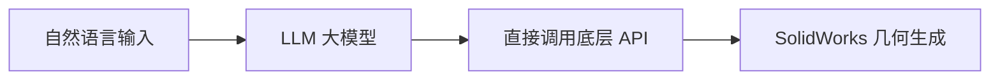
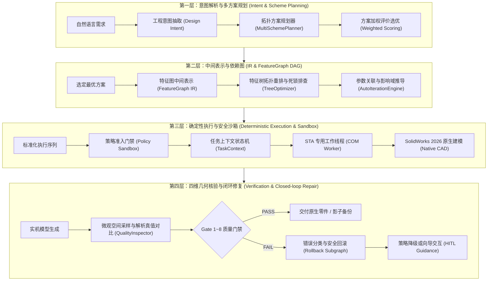

# AI-CAD 与 SolidWorks 插件技术路线系统审查报告
# File: audit/final-independent-review/03_TECHNICAL_ROADMAP_REVIEW.md
# Verification Status: COMPLETED
# Classification: ARCHITECTURE & ROADMAP ASSESSMENT

---

## 1. 原技术路线的根本缺陷审视

历史技术路线的核心逻辑是假设：

经实践证明，这一“直通式”路线存在四大致命死穴：
1. **死穴一：组合爆炸与语义漂移（Combinatorial Explosion & Semantic Drift）**
   SolidWorks API 拥有上万个接口，参数组合极其严苛。让通用 LLM 直接拼装底层 API 序列，成功率随特征数量呈指数衰减（$P_{success} = p^n$，若每步成功率 $p=0.8$，当特征数 $n=5$ 时，整体成功率仅为 $0.32$）。
2. **死穴二：缺少状态感知与几何闭环（Lack of State Perception & Closed Loop）**
   底层 API 调用返回 True 仅表示“COM 指令已发送”，并不保证“实体几何有效且无自交”。
3. **死穴三：无特征历史关联维护机制（No Dependency Maintenance）**
   当修改前序尺寸（如基体拉伸高度）时，后续草图引用（Sketch Plane / Coincident Relation）极易悬空（Dangling），导致整个特征树变红崩溃。
4. **死穴四：无法实现增量安全修改（Inability to Safely Edit Existing Parts）**
   直通式路线只能“从零重建”，一旦用户给出一个已包含数十个特征的现有零件并要求“把孔径从 10 改为 12”，直通式路线彻底瘫痪。

---

## 2. 现代重构技术路线：四层解耦架构

针对上述缺陷，经过深入外部研究与架构复核，必须确立全新的“四层解耦架构”（Four-Layer Decoupled Architecture）：

### 2.1 关键技术组件与机制重构

#### 机制 1：基于 FeatureGraph IR 的确定性编译
- **核心定位**：将 LLM 的角色从“直接编写底层控制代码的程序员”降维为“输出结构化特征意图的架构规划师”。
- **技术突破**：LLM 仅需输出语义明确的 FeatureGraph JSON（定义 BaseExtrude, CutExtrude, Fillet, Hole 等节点及参数）。编译层负责调用 Kahn 拓扑排序算法，自动将圆角、倒角等终饰特征重排至末尾，消除人为拓扑错误。

#### 机制 2：基于 DAG 的增量影响域推导（Impact Analysis）
- **核心定位**：解决“修改一个尺寸导致整个模型崩溃”的痛点。
- **技术突破**：在修改任何参数前，通过图遍历算法找出该参数所属节点的所有下游子孙依赖（Descendants）。
  - 若修改仅影响孤立叶子节点，判定为低风险（LOW），执行就地快速重建；
  - 若修改影响核心基准节点（如主拉伸基体），触发中/高风险预警（MEDIUM/HIGH），强制创建影子快照备份，并在重建后验证几何单调性（如厚度变大时体积必须单调递增）。

#### 机制 3：解析几何先验计算与独立四维核验
- **核心定位**：彻底消灭“模型自己证明自己正确”的伪核验。
- **技术突破**：
  - 核验器在调用 SolidWorks 提取属性前，通过无状态几何公式独立算出标准圆柱、圆环、阶梯轴的解析理论体积与理论表面积；
  - 引入**空间微观坐标采样点**对比（检查关键孔位中心坐标与设计图纸的欧氏距离公差），彻底击穿以往“孔位偏离了但总质量算不出来”的核验盲区。

#### 机制 4：三级安全降级与策略拦截
- **核心定位**：杜绝盲目无限自愈与未经验证的危险调用。
- **技术突破**：
  - 针对历史已探明的 SolidWorks 镜像崩溃缺陷（DEF-11），执行器直接实施安全硬拦截（Hard Block），阻止易崩溃 API 的执行；
  - 优先向 Agent 推荐“草图对称拉伸”或“双向对称拉伸”等成熟替代几何方案；
  - 若连续三次重试几何仍不收敛，立即触发安全回滚子图，将模型恢复至上一个干净状态，杜绝污染用户活动文档。

---

## 3. 装配体与工程图路线的技术重估

### 3.1 装配体路线重构：从“盲目配合”到“静态约束规划”
- **原路线问题**：原路线试图让 AI 在没有零件坐标系认知的情况下，随机调用重合、同轴配合，导致 SolidWorks 配合冲突频繁报红。
- **新路线**：
  1. 引入**基准件自动锁定机制**：自动识别装配体中的机架、壳体或底座（含 `base`, `housing`, `frame` 关键字），优先将其设为固定基准件（Fixed Component）。
  2. 引入**装配拓扑树预检**：在向 SolidWorks 发送配合指令前，通过图算法检测距离配合之间是否存在过约束（Over-constraint）或矛盾冲突，提前阻断错误配合。

### 3.2 工程图路线重构：从“复杂排版”到“标准视图投影与元数据绑定”
- **原路线问题**：试图一步到位实现全自动防碰撞智能排版，超出了当前 COM API 的直接能力。
- **新路线**：
  1. 第一阶段聚焦于：标准工程图模板加载、标准三视图（主视、俯视、左视）与轴测图的规范投影比例设置。
  2. 第二阶段聚焦于：零件质量、材质、设计者元数据自动填入标题栏。
  3. 第三阶段将复杂的尺寸标注排版降级为“生成基础基准尺寸标注”，将高精细排版交由工程师在 SolidWorks 中轻微拖动调整。

---

## 4. 技术路线重审结论

新路线从根本上纠正了“把 LLM 当成底层脚本编译器”的幼稚路线，确立了**“LLM 意图规划 -> IR 拓扑编译 -> 确定性沙箱执行 -> 独立解析几何核验”**的现代工业级 CAD AI 架构。这一重构为后续的真正工程化交付奠定了坚实的基础。
