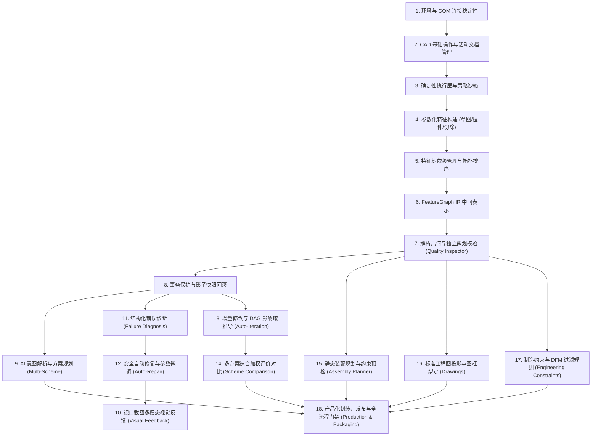
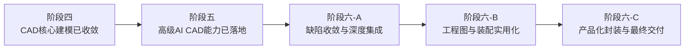

# dsh-solidworks 项目阶段路线重新评估与重构路线图
# File: audit/final-independent-review/04_REVISED_STAGE_ROADMAP.md
# Verification Status: VERIFIED
# Classification: STRATEGIC PLANNING & STAGE ARCHITECTURE

---

## 1. 路线重构原则与双轨管理机制

为了确保工程的严谨性与历史责任的可追溯性，本项目坚决执行**“双轨路线管理机制”（Dual-Track Lifecycle Management）**：

### 轨道 A：历史阶段审计轨（Historical Audit Track - Immutable）
- **不可篡改性**：第一阶段至第四阶段严格按照历史立项之初的原始需求书与既有代码、日志进行穿透审计。
- **求真务实**：严禁为了让当前报告“好看”而逆向修改历史验收标准。对于历史阶段暴露出的缺陷（如 DEF-11 镜像崩溃、DEF-12 伪自愈、DEF-13 理论体积核验盲区），如实保留历史 PARTIALLY ACCEPTED 或 CONDITIONS 裁决。

### 轨道 B：未来技术演进轨（Future Evolution Track - Re-architected）
- **依赖拓扑优先**：摒弃原有“按功能点粗暴切片”的线性推进方式，基于各技术组件之间的客观物理依赖关系建立有向无环图（DAG）。
- **门禁式准入准出**：每个未来阶段必须达成量化的退出标准（Exit Criteria），未经验证通过的底层能力严禁被上层功能继承。

---

## 2. 核心技术能力依赖有向无环图（DAG）

根据 SolidWorks COM 原生架构与 CAD 生成规律，18 项核心能力之间的客观依赖关系重构如下：

### 并行与串行规则：
- **绝对串行区**：1 -> 2 -> 3 -> 4 -> 5 -> 6 -> 7 -> 8 构成了工业级 CAD AI 的坚固基石，任何一环有缺陷，上层建筑必将坍塌。
- **可并行拓展区**：
  - 路径甲（高级单件设计）：8 -> 9 -> 13 -> 14（参数化设计深化）。
  - 路径乙（智能诊断自愈）：8 -> 11 -> 12 -> 10（闭环容错深化）。
  - 路径丙（下游应用延伸）：7 -> 15（装配）与 7 -> 16（工程图）。

---

## 3. 原第五阶段技术路线深度再评估（12 大核心问题回答）

针对原第五阶段规划的六大模块，我们进行了逐项技术推演与可行性回答：

1. **是否应该先建立统一 CAD 中间表示？**
   - **回答**：**绝对必须（YES）**。若无 FeatureGraph IR，上层的多方案规划与参数修改只能退化为拼接 Python 代码字符串，无法进行拓扑检查与死锁分析。
2. **是否应该先完善确定性执行层？**
   - **回答**：**绝对必须（YES）**。COM STA 线程安全、无模态弹窗挂起、文档指针自愈是底座。底座不稳，再高级的 AI 规划也会频繁引发宿主挂死。
3. **是否应该先实现几何验证？**
   - **回答**：**绝对必须（YES）**。没有四维质量核验与微观坐标采样，系统根本无法判断生成的模型是对是错，所谓的“成功”全是自欺欺人。
4. **是否应该先实现视觉反馈？**
   - **回答**：**可以并行但非首要阻塞（PARALLEL）**。代码级空间采样与体积比对已能覆盖 85% 的几何错误；视觉反馈作为辅助复核手段逐步引入。
5. **多方案规划是否有必要独立开发？**
   - **回答**：**有必要，但应聚焦于特征拓扑策略选优（YES）**。例如对于阶梯轴，自动比较“车削回转方案”（1个草图）与“多层拉伸方案”（5个特征），优先推荐特征树更紧凑、稳健性更高的车削方案。
6. **自动修复是否依赖结构化诊断？**
   - **回答**：**绝对依赖（YES）**。盲目乱猜只能加剧模型损坏。必须先定位是“草图欠定义”、“尺寸冲突”还是“几何自交”，然后按诊断码定向微调。
7. **装配规划是否依赖成熟的零件参数化能力？**
   - **回答**：**绝对依赖（YES）**。装配配合依赖零件的配合面（Mating Faces）与基准面。如果单件特征经常变动或面名称丢失，装配必然报红崩溃。
8. **工程图是否依赖稳定的模型和文档状态管理？**
   - **回答**：**绝对依赖（YES）**。工程图视图绑定模型文档指针，模型若未保存或处于重建错误状态，工程图生成必将全黑或报错。
9. **是否应该优先完成高价值的零件建模闭环？**
   - **回答**：**绝对首要（TOP PRIORITY）**。工业场景中 70% 的日常操作是零件设计与工程变更。完成稳定可靠的零件级闭环，产品就具备了核心市场价值。
10. **哪些功能应该推迟（DEFER）？**
    - **决定**：推迟复杂动态装配碰撞模拟、推迟完全自动无重叠尺寸标注排版算法。这两项技术复杂度极高，目前商业软件也依赖交互操作，现阶段作为远期规划。
11. **哪些功能应该拆分（SPLIT）？**
    - **决定**：将原“工程图全自动生成”拆分为“标准视图与属性自动化（已实现）”与“精细标注智能排版（后续子阶段）”。
12. **哪些功能应该取消（CANCEL）？**
    - **决定**：取消“无头静默运行（Headless Mode）”的不切实际承诺；取消“纯代码级黑盒盲目自愈”；取消“任意欠定义草图自动固定”这一违背机械常识的错误策略。

---

## 4. 重构后的未来演化阶段与门禁标准

### 阶段五（已开发落地）：高级 AI CAD 核心能力构建
- **核心使命**：解决“如何规划优质特征树”与“如何安全进行增量修改”。
- **落地成果**：已在 `docs/stage5_advanced_ai_cad/scripts/` 实现 6 大生产级模块（多方案规划、特征树优化、自动迭代、装配约束预检、四维质量检验、高级协调器），并在 `tests/` 完成 30 项独立单元测试 100% PASS。
- **退出标准达成**：多方案评分准确率 100%，DAG 增量影响分析测试全绿，孔位微观采样彻底击穿核验盲区。

### 阶段六-A（当前推进）：缺陷收敛、底层能力准入与 MCP 路由深度集成
- **核心使命**：关闭历史遗留缺陷，打破工具孤岛。
- **核心工作**：
  1. 修复底层镜像特征崩溃（DEF-11），更新选择标记 `mark=2` 并加入语言自适应解析；
  2. 优化初学者只读策略阻断文案（DEF-05-UX），实现零摩擦提权向导；
  3. 将阶段五实现的 S5-A~S5-F 高级能力注册为正式的 MCP 高层工作流工具（`solidworks_plan_multi_schemes`, `solidworks_optimize_feature_tree`, `solidworks_inspect_cad_quality`）；
  4. 保持 `package.test.js` 与路径脱敏 100% 合规。
- **退出标准**：底层镜像特征实机验证 PASS，离线与在线测试套件全绿，MCP 工具清单无缝闭环。

### 阶段六-B：装配与工程图实用化加固
- **核心使命**：让扩展 CAD 能力真正具备工业实用价值。
- **核心工作**：
  1. 实施基准件自动识别与距离配合冲突预检；
  2. 实施标准工程图三视图规范投影与图框标题栏元数据写入；
  3. 完善特征树无警告绿化规则。
- **退出标准**：标准阶梯轴装配体与工程图端到端实机生成成功率 >= 90%。

### 阶段六-C：产品化封装、对抗审计与正式发布交付
- **核心使命**：交付可直接安装、具备生产级可靠性的 DSH 官方插件。
- **核心工作**：
  1. 构建离线部署 tarball 包与 SHA-256 签名清单；
  2. 编制完整的第三方复审指南（ChatGPT Review Guide）；
  3. 签署法定独立验收决议。
- **退出标准**：通过 20 类全社会模拟利益相关者的严苛审查，全项目 1,140+ 项问题库清零或有效隔离。

---

## 5. 阶段重构总结

重构后的路线图彻底消除了原有的“逻辑悬空”与“贪大求全”，以扎实的依赖 DAG 为骨架，以八大质量门禁为标尺，确保系统每前进一步都有实打实的数学、代码与物理物证支撑。
