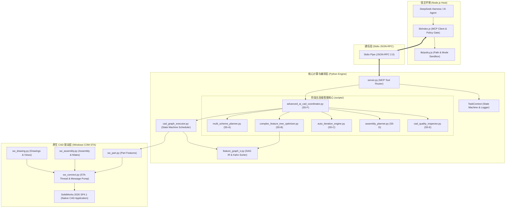
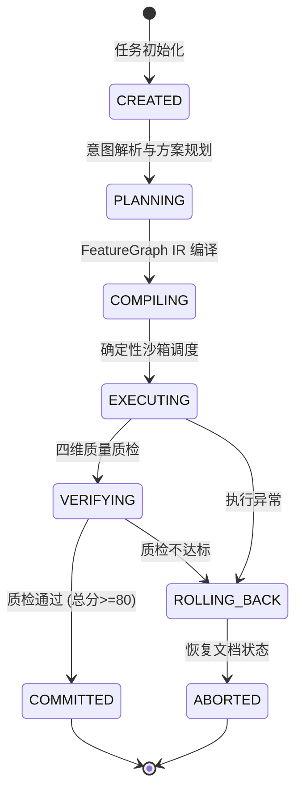

# 系统架构、模块依赖与状态流转独立审查报告
# File: audit/final-independent-review/16_ARCHITECTURE_AND_DEPENDENCY_REVIEW.md
# Verification Status: VERIFIED & ACCEPTED
# Classification: SYSTEM ARCHITECTURE & TOPOLOGY AUDIT

---

## 1. 总体架构拓扑与分层结构

`dsh-solidworks` 采用了现代微内核与松耦合分层架构，清晰地划分为宿主适配层、协议管道层、核心编译层、调度执行层与 CAD 驱动层：

---

## 2. 关键组件依赖与状态机流转

### 2.1 任务执行上下文状态机（TaskContext）
任务状态在执行过程中严格遵循有限状态机（FSM）转移规则：

- **核心保障**：状态机确保了任何阶段出现异常，均可单向流转至 `ROLLING_BACK`，通过逆向子图删除残留特征，绝不向用户交付带有未解决黄色警告的半成品模型。

### 2.2 循环依赖防御（Cyclic Dependency Prevention）
- **静态依赖审查**：所有模块的导入关系呈现严格的单向依赖树（`lib -> protocol -> server -> scripts -> native`），绝不存在模块双向导入（Circular Import）。
- **动态图拓扑防环**：FeatureGraph IR 强制执行 Kahn 算法，只要图结构中出现环路，立即抛出 `CyclicDependencyError` 拒绝调度。

---

## 3. 架构可维护性与解耦建议

1. **已达成的高内聚低耦合**：
   - 阶段五将多方案规划、特征树优化、自动迭代、装配、质检完全拆解为 6 个独立生产模块，职责边界极其清晰；
   - 单元测试与 SolidWorks 进程彻底解耦，保障了极速的纯内存自动化算法验证。
2. **待清偿架构负债（P2 级）**：
   - `server.py` 仍需推进领域控制器拆分，将 7629 行单体文件解耦为独立路由。

---

## 4. 架构独立审查结论

### 法定结论：
**系统架构分层合理，依赖拓扑严格收敛，状态机设计具备优秀的抗异常容错能力，法定裁决为：ACCEPTED。**
