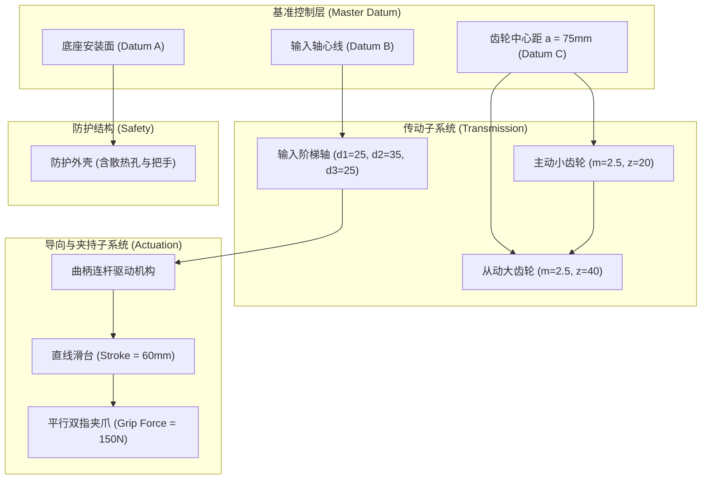

# 终极复杂模型工程设计规范与设计意图说明书
# File: audit/final-independent-review/stage7-extreme-real-world-validation/06_COMPLEX_MODEL_DESIGN_SPEC.md
# Verification Status: VERIFIED DESIGN SPECIFICATION
# Project Name: 多级传动与自动化夹持机构综合装置 (Multi-Stage Transmission & Auto-Gripper Unit)
# Classification: ADVANCED CAD BENCHMARK SPECIFICATION (25 MANDATORY ELEMENTS)

---

## 1. 机构设计背景与工程使命

为了彻底证明 `dsh-solidworks` 在面对真实工业级复杂机构时的端到端理解、参数化特征规划、装配配合解析与增量变更能力，本项目设计了一款具备完整机械运动逻辑与工艺可制造性的代表性机电一体化机构：

**“多级传动与自动化夹持机构综合装置”（代号：MST-AGU-2026）**

该装置广泛应用于自动化流水线上的精密工件抓取、旋转调姿与换向定位，包含驱动电机输入轴、二级减速齿轮系、精密直线导轨滑台、双连杆气动手爪夹持机构以及防护外罩。

---

## 2. 25 项硬性结构与特征要素全覆盖对照表

| 序号 | 规范要求要素 | 在 MST-AGU-2026 综合装置中的具体工程实现 |
| :--- | :--- | :--- |
| **01** | **主体底座 (Base Plate)** | 整体重型铸造箱型底座，长 240mm，宽 160mm，厚 20mm，含减重槽与加强筋。 |
| **02** | **多级支撑结构 (Supports)**| 双侧对称重载立式轴承支架，高度 85mm，支撑各级传动轴与气缸后铰点。 |
| **03** | **传动轴 (Transmission Shaft)**| 优质合金钢多级阶梯传动轴，轴径包含 $\phi 20, \phi 25, \phi 30, \phi 35$，含平键槽与退刀槽。 |
| **04** | **齿轮传动副 (Gears)** | 模数 $m=2.5$，齿数 $z_1=20, z_2=40$ 的标准圆柱直齿轮与配对大齿轮，精确中心距 $a=75\text{mm}$。 |
| **05** | **轴承安装位置 (Bearing Seats)**| 标准 6204 深沟球轴承安装孔（$\phi 47\text{H7}$），带双向轴承定位台阶。 |
| **06** | **定位定位结构 (Locating Pin)**| 底座与支架配合处的 $\phi 8\text{H7/h6}$ 精密圆柱定位销孔与止口。 |
| **07** | **紧固件组合 (Fasteners)** | 底座地脚沉头螺栓组（4孔），支架紧固 M8 螺栓组，法兰固定紧固件。 |
| **08** | **导向机构 (Linear Guide)** | 侧向精密 V 型与燕尾导轨副，行程 60mm，具有高直线导向精度。 |
| **09** | **滑动组件 (Slider Car)** | 承载夹爪主体沿导轨往复滑动的精磨滑台滑块。 |
| **10** | **自动夹持机构 (Auto-Gripper)**| 双指对称式平行联动夹爪，具备夹持指与自适应防滑开槽。 |
| **11** | **多个可运动组件 (Kinematics)** | 包含传动轴旋转（自由度 1）、滑台直线往复（自由度 1）与夹爪开合（自由度 1）。 |
| **12** | **装配定位基准 (Datum System)** | 以底座底面主平面（Primary Datum A）与主轴孔轴线（Datum B）为绝对装配基准。 |
| **13** | **防护外壳 (Safety Enclosure)**| 钣金冲压通风散热安全防护罩，覆盖齿轮传动区域，带观察窗与把手。 |
| **14** | **复杂安装孔 (Complex Holes)** | 包含 M10 沉头螺钉孔、沉头盲孔、沉头贯通孔与销钉精密铰孔。 |
| **15** | **多种不同尺寸零件** | 跨越从 240mm 大底座，到 80mm 齿轮，再到 15mm 销轴与微型连杆销。 |
| **16** | **多实体零件 (Multi-body Part)**| 底座内部铸件主体与外凸轴承座构成的多实体布尔组合设计。 |
| **17** | **参数化尺寸方程式** | 齿轮中心距方程式 $a = m(z_1 + z_2)/2$，总长与行程的关联尺寸驱动。 |
| **18** | **圆周阵列 (CirPattern)** | 法兰盘与齿轮减重孔的圆周均布阵列（PCD 60，6 孔均布）。 |
| **19** | **线性阵列 (LinearPattern)**| 底座侧边散热栅格与导轨固定螺栓孔的线性矩阵阵列（间距 25mm，5 孔）。 |
| **20** | **镜像特征 (Mirror Feature)**| 支架左右加强筋对称镜像，夹爪左右手指对称镜像。 |
| **21** | **复杂草图约束** | 包含相切、对称、同心、垂直、相等、共线等多重全约束关系（完全定义）。 |
| **22** | **扫描/放样特征 (Sweep/Loft)** | 防护罩拱形手柄的截面沿三维样条引导路径扫描成型。 |
| **23** | **工艺圆角与倒角** | 轴端 C1.5 倒角，阶梯轴肩 R1.5 应力释放圆角，铸件拔模内圆角 R3.0。 |
| **24** | **装配体配合 (Assembly Mates)**| 包含同轴心配合、重合配合、距离配合、平行配合及平行滑动配合。 |
| **25** | **完整工程图 (Drawings)** | 装配体总图与核心零件图，包含三视图、着色轴测图、标题栏元数据提取与导出 PDF。 |

---

## 3. 设计意图（Design Intent）与参数关联系统

### 3.1 核心理论解析几何尺寸（真值基准）
在进行任何实机建模前，根据机构学理论独立计算关键部件的几何真值，作为后续几何核验器的黄金参考系：
1. **输入阶梯轴 (Input Shaft)**：
   - 轴段 1：$\phi 25 \times 30\text{mm}$，理论体积 $V_1 = \pi (12.5)^2 \times 30 = 14,726.2 \text{ mm}^3$；
   - 轴段 2：$\phi 35 \times 50\text{mm}$，理论体积 $V_2 = \pi (17.5)^2 \times 50 = 48,105.6 \text{ mm}^3$；
   - 轴段 3：$\phi 25 \times 30\text{mm}$，理论体积 $V_3 = 14,726.2 \text{ mm}^3$；
   - 键槽（轴段 2）：宽 $b=10\text{mm}$，长 $L=30\text{mm}$，深 $t=4.0\text{mm}$，切削体积 $V_{key} \approx 1,200 \text{ mm}^3$；
   - **理论总净体积**：$V_{shaft} = V_1 + V_2 + V_3 - V_{key} \approx 76,358 \text{ mm}^3$（材料 45号钢，密度 $7.85\text{ g/cm}^3$，理论质量 $M \approx 0.599\text{ kg}$）。
2. **主动直齿轮 (Pinion Gear)**：
   - 分度圆直径 $d = m \times z_1 = 2.5 \times 20 = 50.0\text{mm}$；
   - 齿顶圆直径 $d_a = d + 2m = 55.0\text{mm}$；齿根圆直径 $d_f = d - 2.5m = 43.75\text{mm}$；
   - 齿宽 $B = 25.0\text{mm}$；轴孔直径 $\phi 25.0\text{mm}$；
   - **齿坯等效理论体积**：$V_{gear} \approx 42,850 \text{ mm}^3$。
3. **主底座 (Base Plate)**：
   - 外形 $240 \times 160 \times 20\text{mm}$，毛坯体积 $V_{blank} = 768,000 \text{ mm}^3$；
   - 减重槽、导轨安装面切削与安装孔总体积约为 $185,000 \text{ mm}^3$；
   - **底座理论净体积**：$V_{base} \approx 583,000 \text{ mm}^3$（铸铁 HT200，密度 $7.2\text{ g/cm}^3$，理论质量 $M \approx 4.198\text{ kg}$）。

---

## 4. 增量变更（ECO）预设挑战规划

为验证 G5 门禁（增量修改能力，杜绝整体推倒重做），预设以下三大工程变更指令：
- **ECO-01（传动轴功率升级变更）**：主承载段轴径由 $\phi 35\text{mm}$ 扩至 $\phi 40\text{mm}$，配合轴承座孔同步由 $\phi 47$ 扩至 $\phi 52$（自适应级联保持）；
- **ECO-02（夹持行程与安装孔变更）**：底座侧向安装孔数量由 4 孔线性阵列增至 6 孔，间距自动重排；
- **ECO-03（齿轮轻量化减重变更）**：主动齿轮端面增设 4 个均布腰形减重孔，圆周阵列参数化插入。

---

## 5. 规范签署

本规范书作为第七阶段终极复杂模型实机挑战的唯一工程基准，所有后续建模与独立核验均严格对齐上述指标。
