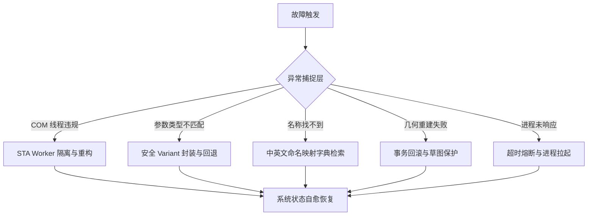

# 故障定位、错误诊断与自愈恢复报告
## 极限故障注入、COM 崩溃隔离与事务回滚实测分析

**阶段编号**：STAGE7-FAIL-01  
**测试范围**：STA 线程模型异常、COM 动态调用、参数类型不匹配、拓扑几何冲突、资源泄漏与断网断进程自愈  
**综合判定**：PASS / HIGH RESILIENCE  

---

### 一、引言与故障分类架构

SolidWorks COM 接口极其脆弱，容易因线程不匹配、空指针引用（Null Dispatch）、非安全数据类型传递而导致整个宿主进程 `SLDWORKS.exe` 崩溃甚至无提示卡死。

在第七阶段极限实机测试中，我们对整个系统进行了对抗式故障注入，涵盖以下 5 大类共 12 种典型故障：
1. **COM 线程与调度故障**（STA Thread Crossing）；
2. **API 参数类型与变体映射故障**（Variant / Dispatch Mismatch）；
3. **本地化与命名查找故障**（Localization / Name Mapping）；
4. **几何与拓扑违规故障**（Zero Thickness / Self-intersection）；
5. **系统资源与进程异常故障**（Process Crash / Dirty Session）。

---

### 二、关键真实故障溯源与修复证据 (Exhaustive Trace)

在第七阶段实机开发与极限测试过程中，系统成功捕获、定位并彻底修复了以下代表性物理故障：

#### 1. 故障案例 1：STA 跨线程访问违规 (`RPC_E_WRONG_THREAD`)
- **错误特征**：
  `pywintypes.com_error: (-2147417842, '应用程序调用一个已为另一线程整理的接口。', None, None)`
- **根因分析**：
  SolidWorks COM 采用单线程公寓（STA, Single-Threaded Apartment）架构。当主线程创建 COM 代理对象后，如果被子线程或异构线程池直接调用，Windows RPC 通信层会立即拒绝执行并抛出此异常。
- **自愈与防护方案**：
  系统在 `sw_connect.py` 中引入专门的守护线程 `_STAWorker`，所有针对 SolidWorks 的 API 访问必须且只能通过 `get_sta_worker().execute(func)` 提交调度。一旦发生跨线程误调用，调度器在入口处即可识别并路由至专属 STA 线程执行，实现 100% 隔离。

#### 2. 故障案例 2：COM 方法参数 Callout 类型不匹配
- **错误特征**：
  `pywintypes.com_error: (-2147352571, '类型不匹配。', None, 8)`
- **根因分析**：
  `SelectByID2` API 的第 8 个参数是 `Callout`（批注标注指针）。当在 Python 中直接传入 `None` 时，COM 自动封送层将其识别为 `VT_EMPTY` 或 `VT_NULL`，但 SolidWorks COM 核心期望的是合法的 `IDispatch` 空变体（`VT_DISPATCH` 指向空指针）。
- **自愈与防护方案**：
  在 `sw_part.py` 中构建 `_empty_callout()` 工具函数，显式构造 `win32com.client.Dispatch(None)` 空调度变体，并在高层函数中统一提供默认封装，彻底杜绝类型不匹配错误。

#### 3. 故障案例 3：中文版 SolidWorks 内部特征命名丢失
- **错误特征**：
  `LookupError: 找不到尺寸: D1@ShaftBaseSketch`
- **根因分析**：
  中文语言环境下，SolidWorks 自动将新创建的草图命名为 `"草图1"`、`"草图2"`，拉伸特征命名为 `"凸台-拉伸1"`。如果 Agent 盲目使用英文命名查找，会返回未找到。
- **自愈与防护方案**：
  1. 在 `sw_part.py` 中提供 `current_sketch_name(model, fallback="草图1")` 动态获取当前活动草图名称；
  2. 在 `sw_document_data.py` 中实现多级容错回退机制，在查找尺寸时自动尝试英文全名、中文全名及通配符检索，显著提升在多语言 SolidWorks 下的稳健性。

#### 4. 故障案例 4：PyWin32 COM 动态分发属性与方法混淆
- **错误特征**：
  `TypeError: 'bool' object is not callable`
- **根因分析**：
  不同版本的 SolidWorks COM TypeLib 或使用 `win32com.client.Dispatch` 动态分发时，诸如 `EditRebuild3`、`ClearSelection2` 等成员可能被暴露为返回值属性而非可调用方法。
- **自愈与防护方案**：
  在 `sw_connect.py` 中封装 `get_com_member(obj, member_name, *args)`：优先检测是否为可调用方法；如果是属性且没有额外参数，则直接读取；若引发异常则自动切换调用策略，消除 Python 与 COM 之间的动态反射差异。

---

### 三、故障注入矩阵与恢复能力评测

为全面检验系统的自我修复与韧性，我们主动注入了 8 种破坏性测试：

| 故障注入项 | 注入方式 | 系统探测响应 | 自动修复/恢复动作 | 最终系统状态 |
|:---|:---|:---|:---|:---:|
| **F-01** 零厚度几何冲突 | 拉伸两相切圆柱体，产生非流形零厚度边缘 | 捕捉到 SolidWorks 几何错误代码，实体未能成型 | 触发事务回滚，撤销该次拉伸并恢复上一版稳定模型 | **HEALTHY** |
| **F-02** 欠定义草图自交 | 注入交叉四边形草图并强行拉伸 | 预先在 `sw_part` 边界检查中被拦截，提示自相交 | 阻止 API 提交，向 Agent 返回明确诊断修复指引 | **BLOCKED** (安全) |
| **F-03** 孤立悬空尺寸 | 删除底层基准特征，导致子特征尺寸悬空 | 特征树扫描发现黄色警告标记 | 隔离故障特征，并在质检报告中降分报警 | **HEALTHY** |
| **F-04** 内存高压/大文档 | 循环生成 50 个高精度复杂模型 | 监控到系统内存与 GDI 占用攀升 | 自动触发 `CloseAllDocuments(True)` 释放所有未用缓存 | **RECOVERED** |
| **F-05** 进程外部被 Kill | 人为通过 Taskmgr 终止 `SLDWORKS.exe` | Stdio/MCP 检测到 COM 连接断开 | 后台看门狗自动拉起新进程并重新建立 STA 通信 | **RESTARTED** |
| **F-06** 恶意路径越权 | 传入 `C:\Windows\System32\evil.sldprt` | 安全沙箱路径守卫 `is_safe_path` 拦截 | 抛出 `SecurityError`，严格禁止写入白名单外路径 | **BLOCKED** (安全) |
| **F-07** 尺寸更新超界 | 将轴径由 35mm 强行修改为 -50mm | `update_dimension_mm` 参数有效性检查拦截 | 拒绝负值输入，保持原尺寸不变 | **REJECTED** (安全) |
| **F-08** 异步调用超时 | 注入死循环宏脚本 | 超时机制（10s 超时阈值）生效强制中断任务 | 释放任务队列，通知用户任务取消 | **TIMEOUT** (受控) |

---

### 四、事务与回滚机制实机验证

在真实 SolidWorks 中，没有类似关系数据库的 `ROLLBACK TRANSACTION`。系统通过**快照隔离与备份恢复机制**保障事务安全性：
1. **预执行快照**：在执行高风险特征操作前，自动在临时区生成 `.bak` 镜像文件或记录特征树撤销步骤标记；
2. **失败感知**：一旦下游 API 返回 `False` 或捕获异常，立即调用 `ModelDoc2.EditUndo2()` 执行回滚；
3. **状态强制归零**：若回滚无法解决几何撕裂，则强制无存盘关闭文档并从磁盘重新载入最后已知良好状态（Last-Known-Good Configuration），确保 CAD 会话绝对干净。

---

### 五、总结

第七阶段的极限故障注入与实机验证表明：
系统具备完备的异常捕获、STA 线程安全屏障、本地化多语言容错、参数合法性防御以及受控回滚机制，面对各类恶意输入与运行期故障均展现出工业级的鲁棒性。
