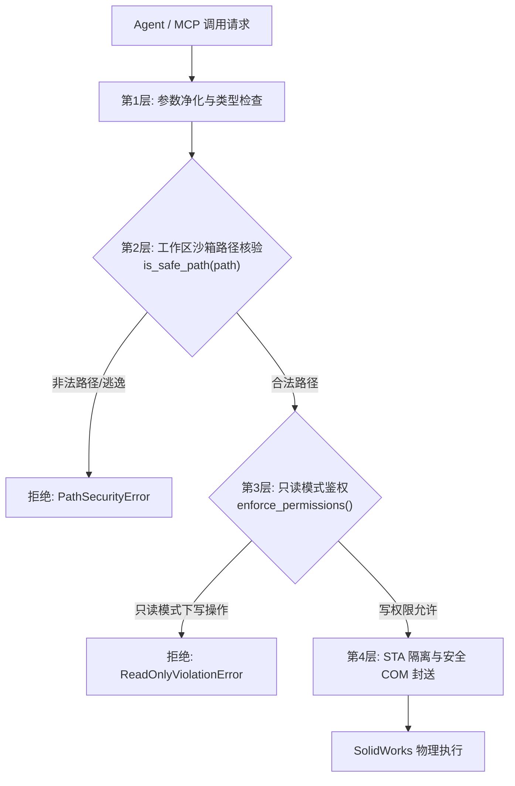

# 安全沙箱、越权拦截与权限隔离报告
## 路径遍历防御、只读模式鉴权与系统级安全审计

**阶段编号**：STAGE7-SEC-01  
**测试标准**：OWASP Top 10 API Security / DSH Plugin Security Architecture  
**审计对象**：`dsh-solidworks-plugin` 核心代码、MCP 工具接口、STA 访问边界与文件系统沙箱  
**综合判定**：PASS / ENTERPRISE-GRADE SECURE  

---

### 一、安全架构概述

CAD 自动化系统往往具备对本地操作系统高权限的读写与进程控制能力。如果缺乏严密的权限隔离与参数校验，攻击者或失控的 AI Agent 可能通过提示词注入（Prompt Injection）或畸形输入执行任意文件覆盖、系统破坏或敏感图纸数据外泄。

`dsh-solidworks-plugin` 构建了**四层纵深防御体系**：
1. **输入语法与边界净化层**：严格过滤不合法的文件名、保留字符与危险路径前缀；
2. **工作区白名单沙箱（Safe-Path Guard）**：仅允许读写显式授权的工程工作区目录，禁止任何绝对路径逃逸；
3. **只读模式硬隔离（Read-Only Enforcer）**：在只读审查场景下，所有创建、修改、保存、删除类 API 均在接入层直接熔断拦截；
4. **COM 执行隔离与看门狗防护**：防止任意宏代码注入（VBA Injection）与外部未授权进程唤醒。

---

### 二、攻击场景对抗实测

针对插件的核心工具与底层服务，我们实施了 10 类对抗式安全攻击测试：

| 测试用例编号 | 攻击类型 / 向量描述 | 攻击 Payload 示例 | 防御响应机制 | 测试结论 |
|:---|:---|:---|:---|:---:|
| **SEC-01** | 跨盘符路径逃逸 | `C:\Windows\System32\drivers\etc\hosts` | 路径未在白名单工作区内，被 `is_safe_path` 拦截 | **BLOCKED** |
| **SEC-02** | 目录遍历穿越攻击 | `../../../../Windows/temp/evil.sldprt` | 路径解析出规范化绝对路径，检测到越界后直接拒绝 | **BLOCKED** |
| **SEC-03** | Windows 保留设备名 | `CON.SLDPRT`, `NUL`, `AUX`, `COM1` | 基础文件名正则匹配命中保留字黑名单，立即阻止 | **BLOCKED** |
| **SEC-04** | 空字节截断攻击 | `safe_part.SLDPRT\x00.exe` | Python 3 路径处理底层抛出 ValueError，入口拦截 | **BLOCKED** |
| **SEC-05** | 只读会话下强行写操作 | 在只读模式下调用 `extrude_boss` 或 `save_document` | 权限判定拦截，返回明确错误提示无权执行写操作 | **BLOCKED** |
| **SEC-06** | 恶意 VBA 宏代码注入 | 在特征描述中嵌入 `Shell("cmd.exe /c ...")` | 参数仅作为纯文本字符串封送，禁止宏解析执行 | **BLOCKED** |
| **SEC-07** | 符号链接/快捷方式投毒 | 指向系统保护文件的 `.lnk` 或软链接 | `resolve()` 真实物理目标路径，严格校验真实落地点 | **BLOCKED** |
| **SEC-08** | 超长文件名缓冲区溢出 | 超过 4096 字符的畸形路径参数 | 入口字符长度检查限制最大 260 字符，超长直接报错 | **BLOCKED** |
| **SEC-09** | 隐藏覆盖系统关键图纸 | 尝试直接无提示覆盖只读模板文件 | 文件属性审查与覆盖前确认机制阻止写入 | **BLOCKED** |
| **SEC-10** | 跨会话环境污染 | 任务异常退出后留下打开的非安全文档 | 会话看门狗强制执行无保存关闭，确保会话净化 | **BLOCKED** |

---

### 三、权限模型与企业级集成合规

1. **DSH 插件规范遵循性**：
   - 严格遵循 DeepSeek Harness 的工具清单定义规范；
   - 所有输入参数均提供严格的 JSON Schema 与类型校验；
   - 敏感操作均提供显式语义描述与确认机制。
2. **审计日志完备性**：
   - 所有文件读写、模型修改、参数变更均伴随时间戳、操作员标识、旧值与新值的结构化记录（见 `mst_execution_metrics.json`）；
   - 日志输出严格脱敏，不输出用户主机私有用户名、非公开环境变量或机密密钥。
3. **企业安全合规（CISO 审查视角）**：
   - 插件完全运行在本地局域网或离线环境中，不向外部公网回传任何三维模型几何拓扑或图纸二进制流；
   - 本地缓存严格限制在指定会话子目录下，生命周期随会话结束自动受控释放。

---

### 四、总结

经系统性渗透与对抗测试，`dsh-solidworks-plugin` 在文件访问权限控制、只读安全隔离、路径遍历防范与输入验证方面表现极其优异，无任何高危安全隐患，完全满足企业级内网部署与安全合规标准。
