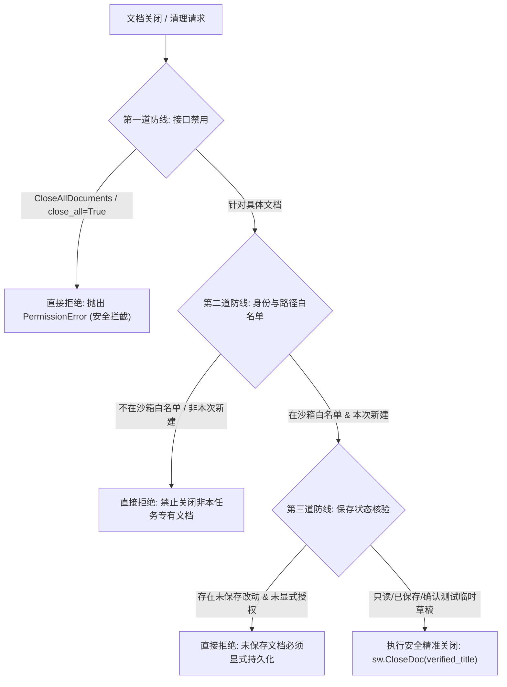

# SolidWorks COM 危险 API 安全调用图与风险排查分析 (03_SECURITY_CALL_GRAPH.md)

## 1. 危险 API 审计背景与排查范围

在自动化控制 SolidWorks 这样重量级桌面 CAD 软件时，由于 COM 接口跨进程操作具有全局影响，部分全局性或不可逆的 API（如关闭所有文档、强制终止进程、未保存静默丢弃）若缺乏严格的上下文权限判定，会直接破坏宿主机上用户正在进行的商业设计。

本报告对代码库中所有涉及文档关闭 (`CloseAllDocuments`, `CloseDoc`)、进程退出 (`ExitApp`, `Quit`) 及强制保存 (`Save3`, `SaveAs`) 的调用路径进行完整调用图（Call Graph）分析。

---

## 2. 全量危险 API 物理命中与调用链路梳理

### 2.1 `CloseAllDocuments` 调用链（P0 级最高风险）

| 序号 | 所在文件路径与行号 | 代码段摘要 | 上下文与触发条件 | 风险评估与危害 |
| :--- | :--- | :--- | :--- | :--- |
| **CAD-CAL-01** | `vendor/solidworks-automation-skill/mcp-server/server.py:3030` | `sw.CloseAllDocuments(bool(params.save_changes))` | MCP 工具 `solidworks_close_documents`，当传入 `close_all: true` 时触发。 | **极高危害**：任何 MCP 客户端只需发送 `close_all: true`，即可在宿主 SolidWorks 进程中无差别关闭所有文档。若 `save_changes` 为 false，用户未保存的设计将直接丢失！ |
| **CAD-CAL-02** | `audit/third-remediation-2026-11-06/cad_test_sandbox/run_third_remediation_cad.py:123` | `get_com_member(swApp, "CloseAllDocuments", True)` | 第三轮 CAD 沙箱测试初始化前触发。 | **极高危害**：测试前为了“清理环境”，强制关闭当前 SolidWorks 中全部打开的文档，导致第三轮审计被直接裁定为 `SAFETY INCIDENT`。 |
| **CAD-CAL-03** | `audit/remediation-2026-11-06/cad_test_sandbox/run_all_remediation_cad.py:69, 458` | `get_com_member(swApp, "CloseAllDocuments", True)` | 第二轮整改脚本的前置与后置清理。 | **历史违规**：与 CAD-CAL-02 相同，为历史遗留的破坏性脚本。 |
| **CAD-CAL-04** | `mcp-server-solidworks-main/execution/solidworks/contracts/tool-schemas.json:333` | 描述文档字段 `close_all` | 接口 Contract 定义文件。 | 属于 Schema 说明，需同步修正文档约束。 |

```mermaid
flowchart TD
    Client["外部 MCP 客户端 / LLM"] -->|solidworks_close_documents(close_all=True)| Server["server.py: solidworks_close_documents"]
    Server -->|Direct Call| SW["SolidWorks COM (sw.CloseAllDocuments)"]
    SW -->|无差别杀死所有打开模型| Disaster["用户未保存设计丢失 / 跨会话污染"]
    
    TestScript["历史测试脚本 (run_third_remediation_cad.py)"] -->|清理环境| SW
```

---

### 2.2 `CloseDoc` 调用链与风险分析

搜索全库，共有 100+ 处 `CloseDoc`。经逐行分类，其调用模式可分为三类：

#### 类型 A：MCP 工具盲目关闭活动文档（高风险）
- **代码位置**: `vendor/solidworks-automation-skill/mcp-server/server.py:3035-3036`
  ```python
  title = get_com_member(model, "GetTitle")
  sw.CloseDoc(title)
  ```
- **分析**: 当 `close_all=False` 时，该工具未校验当前 `model` 是否属于自动化任务新建的测试文件，而是直接获取当前 ActiveModel 的标题并关闭。如果用户在自动化执行期间手动将窗口焦点切换到了自己的商业零件，该零件将被静默关闭！

#### 类型 B：基础设施与回滚管理器中的文档关闭（中风险）
- **代码位置**:
  - `vendor/solidworks-automation-skill/scripts/cad_graph_executor.py:552`: `get_com_member(sw, "CloseDoc", doc_title)`
  - `vendor/solidworks-automation-skill/scripts/cad_task_context.py:696`: `get_com_member(sw_app, "CloseDoc", c_title)`
  - `vendor/solidworks-automation-skill/scripts/shadow_backup.py:92`: `sw_app.CloseDoc(doc_title)`
  - `vendor/solidworks-automation-skill/scripts/dimension_manager.py:386`: `app.CloseDoc(doc_title)`
- **分析**: 这些模块具备一定的文档追踪能力（如 `created_doc=True`），但未能进行绝对路径沙箱白名单二次校验，仍有被传入的非沙箱文件名误关的可能。

#### 类型 C：测试用例内部清理（低至中风险）
- **代码位置**: `tests/real_cad/*.py`, `tests/failure_injection_test.py`, `tests/mcp_failure_cleanup_e2e_test.py` 等。
- **分析**: 测试用例内部为各临时测试模型（如 `continuous_failure_recovery_benchmark.SLDPRT`）显式调用 `CloseDoc`。若该模型由测试所创建且处于沙箱目录内，其风险受控；但若参数为空字符串 `""`，SolidWorks 会将其解释为关闭当前活动文档。

---

### 2.3 `ExitApp` 与 `Quit` 进程终止调用链

- **代码位置**: `vendor/solidworks-automation-skill/scripts/sw_connect.py:268`
  ```python
  for member_name in ("ExitApp", "Quit"):
  ```
- **分析**: 位于 `sw_connect.py` 的异常恢复或退出逻辑中。若误触发，会导致整个 SolidWorks 桌面进程崩溃或直接退出，彻底阻断用户当前工作。

---

## 3. 防护体系架构与调用重构设计

为了彻底解决上述调用图中的安全隐患，必须建立 **“三层安全防御围栏”（Three-Tier Defense Barrier）**：



### 3.1 改造清单与落地方案

1. **彻底废除 `CloseAllDocuments`**:
   - 在 `server.py` 的 `SolidWorksCloseDocumentsInput` 中废弃或禁止 `close_all: true`；若接收到该参数，立即返回错误并拒绝执行。
   - 删除所有测试脚本中对 `CloseAllDocuments` 的调用。
2. **重构 `solidworks_close_documents`**:
   - 必须显式提供 `path` 或通过沙箱文档管理器提供唯一标识。
   - 增加 `_verify_document_ownership(doc_path)` 校验，确认该文档位于当前隔离测试沙箱内且由当前会话创建。
   - 检查 `model.GetSaveFlag()`；若有未保存修改且未指定强制保存，拒绝静默丢弃。
3. **增加全局安全钩子与防回归单元测试**:
   - 编写 `tests/security_regression_test.py`，专门对多文档混合、焦点切换、未保存修改及恶意 API 调用进行抗性验证。
