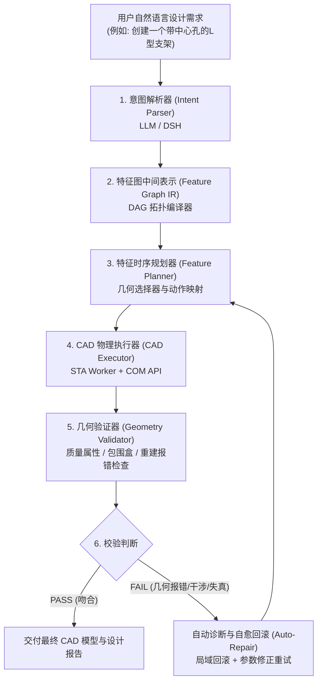

# 从需求到建模的完整闭环评估报告

## 一、AI 驱动参数化 CAD 建模的标准闭环架构

在 DeepSeek Harness (DSH) 与 SolidWorks 深度集成的场景下，一个真正工业可用的参数化建模系统，必须跨越 6 个核心阶段形成闭环：

---

## 二、当前项目 6 大阶段的能力落地现状与关键断层

### 阶段 1：意图解析器 (Intent Parser)
- **现状分析**：
  当前系统完全依赖通用 LLM 的零样本（Zero-shot）直接生成。系统缺少专门针对机械工程几何特征的 System Prompt 约束与微调 Schema。
- **能力缺口**：
  LLM 在理解“法兰盘、轴承座、加强筋、沉头孔”等复合机械结构时，容易直接生成离散的无约束坐标（例如直接算顶点列表），而无法将其抽象为“基准面 + 草图几何 + 驱动尺寸 + 特征操作”的参数化建模树。
- **职责划分**：
  LLM 负责语义意图拆解并输出结构化 JSON（Feature Graph IR 原始字典）；本地插件负责提供 Schema 校验与标准机械模板库（Feature Templates）。

### 阶段 2：特征图中间表示 (Feature Graph IR)
- **现状分析**：
  本阶段本地算法完备度最高。`feature_graph_ir.py` 成功实现了 Kahn 拓扑排序、有向无环图验证、死锁检测与故障波及子树推导。
- **能力缺口**：
  1. 节点内部的 `parameters` 字典过于扁平松散，未对复杂特征（如异型孔螺纹规格、扫描路径与轮廓、拔模角）提供强类型校验。
  2. 缺乏全局变量与参数驱动表（Global Variables & Equation Expressions），无法在图级别定义 `Length = 100`, `Width = Length / 2`。

### 阶段 3：特征时序规划器 (Feature Planner)
- **现状分析**：
  **当前系统处于完全缺失状态**。
  目前仅在 `feature_graph_ir.py:147` 有一个静态的 `TOOL_MAPPING` 字典，仅负责将 `FeatureType.SKETCH_2D` 映射为字符串 `"solidworks_create_sketch"`。
- **能力缺口**：
  1. **缺少几何上下文计算**：无法将绝对坐标系转换为指定基准面或实体平面的局部坐标系（Local Coordinate System）。
  2. **缺少拓扑实体选择器**：后续特征（例如圆角、切除、抽壳）需要引用已有实体的表面（Face）或边（Edge），当前完全没有“选择拉伸实体顶面”、“选择圆柱侧面”的选择器解析逻辑。

### 阶段 4：CAD 物理执行器 (CAD Executor)
- **现状分析**：
  **当前生产环境处于“断开”状态**。
  - 虽然测试用例 `tests/ir_solidworks_end_to_end_test.py` 证明了通过 STA Worker 驱动 SolidWorks COM 执行草图和拉伸的可行性；
  - 但 MCP Server 中暴露的 `solidworks_compile_feature_graph` 是只读的，没有对应的 `solidworks_execute_feature_graph`；
  - AI 只能退化为依次调用单一的原子级 MCP 工具（如 `solidworks_new_document` -> `solidworks_sketch_and_extrude`），不仅通信往返耗时长，而且一旦第 3 步失败，第 1、2 步已经永久留在 CAD 中，无法进行图级协同。

### 阶段 5：几何验证器 (Geometry Validator)
- **现状分析**：
  - 本地拥有 `sw_measure.py`（提供质量属性 `collect_mass_properties`、包围盒 `collect_bounding_box`）与 `sw_assembly.py`（提供干涉检查 `solidworks_interference_check`）。
  - 在 `dimension_manager.py` 中有 `EditRebuild3` 重构校验。
- **能力缺口**：
  1. 验证器并未与建模执行器流水线串联。执行完拉伸后，系统不会自动调取质量属性与特征树错误代码（`GetErrorCode2`）。
  2. 缺乏物理合理性初筛（例如检查实体体积是否为 0、是否存在零厚度几何体、是否有悬挂草图）。

### 阶段 6：自动诊断与自愈回滚 (Auto-Repair / Rollback)
- **现状分析**：
  - 项目在 v0.2.0 中完成了极其强悍的底层安全防御：`CADTaskRollbackManager`（支持中途故障保护与安全重试）、`FeatureCleanupManager`（逆序删除特征）、`ShadowBackupManager`（影子备份恢复）。
  - `feature_graph_ir.py` 中也推导出了 `evaluate_failure_and_rollback`（确定受波及子图）。
- **能力缺口**：
  **上层自愈逻辑断层**：
  1. 当 CAD 抛出 COM 几何异常时，系统仅做“被动物理清理”，没有将错误原因结构化返回给 AI（例如：“拉伸深度过大导致自相交，建议减小深度或反转方向”）。
  2. 缺少“基于原图局部微调并重新规划”的自动化闭环（In-place Adaptive Re-planning）。

---

## 三、大语言模型与插件本地代码的职责边界划分

为彻底解决上述断层，在阶段三必须确立清晰的分工原则：

| 模块层级 | 大语言模型 (DSH / DeepSeek / Claude) 职责 | 本地插件 (dsh-solidworks-plugin) 职责 |
| :--- | :--- | :--- |
| **意图与概念层** | 1. 理解用户自然语言需求中的工程参数。 2. 决策采用何种建模方案（如拉伸、旋转还是扫描）。 3. 输出符合 Feature Graph IR 规范的 JSON DAG。 | 1. 向 LLM 暴露详尽严谨的 Pydantic JSON Schema。 2. 校验 JSON 的语法合法性与参数物理边界。 3. 提供常用机械标准件的 IR 片段模板。 |
| **拓扑编译层** | 不参与底层图遍历计算。 | 1. Kahn 拓扑排序，生成确定性时序。 2. 死锁环路与未定义前置依赖检测。 3. 拓扑级容错分析。 |
| **几何规划层** | 声明拓扑引用关系（例如声明：“在特征 A 生成的顶面上作草图”）。 | 1. 解析声明式选择器，在 SolidWorks 模型中高精检索对应 Face/Edge。 2. 计算平面转换矩阵与投影。 |
| **物理执行层** | 仅触发执行，不直接操作底层 COM。 | 1. STA Worker 调度并发与 COM 线程安全。 2. 驱动 SolidWorks 事务并跟踪进度。 3. 维护任务上下文与特征引用映射表。 |
| **验证与自愈层** | 接收结构化错误诊断，微调设计意图并更新参数重试。 | 1. 采集体积、表面积、包围盒与重构错误。 2. 执行局域逆向清理，恢复干净上下文。 3. 生成具备因果线索的高质量错误报告。 |

---

## 四、核心总结

当前系统具备了**底层物理操作能力（sw_part）**和**抽象图论算法（feature_graph_ir）**两端的代码，但**中间缺乏连接两者的“时序规划器”与“执行驱动器”**。
阶段三的核心任务，就是构建一条标准化的**“图编译 -> 实体规划 -> 物理执行 -> 几何自验”流水线**，让 AI 只需专注于高阶工程意图，繁重的几何计算、拓扑选择与失败防护由插件坚实兜底。
