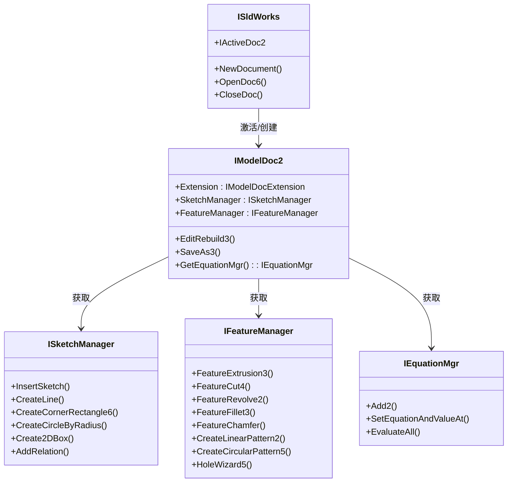

# SolidWorks 官方 API 复用与调用优化分析报告

## 一、SolidWorks 官方 COM API 核心能力图谱

SolidWorks 提供了极其丰富且成熟的自动化 COM/API 接口体系。深入理解并最大化复用官方原生 API，是保障阶段三建模系统稳定性、精确性与高性能的关键。



---

## 二、当前仓库现有 API 包装盘点与冗余分析

通过对 `vendor/solidworks-automation-skill/scripts/` 目录下全部底层脚本的审查，当前项目的 API 包装现状呈现出**“基层扎实但分布离散、存在局部冗余与契约不一”**的特征：

### 1. 存在的重复实现与分散包装
- **选择逻辑碎片化**：
  - 在 [sw_part.py](file:///D:/Agent工作区/DeepSeek%20Harness工作区/dsh-solidworks-plugin/vendor/solidworks-automation-skill/scripts/sw_part.py) 中定义了 `_select_by_id`、`_select_first_candidate`、`_ensure_sketch_selected`；
  - 在 `advanced_geometry.py` 和 `sw_sketch_quality.py` 中又各自存在类似的草图选中与轮廓遍历私有辅助函数；
  - 这种分散的选择逻辑导致缓存维护困难（例如 `sw_part.py` 需要专门的 `clear_sketch_selection_cache` 来防止选择混淆）。
- **尺寸修改双轨制**：
  - [dimension_manager.py](file:///D:/Agent工作区/DeepSeek%20Harness工作区/dsh-solidworks-plugin/vendor/solidworks-automation-skill/scripts/dimension_manager.py) 中基于特征树遍历和 `SetSystemValue3` 实现了带回滚保护的安全修改；
  - 但在 `sw_document_data.py` 中也存在 `update_dimension_mm` 的独立实现，容易引起调用方困惑。

### 2. 现存的高质量直接复用模块
以下模块设计成熟、经过严格回归验证，在阶段三必须予以**100% 继承复用**，绝不推倒重来：
- `sw_connect.py`：单线程单元（STA Worker）调度器与 COM 对象生命周期防护；
- `cad_task_context.py`：文档级别与任务级别的上下文隔离、中途故障保护与物理逆序清理；
- `shadow_backup.py`：内存/磁盘影子备份与无损恢复机制；
- `sw_measure.py`：双精度物理质量属性（体积、质量、表面积、包围盒）采集工具。

---

## 三、阶段三应直接复用的官方关键高级接口

为支撑 Feature Graph IR 的深度建模能力，阶段三无需自研复杂的几何算法，应直接接入以下 SolidWorks 原生接口：

| 接口分类 | 官方 API 方法 | 核心功能与业务价值 | 阶段三集成方式 |
| :--- | :--- | :--- | :--- |
| **草图几何** | `ISketchManager.CreateCornerRectangle6` / `CreateCircleByRadius` | 创建高精度的基本几何形状，原生支持参数化尺寸关联。 | 由 `CADGraphExecutor` 解析 IR 参数后直接调用。 |
| **草图几何约束** | `IModelDoc2.SketchAddConstraints` / `ISketchRelationManager` | 添加重合（Coincident）、同心（Concentric）、相切（Tangent）、平行等约束。 | 将 IR 中的约束描述映射为约束枚举并直接施加。 |
| **三维特征成型** | `IFeatureManager.FeatureExtrusion3`<br/>`IFeatureManager.FeatureCut4` | 工业级拉伸与切除，支持指定方向、拔模角、终止条件（盲孔、贯通、到面）。 | 替换原先固定参数的简易拉伸，支持复杂终止条件。 |
| **拓扑圆角与倒角** | `IFeatureManager.FeatureFillet3`<br/>`IFeatureManager.InsertFeatureChamfer` | 原生多半径圆角、面圆角与倒角算法。 | 配合声明式选择器，批量传入选中的 Edge/Face 指针。 |
| **参数与方程系统** | **`IModelDoc2.GetEquationMgr`**<br/>`Add2`, `SetEquationAndValueAt` | **官方尺寸驱动方程引擎**。<br/>直接支持 `D1@Sketch1 = "Width" * 0.5` 关系式。 | **强烈推荐接入**：建立模型参数表，实现尺寸联动更新。 |
| **特征树诊断** | `IFeature.GetErrorCode2` | 提取特征创建后的底层错误码（如自相交、零厚度几何体）。 | 接入几何验证器，为 AI 提供精准的物理诊断信息。 |

---

## 四、SolidWorks COM API 避坑指南与硬性规范

在阶段三开发物理执行器时，必须严格遵守以下工程规范：

### 1. 绝对 MKS 国际单位制换算
- **陷阱**：SolidWorks COM API 底层只认国际标准单位：
  - 长度必须为 **米 (m)**；
  - 角度必须为 **弧度 (rad)**；
  - 质量必须为 **千克 (kg)**。
- **规范**：用户与 LLM 通常习惯使用毫米（mm）与度数（deg）。所有进入 API 的参数必须强制经过归一化转换层：
  $$L_{\text{COM}} = L_{\text{mm}} \times 10^{-3}, \quad \theta_{\text{COM}} = \theta_{\text{deg}} \times \frac{\pi}{180}$$

### 2. 选择标记（Selection Mark）的严格匹配
- **陷阱**：在 SolidWorks 中，复合特征对于所选实体有严格的 Mark 掩码要求：
  - 基础拉伸：草图通常为 `Mark = 0`；
  - 路径扫描：轮廓 `Mark = 1`，扫描路径 `Mark = 4`；
  - 特征镜像：镜像基准面 `Mark = 2`，被镜像特征 `Mark = 1`。
- **规范**：必须在 Feature Planner 中固化各类特征的 Mark 映射规则表，严禁在多选时随意传入 `mark=0`。

### 3. UI 交互弹窗完全抑制
- **陷阱**：当模型重构失败或存在尺寸冲突时，SolidWorks 默认会弹出模态对话框（如“草图已过定义”、“特征重建错误”），彻底阻塞后台进程。
- **规范**：必须在连接初始化时执行配置抑制：
  ```python
  sw.SetUserPreferenceToggle(swUserPreferenceToggle_e.swPerformance_AutoRebuild, True)
  sw.UserControl = False
  ```
  所有错误一律通过 COM 返回值与 `GetErrorCode2` 捕获，绝不允许阻塞。

---

## 五、结论

SolidWorks 自身 API 的成熟度完全足够覆盖复杂机械建模的一切需求。阶段三的重点在于**“规范化调用、统一选择入口、引入官方方程管理器”**，切忌重复发明轮子。
