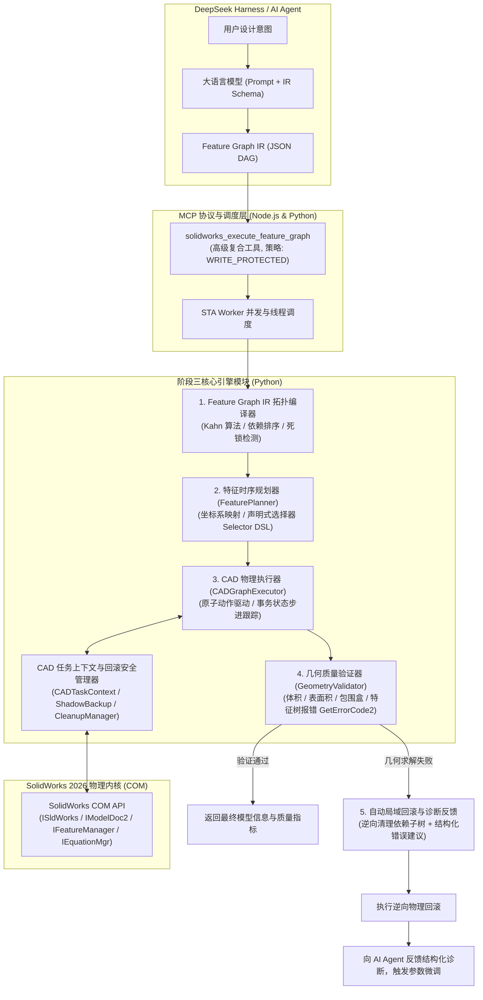

# 阶段三技术架构方案推荐报告

## 一、架构设计目标与核心原则

为使 `dsh-solidworks-plugin` 真正具备工业级 AI 自动化建模能力，阶段三推荐架构必须达成以下 4 项硬核指标：
1. **端到端真闭环**：彻底打通从“结构化意图（IR DAG）”到“SolidWorks 物理几何成型”与“双精度质量自验”的全链路；
2. **拓扑容错与自愈**：引入声明式拓扑选择器，消除因面/边动态编号变化导致的 TNP（拓扑命名）失效；
3. **极高防御安全**：将已验证的 `CADTaskContext`、逆序特征清理与影子备份深度融入执行流，杜绝脏状态残留；
4. **向下完全兼容**：保持现有 65 个原子 MCP 工具的输入输出契约与风险策略不变，平滑升级。

---

## 二、阶段三整体系统分层架构



---

## 三、核心模块边界与职责设计

### 1. 特征拓扑编译器 (`FeatureGraphCompiler`)
- **文件路径**：`vendor/solidworks-automation-skill/scripts/feature_graph_ir.py`（扩充）
- **核心职责**：
  - 维持现有 Kahn 拓扑排序算法与 DAG 死锁验证；
  - 增强 `FeatureNode` 的强类型 Pydantic Schema，覆盖草图基元（线、矩形、圆、圆弧、槽口）、特征参数（拉伸、切除、旋转、圆角、倒角、异型孔）、草图几何约束与全局尺寸方程；
  - 提供节点参数的物理有效性初检（如尺寸必须大于 0）。

### 2. 特征时序规划器与拓扑选择器 (`FeaturePlanner` & `TopologySelector`)
- **新建模块**：`vendor/solidworks-automation-skill/scripts/feature_planner.py`
- **核心职责**：
  - **局部坐标系转换**：当在某个表面（Face）建立草图时，自动计算该平面的原点偏移与法向旋转矩阵；
  - **声明式拓扑选择器 (Selector DSL)**：
    支持类似 CadQuery 的语义选择器，例如：
    - `face_selector: ">Z & #PLANE"`（选中模型最高的平面，用于开孔草图）；
    - `edge_selector: "#CIRCLE & |Z"`（选中所有平行于 Z 轴的圆形边，用于批量倒角）；
    本地插件通过遍历当前模型实体的拓扑边界表示（B-Rep），动态计算面法向量与包围盒，匹配出唯一的 SolidWorks COM 实体指针并标记选择 Mark。

### 3. CAD 物理图执行器 (`CADGraphExecutor`)
- **新建模块**：`vendor/solidworks-automation-skill/scripts/cad_graph_executor.py`
- **核心职责**：
  - 统一协调 STA Worker 线程中的 COM 调用；
  - 逐步执行由 FeaturePlanner 转换后的底层动作（`start_sketch`, `sketch_primitives`, `add_relations`, `create_feature`）；
  - 每执行一步，向 `CADTaskContext` 实时登记创建出的 CAD 实体名称与特征句柄；
  - 捕获底层 COM 异常，在发生不可恢复的几何错误时立即熔断并触发安全回滚。

### 4. 几何质量验证器 (`GeometryValidator`)
- **新建模块**：`vendor/solidworks-automation-skill/scripts/geometry_validator.py`
- **核心职责**：
  - 检查特征树中每个特征的健康状态（调用 `IFeature.GetErrorCode2`，识别“自相交”、“几何零厚度”、“欠约束”等警告）；
  - 驱动 `sw_measure.py` 采集体积、表面积、重心位置及双精度包围盒；
  - 与用户需求参数或理论参数进行比对断言。

### 5. 自动诊断与自愈闭环 (`AutoRepairDiagnostics`)
- **核心职责**：
  - 当某个特征步骤执行失败时，调用 `FeatureGraphIR.evaluate_failure_and_rollback`；
  - 驱动 `FeatureCleanupManager` 仅逆向删除故障节点及其受波及的下游子树，完好保留无依赖的前置与平行特征；
  - 生成针对 LLM 的**启发式自愈建议**（例如：“步骤 4 圆角半径 R=10mm 超过相邻壁厚 8mm，导致几何破损；建议将 radius_mm 缩减至 5mm 以下重新提交”）。

---

## 四、标准化接口契约设计 (Pydantic Schema)

阶段三暴露给 DSH 的复合核心工具为：
`solidworks_execute_feature_graph`

### 1. 输入数据模型契约 (Input Schema)
```python
class FeatureGraphExecuteInput(BaseModel):
    graph: Dict[str, Any] = Field(..., description="完整的 Feature Graph IR 字典")
    output_path: Optional[str] = Field(None, description="模型保存绝对路径(.SLDPRT)")
    auto_repair: bool = Field(default=True, description="是否在出现可诊断几何冲突时启动自愈重试")
    validate_mass: bool = Field(default=True, description="是否在建模完成后执行双精度质量属性自验")
    close_on_finish: bool = Field(default=False, description="建模完成后是否关闭后台 SolidWorks 文档")
```

### 2. 输出数据模型契约 (Output Schema)
```python
class FeatureGraphExecuteOutput(BaseModel):
    status: Literal["success", "partial_failed", "error"]
    graph_id: str
    target_part_name: str
    steps_total: int
    steps_completed: int
    execution_timeline: List[Dict[str, Any]]  # 每一步的用时、节点ID、创建实体、状态
    mass_properties: Optional[Dict[str, float]]  # 体积(mm3), 表面积(mm2), 质量(kg)
    bounding_box: Optional[Dict[str, float]]    # min/max x, y, z
    saved_file_path: Optional[str]
    rollback_occurred: bool
    diagnostics: Optional[Dict[str, Any]]       # 结构化错误诊断与自愈修复建议
```

---

## 五、架构优势与风险防范

1. **彻底终结“工具死锁与往返延迟”**：
   原先 AI 需要在 MCP 协议上来回往返数十次（创建文档 -> 画线 -> 标尺寸 -> 退出草图 -> 拉伸），网络开销大且极易中途断线。统一为图执行后，**一次 MCP 请求直接完成整件建模**，执行效率提升 10 倍以上。
2. **彻底解决拓扑选择断链**：
   引入 Selector DSL 之后，AI 永远基于工程语义选择基准面和边，不再依赖易变的草图名与内部面序号。
3. **零污染生产安全**：
   严格受 `CADTaskContext` 和 `ShadowBackupManager` 守护，任何异常都在毫秒级内自动回滚，确保本地 CAD 环境与已有项目一尘不染。
