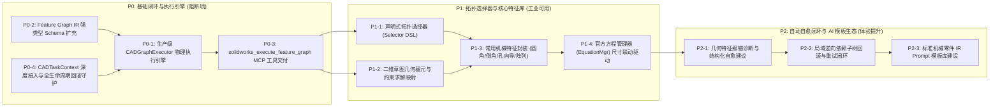

# 阶段三（AI 建模能力升级）分步开发路线图

## 一、阶段三核心战役目标

阶段三的唯一核心使命是：**让 DeepSeek Harness 能够通过自然语言指令，稳定、精确、无损地在真实 SolidWorks 中生成工业级三维零件，并支持参数修改与自愈闭环。**

为确保工程落地的高可靠性，阶段三划分为三个严格递进的批次（P0 -> P1 -> P2）：
- **P0（基础闭环阻断项）**：彻底打通 Feature Graph IR 到 SolidWorks 的生产级物理执行流水线；
- **P1（核心建模能力）**：攻克声明式拓扑选择器与约束系统，支持典型机械零件建模与尺寸联动；
- **P2（自愈与体验增强）**：打通几何报错结构化自愈反馈，建设常用机械标准件模板库。

---

## 二、P0 / P1 / P2 任务全景拆解矩阵

---

## 三、各批次任务详细规格与验收标准

### 【P0 批次】基础闭环与执行引擎（预估周期：2-3 天）

#### 任务 P0-1：生产级 `CADGraphExecutor` 物理执行引擎研发
- **目标**：将原先锁在测试文件中的 `execute_ir_plan_on_live_solidworks` 重构为独立的生产级核心模块。
- **文件交付**：`vendor/solidworks-automation-skill/scripts/cad_graph_executor.py`
- **核心逻辑**：
  1. 接收 `FeatureGraphIR` 对象与目标零件保存路径；
  2. 调度 STA Worker 执行线程，严格按拓扑计划顺序执行建模操作；
  3. 捕获每个节点的执行时长与返回实体句柄，构造全链路 Execution Trace；
  4. 遇到几何异常时精准捕获，保留崩溃现场上下文供回滚管理器调用。
- **验收断言**：运行 Python 单元测试，能够在无人工干预下连续通过 IR 建模生成包含基础拉伸凸台与切除的模型。

#### 任务 P0-2：Feature Graph IR 强类型 Schema 扩充
- **目标**：解决目前 `FeatureNode.parameters` 过于松散的问题，建立面向机械工程的强类型校验。
- **文件交付**：更新 `vendor/solidworks-automation-skill/scripts/feature_graph_ir.py`
- **核心逻辑**：
  为各类特征建立细分的 Pydantic 参数子模型（如 `Sketch2DParams`, `ExtrudeParams`, `FilletParams`），提供范围检查（如深度必须 $>0$、半径必须 $>0$）。
- **验收断言**：非法参数（如负数拉伸、非法方向）在静态验证阶段直接拦截，不传递给 SolidWorks。

#### 任务 P0-3：`solidworks_execute_feature_graph` MCP 工具交付
- **目标**：在 MCP Server 中正式暴露端到端建模工具。
- **文件交付**：
  - 更新 `vendor/solidworks-automation-skill/mcp-server/server.py`
  - 更新 `lib/index.js` 与安全策略表（策略标记：`WRITE_PROTECTED`，需要用户前置确认）
- **核心逻辑**：
  对外暴露 JSON-RPC 接口，接收图参数并返回执行跟踪、质量属性与保存路径。
- **验收断言**：通过 `tests/probe-server.mjs` 与 MCP 测试脚本，断言该工具在 Node 与 Python 双栈均可正常列举与响应。

#### 任务 P0-4：`CADTaskContext` 全生命周期回滚深度打通
- **目标**：确保图执行全程处于 `CADTaskContext` 守护之下。
- **核心逻辑**：
  1. 执行开始时自动注册独立 Task ID 与影子备份；
  2. 无论中途哪一步发生异常，自动调用 `FeatureCleanupManager` 或文档安全关闭逻辑；
  3. 杜绝后台残留任何未命名零件文档。
- **验收断言**：人为在第 3 步注入除零或空指针故障，断言 SolidWorks 后台活动文档数立即恢复为 0，临时文件彻底清除。

---

### 【P1 批次】核心建模能力与工业可用性（预估周期：3-4 天）

#### 任务 P1-1：声明式拓扑选择器 (Selector DSL)
- **目标**：消除拓扑命名断链（TNP），让 AI 能够用语义化语言选择几何基元。
- **文件交付**：`vendor/solidworks-automation-skill/scripts/topology_selector.py`
- **核心逻辑**：
  - 支持面选择器语法：`>Z`、`<Z`、`>X`、`<X`、`#PLANE`、`#CYLINDER`；
  - 支持边选择器语法：`#CIRCLE`、`|Z`、`>Z`；
  - 遍历活动实体的面/边，根据法向点积与顶点极值筛选出唯一的 COM 实体并调用 `Select4`。
- **验收断言**：在不对顶面名称做任何假设的前提下，使用 `">Z & #PLANE"` 选择器 100% 成功在不规则凸台上选中最高表面并开启草图。

#### 任务 P1-2：二维草图几何基元与几何约束映射
- **目标**：支持在指定基准面或实体面上绘制复杂草图，并施加几何约束。
- **核心逻辑**：
  - 支持线段（Line）、矩形（Corner/Center Rectangle）、圆（Circle）、圆弧（3-Point Arc）、槽口（Slot）；
  - 支持草图几何约束：水平（Horizontal）、垂直（Vertical）、重合（Coincident）、同心（Concentric）、相切（Tangent）。
- **验收断言**：通过 IR 生成完全约束（Fully Defined）的草图，SolidWorks 内部草图状态判定为非欠约束。

#### 任务 P1-3：常用机械特征封装 (圆角/倒角/异型孔/阵列)
- **目标**：将机械设计最常用的成型特征全部接入 Feature Graph IR。
- **核心逻辑**：
  - 封装 `IFeatureManager.FeatureFillet3`、`FeatureChamfer`、`CreateLinearPattern2`；
  - 结合 P1-1 的拓扑选择器，实现“在所有竖直边上倒 R=3mm 圆角”的高级操作。
- **验收断言**：成功建模包含“底座拉伸 -> 沉头孔向导 -> 边缘倒圆角 -> 线性阵列 4 孔”的标准测试零件。

#### 任务 P1-4：官方方程管理器 (EquationMgr) 尺寸联动驱动
- **目标**：支持图级别的全局参数表与尺寸方程驱动。
- **核心逻辑**：
  - 将 IR 中的全局参数写入 SolidWorks `IEquationMgr`；
  - 草图与特征尺寸绑定全局变量（例如 `"D1@Sketch1" = "Length" * 0.5`）；
  - 修改全局变量后触发 `EvaluateAll` 和 `EditRebuild3`。
- **验收断言**：修改单一全局变量 `Length`，整个模型的尺寸与衍生特征按比例联动变化，无拓扑报错。

---

### 【P2 批次】自动自愈闭环与 AI 模板生态（预估周期：2-3 天）

#### 任务 P2-1：几何特征报错诊断与结构化自愈建议
- **目标**：当物理建模发生几何冲突时，为 AI 提供具备因果关系的错误报告。
- **核心逻辑**：
  - 调用 `IFeature.GetErrorCode2` 解析底层错误码；
  - 将错误翻译为易懂的工业诊断（例如：“拉伸切除贯穿方向与实体相反”、“圆角半径过大导致面自相交”）；
  - 输出 `suggested_patch` 字典供 Agent 直接参考。
- **验收断言**：故意传入过大圆角半径，系统返回结构化自愈诊断信息，指导 AI 自动将半径调整到合理范围并重试成功。

#### 任务 P2-2：局域逆向依赖子树回滚
- **目标**：实现“哪里失败回滚哪里”，无需整件推倒重来。
- **核心逻辑**：
  - 结合 `feature_graph_ir.evaluate_failure_and_rollback`；
  - 仅物理删除故障节点及其下游节点，保留无依赖的前置实体；
  - 在保留的实体基础上接受 AI 的修复补丁继续推进。
- **验收断言**：在 5 步特征建模中，第 4 步注入失败，断言前 3 步特征完好保留在特征树中，仅第 4 步被安全移除。

#### 任务 P2-3：标准机械零件 IR Prompt 模板库建设
- **目标**：降低 LLM 生成复杂零件的门槛。
- **交付内容**：在 `vendor/.../templates/` 沉淀 8 类典型机械构件的黄金 IR 模板（法兰盘、轴承座、直齿轮坯、L型安装支架、轴类零件、箱体盖板等）。
- **验收断言**：输入自然语言“生成一个标准 DN50 法兰盘”，LLM 能准确调用法兰盘模板并填入对应尺寸参数，一次性建模成功率 $\ge 95\%$。

---

## 四、阶段三交付路线时间表与里程碑判定

| 里程碑 | 目标周期 | 核心交付物 | 终验基线 |
| :--- | :--- | :--- | :--- |
| **M3-A (P0 达成)** | 第 1 周前期 | `cad_graph_executor.py` + `solidworks_execute_feature_graph` MCP 工具 | 能够端到端生成带切除的规则几何零件，100% 回滚保护。 |
| **M3-B (P1 达成)** | 第 1 周后期 | `topology_selector.py` + 草图约束 + 圆角/倒角/阵列/孔向导 + 方程联动 | 能够完成典型机械构件（如支架、带孔底板），支持选择器自愈与尺寸驱动。 |
| **M3-C (P2 达成)** | 第 2 周前期 | 自愈闭环诊断器 + 局域回滚 + 机械模板库 + 8 大典型真实 CAD 验收用例 | 8 大典型机械设计任务 100% 真实通过，交付阶段三正式封版报告。 |
