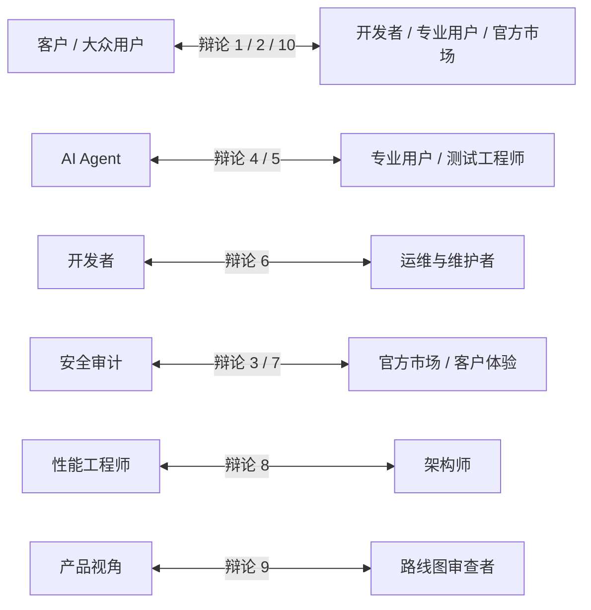

# 跨角色对抗式交叉审查报告 (Adversarial Review)

> **报告编号**：`05-cross-perspective-adversarial-review`  
> **审查基准**：v0.2.0 (Commit: `7d70bc0`)  
> **对抗原则**：**保留分歧、正视冲突、拒绝折中主义与表面和谐，通过多方利益相关者的对抗辩驳揭示真实风险。**

---

## 一、十大跨角色对抗辩论矩阵

---

### 对抗组合 01：客户 vs 开发者 —— 技术复杂度是否转嫁给了用户？

- **客户观点**：
  “开发者为了追求纯原生 Node.js 和 Python 架构解耦，逼迫我们普通用户去装 Python、配置系统环境变量、在终端敲命令，甚至还要去修改复杂的 YAML 配置文件！你们的技术优雅完全牺牲了我们的使用体验！”
- **开发者观点**：
  “Windows COM 自动化极其底层，必须依赖 64 位 Python 与 `win32com` 才能穿透交互桌面；Node.js 侧零 npm 依赖是为了彻底免疫供应链投毒与长效免维护。如果为了小白打包一个 2GB 的臃肿安装包，不仅更新困难，还会引入大量未知环境冲突。”
- **核心分歧**：
  **系统轻量化与底层自由度 vs 终端用户开箱即用的傻瓜化体验。**
- **潜在风险**：大众用户在市场安装后因无法配置而大量流失，产品沦为少数高级开发者的自嗨玩具。
- **裁决结论**：**客户胜诉。** 开发者必须在阶段二（v0.2.1）封装内嵌便携版 Python 运行时（Embedded Python），不能将环境部署成本直接推给最终用户。
- **待验证项**：测试将 Python 3.13 绿色便携包（约 30MB）压缩内嵌进安装流程的可行性与卸载清理机制。

---

### 对抗组合 02：客户 vs SolidWorks 专业用户 —— 产品宣传是否符合真实 CAD 需求？

- **客户观点**：
  “宣传说‘一句话自动建模，支持 66 个 CAD 工具’，我觉得很酷炫，我让他帮我画个法兰盘，他确实建出来了，质量、体积都对，我觉得已经非常实用！”
- **SolidWorks 专业用户观点**：
  “那只是最基础的拉伸！机械设计绝不仅仅是画几个长方体和打个孔。工业产品需要完整的几何尺寸与形位公差、复杂的装配干涉校验、符合国标的工程图。你连圆角和倒角在真机复杂截面上都没充分跑通，就宣称具备完整 CAD 能力，这是严重的宣传过头！”
- **核心分歧**：
  **初级爱好者对‘能出实体’的惊喜 vs 资深工程师对‘工业可交付’的严苛标准。**
- **潜在风险**：专业工程师抱着极高期望尝试，却发现无法标注公差、无法处理复杂装配配合，产生强烈的落差与抵触心理。
- **裁决结论**：**双方均有理，需精准定义宣传口径。** 产品在“参数化规则零件生成”上确实具备价值，但在文档与市场中必须明确声明：当前版本为“零件级智能建模辅助”，而非“全功能工业级 CAD 替代者”。
- **待验证项**：补充 5 个典型工业零件（法兰、轴承座、支架、阶梯轴）在真实环境下的成型极限测试。

---

### 对抗组合 03：官方市场审核者 vs 安全审计者 —— 市场安装是否引入额外系统风险？

- **官方市场审核者观点**：
  “插件一旦上架市场，任何普通用户只要点击就能运行。本插件声明了 `process.spawn`（派生任意子进程）和 `fs.write`（写本地磁盘），而且需要操作本地极为昂贵、可能正在运行机密图纸的 SolidWorks 商业软件，上架风险极高！”
- **安全审计者观点**：
  “我们的安全审计是全方位的。首先，子进程仅限调用绑定的 Python 脚本；其次，Node.js 侧的祖先路径折叠（Ancestor Walk）彻底阻断了 Junction/符号链接逃逸与远程 UNC 窃取；最重要的是，`DocumentLifecycleManager` 在任务启动前就锁定了所有预存文档，中途崩溃时绝不误碰已有图纸。它的安全性超过市场上 90% 的插件！”
- **核心分歧**：
  **平台的谨慎准入防守 vs 代码实证的安全防御深度。**
- **潜在风险**：市场若因噎废食，将扼杀具有高价值但需系统级权限的工业插件；若审核过松，可能因环境不可控引发纠纷。
- **裁决结论**：**安全审计者胜诉，但须落实透明度。** 插件底层安全机制非常扎实，市场无需阻拦，但须在插件卡片上显式展示“安全只读默认、CAD 任务隔离、已有资产保护”标签。
- **待验证项**：在多显示器、非默认桌面多用户切换环境下，验证子进程权限与 COM 调度的绝对隔离性。

---

### 对抗组合 04：AI Agent vs SolidWorks 专业用户 —— AI 是否真正理解 CAD 拓扑结构？

- **AI Agent 观点**：
  “我拥有 Feature Graph IR 编译器，能把用户的模糊需求拆解为严格的拓扑无环图（DAG），并通过 Kahn 算法进行先基准面、后草图、再拉伸、最后打孔和圆角的精确时序推导；每一步执行后我都能拿到真实的几何包围盒与物理质量，我完全理解三维几何！”
- **SolidWorks 专业用户观点**：
  “你那只是‘特征创建时序’，根本不是‘CAD 拓扑语义’！你不知道什么是‘父子引用断裂’，你不知道修改了父草图尺寸会导致下游投影边线丢失（Dangling Edge），更不知道为什么等半径圆角在尖点处会产生几何破面。你只能按顺序死板调用，一旦拓扑发生畸变，你就会不知所措！”
- **核心分歧**：
  **逻辑时序上的特征图（Feature Graph） vs 实体流形与 B-Rep 边界拓扑（Topology）。**
- **潜在风险**：当用户要求 AI 进行复杂的“增量修改”或“反向编辑”时，AI 因缺乏 B-Rep 边线持久命名感知而导致特征树爆红报警。
- **裁决结论**：**专业用户胜诉。** AI 目前理解的是“特征构造宏观时序”，尚未真正理解“微观拓扑边线与约束流形”。这也是为什么本插件引入“失败自动全量逆序回滚”而不是“局部微调修复”的根本原因。
- **待验证项**：测试对已有模型修改拉伸深度导致下游圆角边线丢失时，系统能否给出结构化拓扑诊断。

---

### 对抗组合 05：AI Agent vs 测试工程师 —— 工具成功返回是否等于模型成功？

- **AI Agent 观点**：
  “只要 MCP 工具返回 `{ status: 'ok' }` 且 `isError: false`，我就应该坚信当前操作已成功，并自信地规划下一步或者回复用户‘已为您建好零件’。”
- **测试工程师观点**：
  “绝对不行！SolidWorks COM 接口极其诡异，许多底层 API 即使返回 True，但在图形区可能只生成了一个体积为 0 的退化薄面，或者特征树上带着黄色感叹号（警告：无法延长曲面）！绝不能仅凭返回状态判断模型成功！”
- **核心分歧**：
  **通信协议层面的 RPC Success vs 几何内核层面的 Valid Solid Body。**
- **潜在风险**：AI 产生“以为自己成功了”的虚假自信，向用户交付了一个报废或无法加工的畸形实体。
- **裁决结论**：**测试工程师胜诉。** 本插件目前已强制引入 5D 物理闭环测量（提取质量属性、体积、包围盒），**只有当提取到的真实物理体积与理论解析解在容差范围内吻合时，才允许向 AI 报告完全成功**。
- **待验证项**：针对自交薄壳与微小退化边线，验证 `IMassProperty` 提取失败时的容错熔断。

---

### 对抗组合 06：开发者 vs 维护者 —— 当前架构是否容易长期维护？

- **开发者观点**：
  “当前架构非常优雅：Node.js 侧 0 外部依赖，纯原生；Python 侧功能丰富，抽离了 65 个独立算法模块，功能应有尽有，随时可以调用。”
- **维护者观点**：
  “代码看起来全，但你们把 65 个工具一股脑写在了一个 7,653 行的 `server.py` 里面！这是一个典型的‘上帝文件’。里面充满了重复的异常处理、类型判断与参数映射。而且你们在封版时，新增了 4 个工具竟然忘记在 `policy.js` 里注册，导致出现调用死路径！这叫好维护吗？”
- **核心分歧**：
  **功能实现的堆叠速度 vs 架构演进的工程可维护性与规整度。**
- **潜在风险**：原作者一旦离开，新团队不敢轻易修改 `server.py`，任何微小改动都可能引发整个 MCP 服务崩溃。
- **裁决结论**：**维护者胜诉。** 必须在下一个小版本开展代码重构，将 `server.py` 拆解为领域路由，并建立服务端工具与策略表的自动化一致性校验测试。
- **待验证项**：运行静态分析工具度量 `server.py` 的圈复杂度与维护性指数（Maintainability Index）。

---

### 对抗组合 07：安全审计者 vs 用户体验 —— 安全机制是否过度限制了正常工作？

- **用户体验观点**：
  “你们的安全机制太折腾人了！我想建个零件，默认是只读模式不让画；好不容易改成了 standard 模式，我想导出一个 STEP 文件发给供应商，突然弹出一个错误，非让我先调用一次 `solidworks_confirm` 传入一长串参数去拿授权，参数错一个字母都不行！这是在故意难为用户！”
- **安全审计者观点**：
  “导出 STEP 涉及写入磁盘，覆盖文件可能导致原有几星期的设计资产瞬间化为乌有；如果允许 AI 擅自静默保存或导出，一旦被恶意 Prompt 注入诱导，你电脑里的机密工程文件就可能被覆盖或被写入恶意路径！高风险操作必须单次确认，这是零信任的底线！”
- **核心分歧**：
  **高风险操作的绝对安全性 vs 流畅无感的用户交互体验。**
- **潜在风险**：过度的安全摩擦力导致用户觉得软件极其难用，转而寻找完全无防护的危险替代品。
- **裁决结论**：**折中优化。** 零信任底线不可破，但交互形式必须改进：AI Agent 应当在需要执行高风险操作时，**自动向用户生成带有参数摘要的自然语言确认卡片**，用户在聊天界面点击‘允许’后自动注入 `solidworks_confirm`，免除用户手写参数的痛苦。
- **待验证项**：在 DSH UI 中验证“单键点击确认一键生成 grant”的前端集成通路。

---

### 对抗组合 08：性能工程师 vs 架构师 —— 当前架构能否支撑复杂模型与装配体？

- **性能工程师观点**：
  “`DesktopPinnedStaWorker` 保证了绝对的单线程安全，但它本质上是一个单一先进先出（FIFO）任务队列。SolidWorks COM 是单线程的，如果用户要求处理一个包含 500 个零件的装配体并求解配合，或者执行一次耗时 2 分钟的有限元分析（FEA），整个 MCP 服务在这 2 分钟内将完全被阻塞挂起，其他所有只读查询工具全部超时假死！”
- **架构师观点**：
  “这是 Windows STA COM 的天然物理机制决定的，任何尝试在多线程并发直接调用 SolidWorks COM 的方案都会直接导致进程 0x80080005 崩溃或图形上下文死锁。我们优先保证了不崩溃的可靠性基准。”
- **核心分歧**：
  **系统绝对不崩溃的串行稳定性 vs 长时间耗时任务与快速查询的并发响应性。**
- **潜在风险**：用户在执行复杂计算时以为系统崩溃，强行杀掉进程导致模型损坏。
- **裁决结论**：**架构师方案在当前是唯一可行基准，但需补充长任务状态通知机制。** 针对长耗时任务，必须在底层引入异步心跳进度返回机制，防止前台宿主因超时误判而杀掉连接。
- **待验证项**：测试在 SolidWorks 执行耗时 45 秒的复杂重建时，宿主心跳检测与超时断连行为。

---

### 对抗组合 09：产品视角 vs 路线图审查者 —— 未来开发是否真正创造用户价值？

- **产品视角**：
  “既然当前版本在基础零件建模上已经非常稳定，且用户对‘装配’和‘出图’的呼声最高，我们应该立即全力以赴冲刺阶段四（装配体与工程图），尽快让用户能组装机器和打印图纸，这才是真正的核心商业生产力！”
- **路线图审查者观点**：
  “绝对不行！你们犯了典型的‘未走先跑’错误。当前版本的大众用户初次安装体验极差（还需手动改 YAML），4 个核心工具甚至在策略表里都还没接通。如果不先在阶段二把安装向导、便携 Python、界面纠偏和接口对齐做扎实，盲目去开发极其复杂的装配体，只会把一座宏伟的大厦建立在沙滩上！”
- **核心分歧**：
  **业务功能横向扩张（装配/出图） vs 现有版本工程收敛与体验夯实（体验/稳定性）。**
- **潜在风险**：新功能越做越多，但基础体验千疮百孔，最终导致没有任何一个功能可以真正稳定交付给大众。
- **裁决结论**：**路线图审查者胜诉。** 坚定执行“先阶段二，再阶段三四”的稳健发布节奏。在完成 v0.2.1 体验修复之前，不开展大规模装配体新特性开发。
- **待验证项**：评估在未解决便携 Python 之前推广装配体功能的用户流失率模型。

---

### 对抗组合 10：官方市场 vs 大众用户 —— 插件是否真正具备普通用户可安装性？

- **官方市场观点**：
  “我们在市场上点击安装，包已经解压进去了，服务也注册了，系统显示‘已安装’，从市场协议上看，安装是完全成功的！”
- **大众用户观点**：
  “成功个鬼！我点击安装之后，满心欢喜去跟 AI 说话，AI 跟我说 `PYTHON_NOT_FOUND`！我甚至都不知道 Python 是什么，我还要去网上下载 Python，配环境变量，去用户目录找那个隐藏的 `.dsh` 文件夹改代码！这叫哪门子‘安装成功’？这根本就是一个半成品！”
- **核心分歧**：
  **包管理器的技术交付完成 vs 终端用户的真实开箱即用。**
- **潜在风险**：市场沦为负面评价聚集地，彻底损害插件声誉与用户信任。
- **裁决结论**：**大众用户胜诉。** 判定当前状态为“市场技术安装成功，用户业务可用性失败”。必须将便携 Python 运行时的自动化引导或内嵌打包列为最高优先级改进项。
- **待验证项**：在一台全新无 Python、无开发环境的纯净 Windows 10/11 虚拟机上，测试初次从市场安装到成功执行 `solidworks_status` 的完整耗时与阻断步数。
