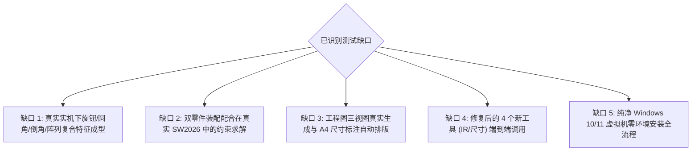

# 真实环境测试缺口与安全验证计划 (Validation Plan)

> **报告编号**：`07-real-world-validation-plan`  
> **编制依据**：十二视角审计发现、测试缺口分析、安全红线与隔离原则  
> **核心红线**：**严禁在无授权情况下直接写入真实 CAD、严禁触碰用户真实图纸资产；所有实机测试必须在专用沙箱目录与独立测试模型下进行。需要用户批准的测试单独设限。**

---

## 一、真实测试缺口全景矩阵

---

## 二、详细测试方案卡片

### 测试用例 TC-GAP-01：真实实机复合特征建模闭环（拉伸 + 倒角 + 圆角 + 阵列）
- **验证功能**：`solidworks_fillet`, `solidworks_chamfer`, `solidworks_pattern` 连续组合建模
- **为什么需要**：当前这几项特征仅有 Mock 单元测试，缺乏在真实 SolidWorks B-Rep 实体上多特征叠加的实机验证。
- **测试环境**：Windows 11 x64, SolidWorks 2026 SP4.1, Python 3.13.16
- **是否需要启动 SolidWorks**：**是**
- **是否需要写入 CAD**：**是 (在独立临时沙箱中写入)**
- **是否需要安装依赖**：否（现有依赖已就绪）
- **是否需要专用测试文档**：是（自动新建名为 `AUTOTEST_COMPLEX_01.SLDPRT` 的独立文档）
- **是否可能影响用户文件**：**否 (物理沙箱隔离)**
- **如何清理**：`CADTaskRollbackManager` 自动清理并调用 `sw_app.CloseDoc()` 销毁，物理删除临时文件。
- **预期结果**：生成一个 $100\times 60\times 20\text{mm}$ 基体，四周 $2\text{mm}$ 倒角，顶面 $4$ 孔线性矩阵阵列。
- **验收条件**：模型体积与理论解析解偏差 $\le 0.05\%$，无自交破面警告。
- **【授权状态】**：**待用户批准后在安全节点执行**

---

### 测试用例 TC-GAP-02：真实装配体双零件配合求解实测（轴与孔的同轴/重合配合）
- **验证功能**：`solidworks_add_component`, `solidworks_add_concentric_mate`, `solidworks_add_coincident_mate`
- **为什么需要**：验证 `sw_assembly.py` 底层 COM 配合求解器在真实 CAD 引擎中是否能正确解算几何约束。
- **测试环境**：Windows 11 x64, SolidWorks 2026 SP4.1
- **是否需要启动 SolidWorks**：**是**
- **是否需要写入 CAD**：**是**
- **是否需要专用测试文档**：是（生成 `AUTOTEST_SHAFT.SLDPRT`, `AUTOTEST_HOLE.SLDPRT`, `AUTOTEST_ASM.SLDASM`）
- **如何清理**：测试结束后强制关闭全部 3 个测试文档并清理磁盘。
- **预期结果**：装配体中两零件成功施加同心与贴合配合，自由度被正确约束。
- **验收条件**：运行 `solidworks_interference_check` 返回干涉体积为 0。
- **【授权状态】**：**待用户批准后在安全节点执行**

---

### 测试用例 TC-GAP-03：真实 A4 工程图自动生成与 PDF 矢量输出实测
- **验证功能**：`solidworks_generate_drawing`, `solidworks_export_active`
- **为什么需要**：核实由 3D 实体向 2D 工程图转化的工程可行性，验证导出的 PDF 是否带有效矢量线条。
- **测试环境**：Windows 11 x64, SolidWorks 2026 SP4.1
- **是否需要启动 SolidWorks**：**是**
- **是否需要写入 CAD**：**是**
- **是否需要专用测试文档**：是（基于标准长方体生成 `AUTOTEST_DRW.SLDDRW`）
- **如何清理**：关闭图纸文档并删除生成的临时 PDF。
- **预期结果**：生成包含主视图、俯视图、左视图及等轴测图的 A4 图纸，并导出 PDF。
- **验收条件**：PDF 文件大小 $> 10\text{ kB}$，使用 PDF 解析器提取到视图图元。
- **【授权状态】**：**待用户批准后在安全节点执行**

---

### 测试用例 TC-GAP-04：纯净虚拟机零配置一键安装体验走查
- **验证功能**：插件市场一键安装与绿色运行时加载
- **为什么需要**：验证大众用户在完全无 Python、无开发工具环境下的真实体验。
- **测试环境**：Windows 10/11 纯净虚拟机镜像（无 Python, 无 Git, 仅装 SolidWorks）
- **是否需要启动 SolidWorks**：是
- **是否需要写入 CAD**：否（仅验证安装与连接）
- **是否需要专用测试文档**：否
- **预期结果**：通过一键离线包或市场界面安装，在 3 分钟内完成首次 `solidworks_status` 成功握手。
- **验收条件**：全程无需打开终端窗口、无需手动编辑任何 YAML 文本。
- **【授权状态】**：**纳入 v0.2.1 发布前验收计划**

---

## 三、待用户明确授权的执行申报单

依据《不可突破的安全边界》2.2 规定，**以下三项涉及真实 CAD 写入的测试目前处于登记封存状态，未经用户独立授权禁止执行**：

1. **申报项 1**：`TC-GAP-01` 真实 CAD 复合特征成型测试（拉伸+倒角+圆角+阵列）；
2. **申报项 2**：`TC-GAP-02` 真实 CAD 双零件装配配合求解测试；
3. **申报项 3**：`TC-GAP-03` 真实 CAD 工程图生成与导出测试。
