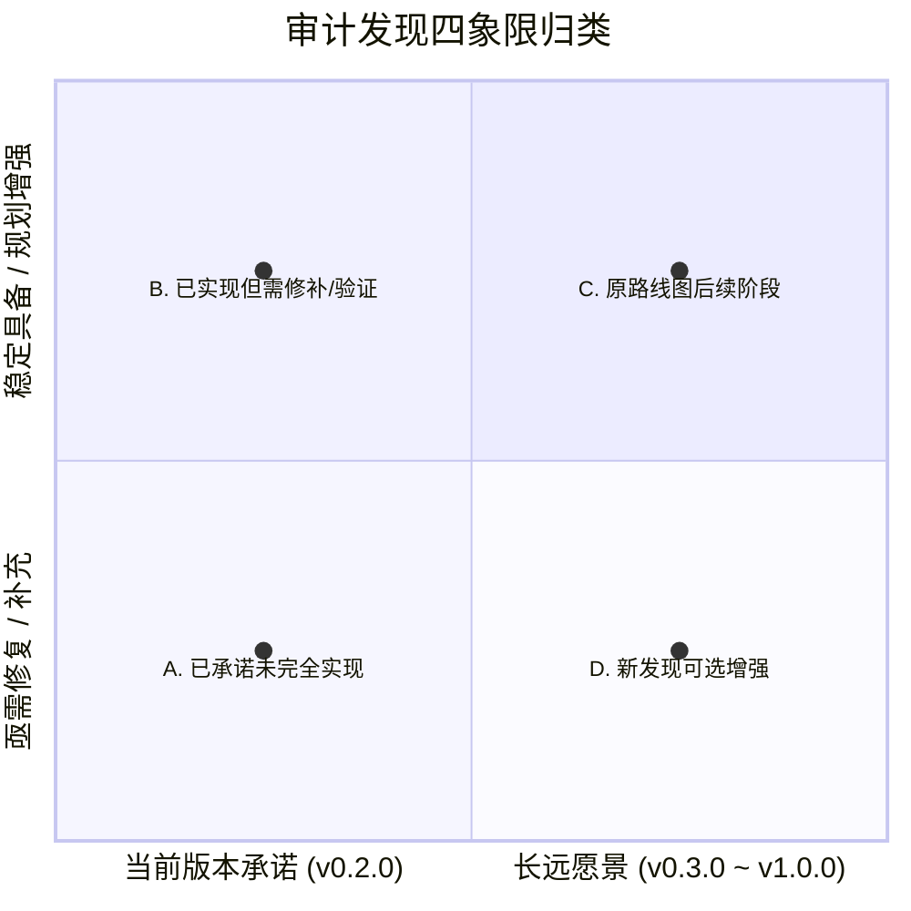

# 版本差距分析与后续演进路线建议 (Roadmap Recommendations)

> **报告编号**：`08-version-gap-and-improvement-roadmap`  
> **基线版本**：v0.2.0 (Commit: `7d70bc0`)  
> **编制依据**：缺陷与风险登记册、真实测试缺口、六阶段技术蓝图  
> **归属原则**：客观四分法分类，精准建议归属版本，既不推迟当下必修缺陷，也不好高骛远强推未成熟愿景。

---

## 一、审计发现全量归类四象限

### A. v0.2.0 已承诺但未完全实现的功能 (0 项重大缺失，2 项接口遗漏)
1. **4 个先锋工具向前台 Policy 表注册与暴露**：已实现于底层，但策略表未同步收录，导致日常模式不可达；
2. **Pack and Go 前后端命名统一**：服务端 `_tool` 后缀与 Manifest 契约漂移。

### B. v0.2.0 已实现但需要修复或补充验证的功能 (4 项)
1. **`lib/index.js:33` 版本号硬编码纠偏**：由 `0.1.0` 修正为 `0.2.0`；
2. **`lib/discover.js` Python 探测补齐**：增加扫描项目根目录 `.venv` 及 `pyvenv.cfg`，与 `scripts/doctor.js` 对齐；
3. **`package.json` 的 `npm test` 命令增强**：纳入 35 项 Python 离线单元测试与 `probe-server.mjs`；
4. **复合特征（圆角、倒角、阵列）实机测试**：补充真实环境下的多特征堆叠验收。

### C. 原路线图后续阶段的功能 (有序推进项)
1. **阶段三 (v0.3.0)**：Feature Graph IR 前台正式接入、全生命周期参数驱动修改、影子物理备份工业化应用；
2. **阶段四 (v0.4.0)**：装配体双/多零件配合解算、干涉碰撞检查、A4 标准三视图工程图自动出图与尺寸排版；
3. **阶段五 (v0.5.0 ~ v0.6.0)**：多文档跨零件工作流、设计规范（Design Spec）全自动生成；
4. **阶段六 (v1.0.0)**：传统 2D 机械蓝图逆向 3D 实体、钣金智能展开、Toolbox 紧固件匹配。

### D. 新发现的可选增强功能 (8 项建议)
1. 内嵌精简版 Python 便携运行时（Embedded Portable Python）；
2. 拆解 7,653 行上帝文件 `server.py` 为领域路由；
3. 增加活动零件全景状态查询工具（`solidworks_get_active_model_summary`）；
4. 提供基于 DSH 聊天界面的图形化确认卡片，一键生成 `solidworks_confirm` 单次授权；
5. 审计日志增加自动大小切片与文件轮转；
6. 补充 TypeScript `.d.ts` 接口类型声明；
7. 增加长耗时操作心跳事件上报；
8. 增加活动视口截图（Screenshot）返回，赋予大模型视觉反馈。

---

## 二、后续版本规划建议路线图 (Release Plan)

| 建议版本 | 版本定位 | 规划完成周期 | 建议收录的核心内容与任务 | 发布准入条件 |
|---|---|:---:|---|---|
| **v0.2.1** | **体验与接口紧急修复版** | 1~3 天 | 1. 修复 `lib/index.js` 版本号为 `0.2.0`； 2. `lib/policy.js` 收录 4 个新工具并修复命名； 3. `lib/discover.js` 增加 `.venv` 探测； 4. 优化只读模式拒绝文案，增加中文切换提示； 5. 完善 `npm test` 测试组合。 | 1. `npm test` 包含 probe 全绿； 2. `node tests/probe-server.mjs` Exit 0； 3. 0 代码死路径。 |
| **v0.3.0** | **自主智能化与编译器版** | 3~4 周 | 1. 正式打通 Feature Graph IR 前台拓扑驱动； 2. 全生命周期尺寸动态修改（用户指令驱动尺寸变更并自愈重建）； 3. 重构拆分 `server.py` 为领域路由； 4. 内嵌便携版 Python 运行时，实现小白零门槛安装。 | 1. 连续修改 3 处核心尺寸模型无警告重构； 2. 纯净虚拟机一键安装运行通过。 |
| **v0.4.0** | **装配与出图交付版** | 2~3 个月 | 1. 构建面向对象的 `AssemblyManager`，支持同心/贴合配合解算； 2. 自动投射主俯左三视图与轴测图并导出 PDF； 3. 全局装配体干涉碰撞检查。 | 1. 自动完成轴与轴承座配合； 2. 成功输出一张可供加工的 A4 图纸 PDF。 |
| **v1.0.0** | **工业级旗舰生态版** | 6 个月+ | 1. 2D 机械蓝图正交三视图逆向转 3D； 2. 钣金展开与折弯系数计算； 3. Toolbox 标准紧固件库智能装配。 | 1. 车间实机加工多套复杂零件； 2. 官方插件市场顶级推荐。 |
