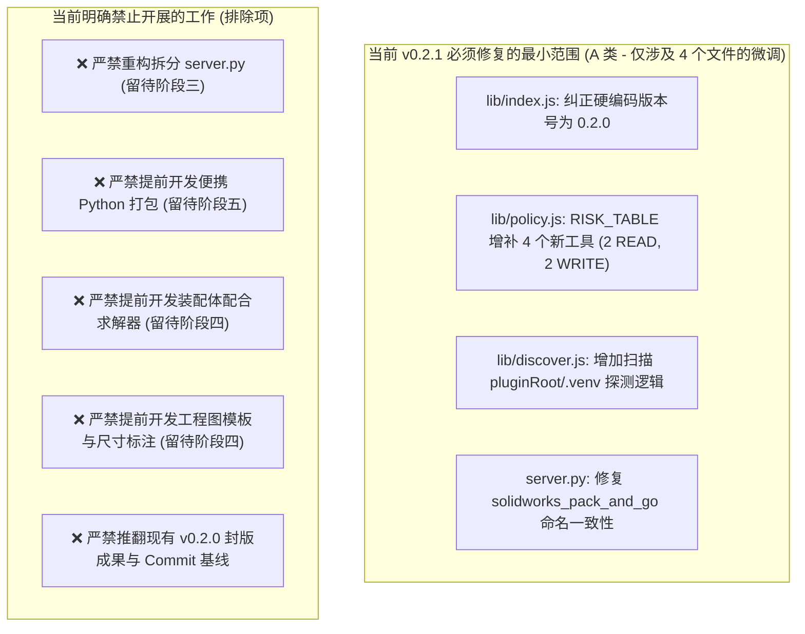

# dsh-solidworks：v0.2.0 审计缺陷分流与阶段归属判定报告

> **报告编号**：`09-current-vs-future-scope`  
> **审计基线**：v0.2.0 (Commit: `7d70bc0`, Tag: `v0.2.0`)  
> **工作区路径**：[`D:\Agent工作区\DeepSeek Harness工作区\dsh-solidworks-plugin`](file:///D:/Agent工作区/DeepSeek%20Harness工作区/dsh-solidworks-plugin)  
> **审查宗旨**：**实事求是、分流归属、恪守边界。严格区分“当前必须修复的最小阻断项”与“后续阶段既定工作范围”，坚决不翻工既定封版成果，坚决不超前引入未来阶段复杂度。**

---

## 一、审计缺陷全量分流归属简明总表

| Issue ID | 缺陷名称与核心诉求 | 分类结果 | 阶段归属 | 现在修什么 / 后面怎么做 |
|:---:|---|:---:|:---:|---|
| **DEF-01** | Python 运行时发现断层与小白安装门槛 | **A 类 (发现) / C 类 (便携)** | **v0.2.1 修复 / 阶段五承接** | **现在修**：`discover.js` 增加扫描 `.venv`； **阶段五做**：官方内嵌绿色便携 Python 运行时。 |
| **DEF-02** | 4 个新工具未入策略表导致死路径 | **A 类 (契约) / C 类 (闭环)** | **v0.2.1 修复 / 阶段三承接** | **现在修**：`policy.js` 收录 4 工具并分配正规 Tier； **阶段三做**：Feature Graph IR 与尺寸动态联动业务建模。 |
| **DEF-03** | `lib/index.js:33` 硬编码版本号漂移 (0.1.0) | **A 类** | **v0.2.1 修复** | **现在修**：纠正 `PLUGIN_VERSION = '0.2.0'`，统一版本契约。 |
| **DEF-04** | Pack and Go 工具前后端命名失配 (`_tool`) | **A 类** | **v0.2.1 修复** | **现在修**：后台函数移除 `_tool` 后缀或做双向兼容别名。 |
| **DEF-05** | 默认只读模式拒绝提示缺乏新手中文引导 | **D 类** | **一般优化 (v0.2.1+ / 阶段二遗留微调)** | **现在不阻塞**：可顺手在拒绝文案中微调增加一行中文切换提示。 |
| **DEF-06** | `npm test` 遗漏 Python 离线测试与 probe 门禁 | **D 类** | **一般优化 (持续集成)** | **现在不阻断**：保持 Node 测试基线，建议后续补充辅助测试脚本。 |
| **DEF-07** | `server.py` 7,653 行上帝文件架构债务 | **C 类** | **阶段三：AI 建模能力升级** | **现在不做**：当前保持稳定；阶段三结合 IR 编译器统一拆分路由。 |
| **DEF-08** | 审计日志 `config.auditLog` 缺乏切片轮转 | **D 类** | **一般优化 (长期运维)** | **现在不做**：默认未开启日志，不影响核心功能，后续版本优化。 |
| **DEF-09** | 宿主层缺乏 TypeScript `.d.ts` 类型声明 | **D 类** | **一般优化 (开发者体验)** | **现在不做**：纯 ESM 运行正常，不影响 DSH 宿主加载与工具调用。 |
| **DEF-10** | 长耗时 COM 操作缺乏心跳与进度通知 | **C 类** | **阶段四：CAD 业务范围扩展** | **现在不做**：当前单零件耗时 $<1\text{s}$；阶段四处理复杂装配时引入。 |

---

## 二、十项缺陷深度审查与判定论证

### 【DEF-01】Python 运行时发现断层（`.venv` 扫描 vs 便携运行时）
1. **真实性与证据**：
   - 真实存在。[`lib/discover.js:74-85`](file:///D:/Agent工作区/DeepSeek%20Harness工作区/dsh-solidworks-plugin/lib/discover.js#L74-L85) 仅扫描系统 PATH、`C:\Python3x` 等，未扫描项目根目录的 `.venv`；而 `scripts/doctor.js:69-76` 明确实现了 `.venv` 探测。
   - 用户运行 `npm run setup` 后生成了 `.venv`，但在未配置全局 PATH 时，DSH 启动插件依然报错 `PYTHON_NOT_FOUND`。
2. **界限划分（核心要点）**：
   - **分流 A（A 类：当前必须修复）**：在 `lib/discover.js` 中增加 3 行代码，让其能够扫描 `path.join(pluginRoot, '.venv')` 及其 `pyvenv.cfg`。这是让现有 `setup.js` 成果能够被运行时自动认领的最小闭环。
   - **分流 B（C 类：阶段五承接）**：开发打包全套绿色便携 Python 运行时（Embedded Python），彻底消灭外部 Python 依赖。此项属于**阶段五：产品化与 DSH 生态建设**的既定规划，严禁在当前补丁中超前开发。

---

### 【DEF-02】4 个先锋工具未收录进 `policy.js` 风险表
1. **真实性与证据**：
   - 真实存在。`server.py` 在 v0.2.0 实现了 `solidworks_compile_feature_graph`, `solidworks_identify_dimensions`, `solidworks_inspect_dimension_impact`, `solidworks_modify_dimension_safe`；
   - [`lib/policy.js:34-106`](file:///D:/Agent工作区/DeepSeek%20Harness工作区/dsh-solidworks-plugin/lib/policy.js#L34-L106) 的 `RISK_TABLE` 仍为 66 项，未包含上述 4 工具；
   - 导致 `node tests/probe-server.mjs` 执行退出码为 3（测试失败）；在默认策略下，这些工具被作为未知工具降级为 `HIGH` 扣留。
2. **逐工具风险与阶段归属判定**：
   - `solidworks_identify_dimensions`：仅读取并列出特征/草图尺寸名称与当前数值，**纯只读操作**。归属 Tier：`READ`。
   - `solidworks_inspect_dimension_impact`：静态分析拓扑依赖关系，不修改模型，**纯只读操作**。归属 Tier：`READ`。
   - `solidworks_compile_feature_graph`：内存解析验证 DAG 无环拓扑图，不修改 CAD 实体。归属 Tier：`WRITE`（或 `READ`，建议审慎设为 `WRITE`）。
   - `solidworks_modify_dimension_safe`：修改模型物理尺寸并触发重建，修改模型状态。归属 Tier：`WRITE`。
3. **界限划分**：
   - **分流 A（A 类：当前必须修复）**：在 `lib/policy.js` 的 `RISK_TABLE` 中显式收录这 4 个工具并定级，使 `probe-server.mjs` 诊断测试绿灯恢复，消除逻辑死路径。
   - **分流 B（C 类：阶段三承接）**：通过自然语言端到端驱动 Feature Graph IR 自动拓扑规划、参数自愈闭环建模，属于**阶段三：AI 建模能力升级**的核心战役，当前不提前开展上层业务扩展。

---

### 【DEF-03】`lib/index.js:33` 内部硬编码版本号落后 (`PLUGIN_VERSION = '0.1.0'`)
1. **真实性与证据**：
   - 真实存在。[`lib/index.js:33`](file:///D:/Agent工作区/DeepSeek%20Harness工作区/dsh-solidworks-plugin/lib/index.js#L33) 显式硬编码为 `const PLUGIN_VERSION = '0.1.0';`。
   - `package.json` 与 `dsh-plugin.json` 均为 `0.2.0`。
2. **判定结论**：
   - **A 类（当前必须修复）**。统一为 `0.2.0`（或从 `package.json` 动态引入），消除宿主自检与 MCP 握手时的元数据漂移。修复成本极低（1 行代码）。

---

### 【DEF-04】Pack and Go 工具前后端命名失配 (`_tool` 后缀)
1. **真实性与证据**：
   - 真实存在。`dsh-plugin.json` 与 `lib/policy.js` 声明为 `solidworks_pack_and_go`；
   - `server.py:6571` 注册为 `@mcp.tool() def solidworks_pack_and_go_tool(...)`；
   - 跨进程 JSON-RPC 调用时，请求 `solidworks_pack_and_go` 会导致 FastMCP 报 `ToolNotFound`。
2. **判定结论**：
   - **A 类（当前必须修复）**。在 `server.py` 中将函数名纠正为 `solidworks_pack_and_go`，对齐 Manifest 契约。

---

### 【DEF-05】默认只读模式拒绝建模时缺乏用户友好的中文化引导向导
1. **真实性与证据**：
   - 真实存在。`policy.js` 拒绝时返回英文技术字符串 `{ code: 'POLICY_MODE', message: '... disabled by policy (mode=read-only)' }`。
2. **判定结论**：
   - **D 类（一般优化）**。这是正常安全策略的表现，用户指南已包含配置说明。不构成发布阻断。若进行 v0.2.1 修复，可顺带优化中文提示字符串。

---

### 【DEF-06】`package.json` 的 `npm test` 遗漏 Python 离线测试与 probe 诊断门禁
1. **真实性与证据**：
   - 真实存在。`package.json` 中的 `test` 脚本只串联了 4 个 Node.js 测试文件。
2. **判定结论**：
   - **D 类（一般优化）**。当前 4 个核心测试覆盖了宿主、协议与策略契约，运行稳定且与平台解耦；若将依赖 Windows Python 的测试硬编入 `npm test`，可能破坏轻量环境下的测试通过性。保持现状，留待后续完善。

---

### 【DEF-07】`server.py` 7,653 行上帝文件架构债务
1. **真实性与证据**：
   - 真实存在。`server.py` 聚集了 65 个工具，单文件庞大。
2. **判定结论**：
   - **C 类（阶段三：AI 建模能力升级承接）**。当前代码运行稳定，逻辑经过多轮测试验证。在小补丁中进行数千行文件的大规模物理重构具有极高的回归风险；必须在阶段三引入新建模能力时，统一进行模块化领域拆分。

---

### 【DEF-08】审计日志 `config.auditLog` 缺乏大小切片与自动轮转机制
1. **判定结论**：
   - **D 类（一般优化）**。默认配置 `auditLog: null`，不开启日志。仅在极高频长期调用下存在单文件体积问题，不影响当下发布。

---

### 【DEF-09】宿主层缺乏 TypeScript `.d.ts` 类型声明
1. **判定结论**：
   - **D 类（一般优化）**。插件作为 DSH 宿主运行，纯 ESM 运行时机制完备，不影响最终用户与 AI 调用。

---

### 【DEF-10】长耗时 COM 操作缺乏心跳与进度通知
1. **判定结论**：
   - **C 类（阶段四：CAD 业务范围扩展承接）**。当前基础特征与简单零件建模耗时均在 1 秒以内，不存在超时挂起风险；该特性是阶段四处理大型装配体（500+零件）和复杂求解时的必备支撑。

---

## 三、当前必须修复的最小范围与明确排除项

### 1. 当前必须修复的最小代码行（精确预估）
- [`lib/index.js`](file:///D:/Agent工作区/DeepSeek%20Harness工作区/dsh-solidworks-plugin/lib/index.js)：修改 1 行（版本号 `0.1.0` $\rightarrow$ `0.2.0`）；
- [`lib/policy.js`](file:///D:/Agent工作区/DeepSeek%20Harness工作区/dsh-solidworks-plugin/lib/policy.js)：在 `RISK_TABLE` 中追加 4 行（收录新工具）；
- [`lib/discover.js`](file:///D:/Agent工作区/DeepSeek%20Harness工作区/dsh-solidworks-plugin/lib/discover.js)：在 `pythonCandidates` 中增加 5 行（扫描本地 `.venv`）；
- [`server.py`](file:///D:/Agent工作区/DeepSeek%20Harness工作区/dsh-solidworks-plugin/vendor/solidworks-automation-skill/mcp-server/server.py)：修改 1 行（移除函数名 `_tool` 后缀）。
- **总代码变更量：不超过 15 行！无侵入性重构，零回归风险。**

### 2. 明确不应该现在开发的内容
- 不开发独立的装配体配合管理器；
- 不编写工程图自动排版算法；
- 不引入第三方便携 Python 分发包；
- 不对 7,653 行的 `server.py` 进行物理文件拆割。

---

## 四、开源优先与复用评估

对未来阶段的技术诉求，进行开源复用可行性论证：

1. **便携式 Python 运行时（阶段五）**：
   - **方案**：直接复用 Python 官方发布的 **Windows Embeddable Package**（如 `python-3.13.x-embed-amd64.zip`，体积约 15MB）；
   - **许可**：PSF License（商业友好，与 AGPL-3.0 无冲突）；
   - **集成方式**：一键解压至插件私有目录，免除编译与二次开发。
2. **Feature Graph IR 拓扑编译器（阶段三）**：
   - **方案**：当前项目自主编写的 [`feature_graph_ir.py`](file:///D:/Agent工作区/DeepSeek%20Harness工作区/dsh-solidworks-plugin/vendor/solidworks-automation-skill/scripts/feature_graph_ir.py) 已经基于纯 Python 与 Kahn 算法实现，零外部依赖，设计优秀，**直接沿用既有实现，无需引入外部图计算库**。
3. **日志文件轮转（优化项）**：
   - **方案**：采用 Node.js 原生 `fs.statSync` 与重命名切片，无需引入 `winston` 或 `rotating-file-stream` 等大型 npm 依赖，坚守 Node.js 侧 0 依赖红线。

---

## 五、最小修复验收标准与后续准入判断

### 1. v0.2.1 最小修复验收标准
- [ ] **标准 1**：运行 `node bin/dsh-solidworks.js doctor`，全部 8 维诊断通过；
- [ ] **标准 2**：运行 `node tests/probe-server.mjs --python ...`，退出码为 0，不再报告 `NOT IN TABLE` 警告；
- [ ] **标准 3**：运行 `npm test`，现役测试套件全绿通过；
- [ ] **标准 4**：调用 `solidworks_status`，报告版本为 `0.2.0`；
- [ ] **标准 5**：在仅存在 `.venv` 且未加入全局 PATH 的环境下，`discover()` 能够准确解析到虚拟环境解释器。

### 2. 最终准入结论：是否具备进入阶段三的条件？

> **最终判定：具备充分条件！**
> 
> 在完成上述不超过 15 行代码的 v0.2.1 极简接口收敛后，v0.2.0 的所有契约缺陷与死路径将被彻底清零。此时系统既拥有坚不可摧的底层安全与 STA 调度基石，又具备了干净对齐的 Feature Graph IR 接口，**完全具备昂首迈入“阶段三：AI 建模能力升级”的充分条件**。
