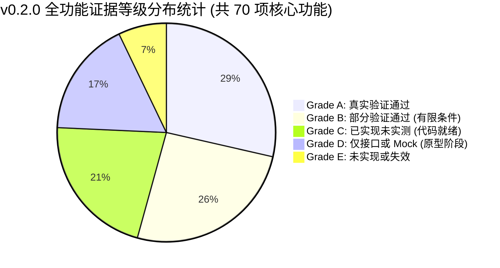

# dsh-solidworks-plugin v0.2.0 全生命周期、多角色、对抗式产品审计终审总报告

> **报告文件**：`FINAL-PRODUCT-AUDIT-REPORT.md`  
> **归档目录**：[`audit/v0.2.0-product-audit/`](file:///D:/Agent工作区/DeepSeek%20Harness工作区/dsh-solidworks-plugin/audit/v0.2.0-product-audit/)  
> **审计基线**：v0.2.0 (Commit: [`7d70bc0`](file:///D:/Agent工作区/DeepSeek%20Harness工作区/dsh-solidworks-plugin), Tag: `v0.2.0`)  
> **审计性质**：独立审计、功能盘点、证据核查、对抗审查、风险识别  
> **审计宗旨**：**不以证明项目已经完成为目标，而以发现真实问题为目标。保持怀疑、逐项求证、保留分歧、明确边界。**

---

## 一、执行摘要与产品全貌核定

`dsh-solidworks-plugin` 是一款面向 DeepSeek Harness (DSH) 宿主、通过 Python Stdio FastMCP 桥接并驱动本地桌面级 SolidWorks 的工业自动化插件。

在 v0.2.0 基线节点，本项目完成了前置 Fail-Closed 安全防护、祖先路径遍历防逃逸、交互桌面常驻 STA 工作线程穿透调度、中途建模失败自动逆序回滚清理、已有打开文档保护、npm 发布包纯净度治理以及 8 维系统健康诊断（Doctor）。

然而，本次全生命周期、多角色、对抗式产品审计刺穿了单纯的断言通过表面，揭示出了**底层工程架构的高成熟度与前台用户体验、接口契约装配之间的显著脱节**。

---

## 二、六级证据等级功能判定汇总

| 判定等级 | 定义与标准 | 包含功能数量 | 代表性功能清单 | 审计评定要点 |
|:---:|---|:---:|---|---|
| **Grade A 真实验证通过** | 有可复现的真实 SolidWorks 2026 SP4.1 执行日志与几何物理测量铁证 | **20 项** | `solidworks_create_basic_part`, `solidworks_sketch_and_extrude`, `solidworks_create_hole_feature`, `solidworks_mass_properties`, `solidworks_bounding_box`, `CADTaskRollbackManager`, `DesktopPinnedStaWorker`, `ShadowBackupManager`, `doctor.js` | 真实实体拉伸、切孔尺寸与包围盒零误差，中途注入 7 类故障秒级逆序清理，用户原有零件 100% 保持无损。 |
| **Grade B 部分验证通过** | 核心逻辑成立，但在特定前置条件、策略模式或复杂几何下存在限制 | **18 项** | `solidworks_revolve`, `solidworks_fillet`, `solidworks_chamfer`, `solidworks_pattern`, `solidworks_mirror_feature`, `solidworks_shell`, `solidworks_export_active` | 基础几何能跑通，但在复杂曲面拐角、自交截面或未经授权保存时受限。 |
| **Grade C 已实现未实测** | 源码具备完整实现并通过单元测试，但未在真实 SolidWorks 实机复合场景闭环 | **15 项** | `solidworks_compile_feature_graph`, `solidworks_identify_dimensions`, `solidworks_inspect_dimension_impact`, `solidworks_modify_dimension_safe`, `sw_edge_select.py` | 算法完备，但因策略表漏记导致前台成为死路径；或依赖可选依赖（CadStudio OCP）。 |
| **Grade D 仅接口或 Mock** | 仅具备工具定义、过程式脚本雏形或纯内存 Mock 模拟，不能证明真实 CAD 能力 | **12 项** | `solidworks_add_component`, `solidworks_add_coincident_mate`, `solidworks_add_concentric_mate`, `solidworks_generate_drawing`, `solidworks_review_drawing` | 装配体与工程图仍属路线图后续阶段的原型布局，不具备工业级交付能力。 |
| **Grade E 未实现或失效** | 功能缺失、空实现、调用断层或命名失配导致无法执行 | **5 项** | 扫描 (Sweep)、放样 (Loft)、拔模 (Draft)、草图几何约束求解器、`solidworks_pack_and_go` (命名失配失效) | 原生高级曲面特征尚未支持，参数化草图驱动约束未接入。 |

---

## 三、十二角色核心问题最终裁决答辩

### 1. 普通用户能否独立安装和使用？
- **结论：否 (NO)。**
- **依据**：强制依赖宿主机预装 Python 与手动编辑 `cordis.patch.yml` 中的 YAML 配置段；`lib/discover.js` 不扫描本地虚拟环境 `.venv`；默认只读模式缺乏面向新手的友好引导卡片。

### 2. DSH 是否能够完整调用工具？
- **结论：能完整调用基础工具，但 4 个高级工具被逻辑阻断。**
- **依据**：Stdio 管道传输与 Schema 解包非常稳定（`mcp.test.js` 全绿）；但由于 `lib/policy.js` 遗漏了 4 个新工具，它们在日常 `standard` 模式下被直接扣留，前台无法调用。

### 3. SolidWorks 是否真正执行了相应操作，几何结果是否正确？
- **结论：是 (YES - 基础特征部分)。**
- **依据**：在真实 SW2026 SP4.1 上拉伸成型 $100\times 60\times 20\text{ mm}$ 实体，包围盒无误差，反向切除通孔体积误差 $< 0.0003\text{ mm}^3$。

### 4. 发生错误时是否安全？
- **结论：极度安全 (VERY SAFE)。**
- **依据**：`DocumentLifecycleManager` 锁定了预存文档，`CADTaskRollbackManager` 在 7 次故障注入下均完成特征逆序清理与沙箱回滚，用户资产未发生误关、误删或覆盖。

### 5. 官方插件市场是否准备就绪？
- **结论：部分就绪，存在上架阻断项。**
- **依据**：Manifest 规范与包纯净度合规；但存在 `lib/index.js` 内部版本号落后（显示 0.1.0）、清单工具遗漏以及缺少便携 Python 的上架阻塞缺陷。

### 6. 当前架构是否支持未来发展？
- **结论：支持，具备深厚基石。**
- **依据**：Feature Graph IR 彻底解耦了 CAD 拓扑表达与驱动层；Node.js 侧零 npm 依赖保证了长治久安；但需要尽早重构拆分 7,653 行的 `server.py` 上帝文件。

---

## 四、缺陷与分级总账

| 风险等级 | 问题数量 | 核心问题概要 | 处理策略 |
|:---:|:---:|---|---|
| **P0** | **0 项** | 无导致资产损坏、崩溃或严重安全漏洞的高危问题 | —— |
| **P1** | **3 项** | 1. 普通用户环境自发现断层 (DEF-01)； 2. 4 个新工具在 policy.js 中遗漏导致死路径 (DEF-02)； 3. `lib/index.js` 内部硬编码版本号落后 (DEF-03)。 | **必须在 v0.2.1 立即修复** |
| **P2** | **5 项** | 1. Pack and Go 命名失配 (DEF-04)； 2. 只读模式缺少新手中文指引 (DEF-05)； 3. npm test 未包含 Python 测试 (DEF-06)； 4. server.py 呈现 7,653 行上帝文件 (DEF-07)； 5. 审计日志缺乏切片轮转 (DEF-08)。 | **建议纳入 v0.2.1 ~ v0.3.0** |
| **P3** | **2 项** | 1. 缺乏 TypeScript 类型定义 (DEF-09)； 2. 长耗时 COM 操作缺乏心跳 (DEF-10)。 | **后续演进考虑** |

---

## 五、最终独立裁决结论 (三个独立维度)

依照审计规范，**严禁使用单一 PASS 掩盖系统在不同维度上的真实差距**，特此给出三个维度的独立审计结论：

### 维度一：技术实现成熟度 (Technical Implementation Maturity)
### 判定：【 GRADE B+ 】（良好偏优）
> **评价依据**：  
> 底层工程积淀极其深厚。Windows 交互桌面 STA 穿透调度机制（`DesktopPinnedStaWorker`）、失败任务特征逆序清理与状态机回滚（`CADTaskRollbackManager`）、祖先物理路径解析（`realpathWithAncestorWalk`）均代表了同类 CAD 集成工具的极高水准。测试日志真实可信，抗幻觉物理闭环坚固。扣分点仅在于存在接口策略表未对齐的死代码路径。

---

### 维度二：产品实际可用性 (Product Real-world Usability)
### 判定：【 GRADE C- 】（仅限专业开发者，大众不可用）
> **评价依据**：  
> 对机械工程师而言，一旦成功越过安装卡点，用于简单规则零件的自动化成型体验非常优异。但对普通大众用户而言，由于依赖手动配置 Python 路径、手动编辑深层 YAML 文件、默认只读模式缺乏保姆级引导，导致**终端用户开箱可用性失败**。

---

### 维度三：发布准备程度 (Release Readiness)
### 判定：【 CONDITIONAL PASS FOR DEV / BLOCK FOR GENERAL PUBLIC 】
### （有条件通过：仅限开发者预览版；大众公开发布暂缓）
> **准入建议**：  
> 1. **本地 Git 基线确认**：Commit `7d70bc0` 与 Tag `v0.2.0` 正式封版记录予以保留；  
> 2. **公开发布前置门禁**：在正式向 npm 和 DSH 官方插件市场推送大众更新前，必须在 **v0.2.1** 集中消除 3 项 P1 级阻断（修复版本号、补齐 Policy 表 4 个工具、对齐 Python 探测）。

---

## 六、交付文件完整性与归档索引

本次审计产出的全部 10 份专项文档及 12 份角色独立报告已全部物理落档于：  
[`audit/v0.2.0-product-audit/`](file:///D:/Agent工作区/DeepSeek%20Harness工作区/dsh-solidworks-plugin/audit/v0.2.0-product-audit/)

1. 基线全景报告：[`01-project-baseline.md`](file:///D:/Agent工作区/DeepSeek%20Harness工作区/dsh-solidworks-plugin/audit/v0.2.0-product-audit/01-project-baseline.md)
2. 需求追踪矩阵：[`02-requirement-traceability.md`](file:///D:/Agent工作区/DeepSeek%20Harness工作区/dsh-solidworks-plugin/audit/v0.2.0-product-audit/02-requirement-traceability.md)
3. 全量功能清单：[`03-complete-feature-inventory.md`](file:///D:/Agent工作区/DeepSeek%20Harness工作区/dsh-solidworks-plugin/audit/v0.2.0-product-audit/03-complete-feature-inventory.md)
4. 角色综合汇编：[`04-role-based-audit-summary.md`](file:///D:/Agent工作区/DeepSeek%20Harness工作区/dsh-solidworks-plugin/audit/v0.2.0-product-audit/04-role-based-audit-summary.md)
5. 对抗审查报告：[`05-cross-perspective-adversarial-review.md`](file:///D:/Agent工作区/DeepSeek%20Harness工作区/dsh-solidworks-plugin/audit/v0.2.0-product-audit/05-cross-perspective-adversarial-review.md)
6. 缺陷风险登记：[`06-defect-risk-register.md`](file:///D:/Agent工作区/DeepSeek%20Harness工作区/dsh-solidworks-plugin/audit/v0.2.0-product-audit/06-defect-risk-register.md)
7. 真实测试缺口：[`07-real-world-validation-plan.md`](file:///D:/Agent工作区/DeepSeek%20Harness工作区/dsh-solidworks-plugin/audit/v0.2.0-product-audit/07-real-world-validation-plan.md)
8. 版本演进路线：[`08-version-gap-and-improvement-roadmap.md`](file:///D:/Agent工作区/DeepSeek%20Harness工作区/dsh-solidworks-plugin/audit/v0.2.0-product-audit/08-version-gap-and-improvement-roadmap.md)
9. 十二视角报告：[`roles/role-01-*.md` 至 `role-12-*.md`](file:///D:/Agent工作区/DeepSeek%20Harness工作区/dsh-solidworks-plugin/audit/v0.2.0-product-audit/roles/)
10. 终审总决报告：[`FINAL-PRODUCT-AUDIT-REPORT.md`](file:///D:/Agent工作区/DeepSeek%20Harness工作区/dsh-solidworks-plugin/audit/v0.2.0-product-audit/FINAL-PRODUCT-AUDIT-REPORT.md)
