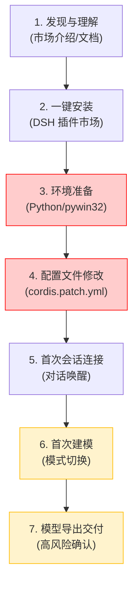

# 角色审计报告 01：客户与大众用户视角

> **审计视角**：普通 CAD 爱好者、机械设计初学者、非技术背景的 DSH 终端用户  
> **审查基准**：v0.2.0 (Commit: `7d70bc0`)  
> **核心命题**：**一个不懂 Python、COM、MCP 与环境变量的普通 SolidWorks 用户，能否独立完成安装、首次连接、首次建模与成果交付？**

---

## 一、用户全生命周期旅程实测与体验走查

### 1.1 产品发现与认知门槛
- **现状**：市场宣传材料称“通过自然语言驱动本地 SolidWorks 桌面，支持 66 个 CAD 工具，开箱即用”。
- **痛点**：普通用户误以为这是一款“安装即用”的独立插件，预期类似 Office 插件一键点击即可运行。事实上它依赖外部 Python 运行时与已运行的本地 SolidWorks 桌面。

### 1.2 安装与配置复杂度（致命卡点）
- **致命断层 1：手动编辑 YAML 配置文件**
  - 根据 [`docs/USER_GUIDE.md`](file:///D:/Agent工作区/DeepSeek%20Harness工作区/dsh-solidworks-plugin/docs/USER_GUIDE.md) 指引，用户必须手动定位并打开 `C:\Users\<username>\.dsh\profiles\desktop\cordis.patch.yml`；
  - 用户必须在 YAML 文件末尾准确缩进填入 `pythonPath: 'C:\\Python312\\python.exe'` 与 `allowedRoots: ['D:\\CAD_Projects']`；
  - **现实**：普通机械工程师对 YAML 缩进格式极其陌生，极易因 Tab/空格混用导致 DSH 宿主解析报错瘫痪。
- **致命断层 2：Python 运行时自发现失败**
  - 如果用户将 Python 安装在非系统盘（例如 `D:\SWCAD-MCP\Python313\python.exe`）且未配置系统 PATH；
  - `scripts/doctor.js` 虽然能通过 `.venv` 查找到，但 DSH 核心运行时调用的 [`lib/discover.js`](file:///D:/Agent工作区/DeepSeek%20Harness工作区/dsh-solidworks-plugin/lib/discover.js) **根本不扫描 `.venv`**，直接抛出 `discover failed: PYTHON_NOT_FOUND`！用户在没有专业指导下必然在此步流失。

### 1.3 首次建模体验与策略阻断
- **模式陷阱**：
  - 默认配置为 `mode: "read-only"`。
  - 用户安装完成后，兴奋地输入：“帮我画一个 100x50x20 的法兰盘”。
  - AI 尝试调用 `solidworks_create_basic_part`，立即被策略门禁拦截，返回：
    `{ "status": "refused", "code": "POLICY_MODE", "message": "solidworks_create_basic_part is disabled by policy (mode=read-only)" }`
  - 用户无法理解为什么“明明装了建模插件却不能建模”，大部分普通用户会误以为插件损坏并直接卸载。

### 1.4 操作反馈与错误可读性
- 当 SolidWorks 未启动时，调用工具会返回详细的英文 COM 错误日志或 `ROT (Running Object Table)` 查找超时；
- 当参数超出几何极限时，返回的是 COM 内部 HRESULT 代码或 Python 堆栈追踪，缺乏人类易读的“参数过大导致特征自交，请调整尺寸”等业务友好提示。

### 1.5 资产安全感与交付闭环
- **优秀体验**：`v0.2.0` 的中途故障自动回滚与用户已有文档保护机制表现极佳。当建模失败时，AI 会默默清理半成品特征，绝不会在屏幕上留下满屏的“草图1、草图2、拉伸失败”。已有打开的模型不会被强退，这一点给用户极大的安全感。
- **交付阻碍**：当用户最终需要导出 STEP 或保存文档时，必须经过 `solidworks_confirm` 单次授权。如果 AI 未能主动告知用户需要确认或参数不匹配，流程会在此卡死。

---

## 二、角色核心问题独立裁决

> **核心问题：一个普通 SolidWorks 用户能否独立完成安装、连接、首次建模和文件交付？**

### 裁决结论：**否定 (NO) —— 目前无法独立完成**

### 关键证据与依据：
1. **安装断层**：依赖宿主机预先安装 Python 3.10-3.13 且手动 pip 安装 `pywin32` 和 `mcp`，缺少一键式绿色运行时（Embedded Portable Python）；
2. **配置断层**：强制要求用户手动编辑底层 YAML 配置文件，缺乏图形化设置界面或交互式引导向导；
3. **策略断层**：默认只读模式缺乏面向新手的友好引导，AI 缺乏“检测到您在只读模式，请先在配置中开启 standard 模式”的保姆级反馈；
4. **诊断断层**：`doctor.js` 虽好，但仅限在命令行输入 `npm run doctor`，而普通 Windows 用户往往连 Node.js 终端都不会打开。

---

## 三、大众用户视角的整改建议清单 (P1)

1. **提供一键离线安装包**：打包内嵌精简版 Python 3.13 便携环境，彻底免除终端用户的 Python 安装与环境配置负担；
2. **图形化/交互式配置向导**：首次在 DSH 中启用时，通过聊天卡片提供一键切换 `read-only` / `standard` 模式的快捷按钮；
3. **错误反馈中文化与业务化**：将底层 COM 错误与策略阻断翻译为用户听得懂的中文操作建议。
