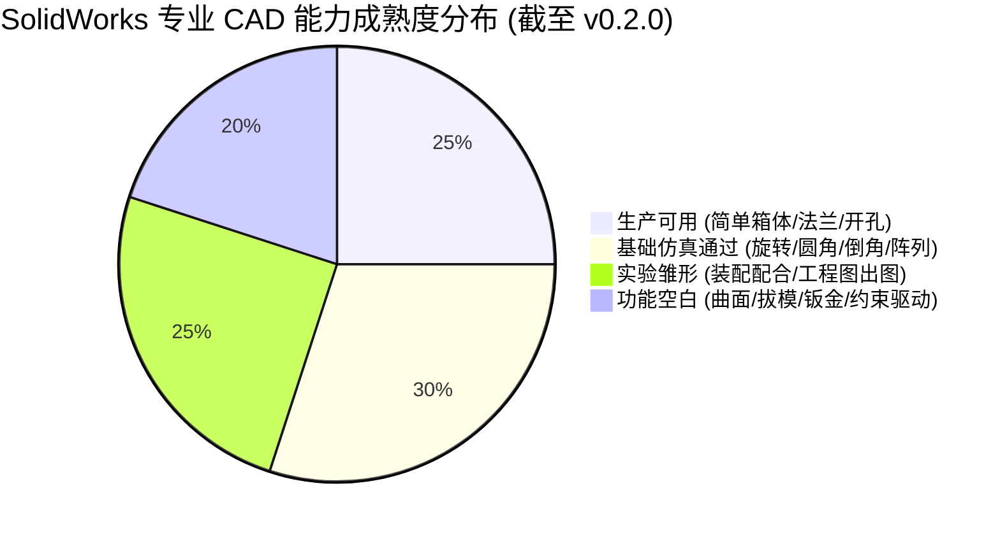

# 角色审计报告 02：SolidWorks 专业用户视角

> **审计视角**：机械设计资深工程师、SolidWorks CSWP/CSWE 认证专家、模具与机加工行业从业者  
> **审查基准**：v0.2.0 (Commit: `7d70bc0`)  
> **核心命题**：**软件宣称的 13 大特征建模、装配体与工程图能力，哪些具备真实专业生产力，哪些只是玩具级 Demo 或未完成骨架？**

---

## 一、SolidWorks 原生 CAD 能力全项刺穿审计

### 1.1 草图与几何约束系统 (Sketch & Constraints)
- **已实现**：
  - 支持在三大基准面（前视/上视/右视）及平表面上开启草图；
  - 支持矩形绘制（`sketch_rectangle`）与圆绘制（`sketch_circle`）；
  - 支持草图自动闭合与拉伸。
- **专业级缺陷**：
  - **严重缺乏几何约束求解器接入**：专业 CAD 的灵魂是“约束”（相切 Tangent、水平 Horizontal、竖直 Vertical、同心 Concentric、重合 Coincident 等）。当前代码完全依赖坐标绝对点绘制，**无法通过语义添加几何约束**；
  - **草图图元类型极少**：不支持多边形、椭圆、样条曲线（Spline）、倒角、偏移（Offset）、剪裁（Trim）；
  - **无尺寸驱动草图**：无法先画粗略草图再通过标注尺寸（Smart Dimension）驱动变形。

### 1.2 零件三维特征建模能力 (3D Features)

| 特征类型 | 对应底层代码 | 真实实测情况 | 专业级评价 |
|---|---|:---:|---|
| **拉伸凸台 (Boss Extrude)** | `sw_part.py: extrude_boss` | ✔ 真机验证 (100x60x20mm) | **成熟可用**：支持单向、两侧对称、拉伸到指定深度。 |
| **拉伸切除 (Cut Extrude)** | `sw_part.py: extrude_cut` | ✔ 真机验证 (Ø20mm 通孔) | **成熟可用**：支持反向贯穿切除与盲孔切除。 |
| **孔特征 (Hole)** | `sw_hole_features.py` | ✔ 真机验证 (通过孔/螺纹底孔) | **可用**：支持标准圆孔，但缺少 SolidWorks 原生异型孔向导 (Hole Wizard) 完整牙表。 |
| **旋转凸台/切除 (Revolve)** | `sw_part.py: revolve_boss` | 🟢 仅 Mock 单元测试 | **基本具备**：支持旋转轴指定与 360° 回转，但未在实机复杂截面上充分测试。 |
| **圆角 (Fillet)** | `sw_part.py: fillet` | 🟢 仅 Mock 单元测试 | **基础可用**：仅支持等半径边线圆角，不支持变半径圆角、面圆角和完全圆角。 |
| **倒角 (Chamfer)** | `sw_part.py: chamfer` | 🟢 仅 Mock 单元测试 | **基础可用**：支持角度-距离倒角，复杂拐角处理易拓扑失败。 |
| **阵列与镜像 (Pattern/Mirror)**| `sw_part.py: linear_pattern` | 🟢 仅 Mock 单元测试 | **有限支持**：支持线性单向/双向阵列，缺少沿曲线阵列和草图驱动阵列。 |
| **抽壳 (Shell)** | `sw_part.py: shell` | 🟢 仅 Mock 单元测试 | **初级可用**：支持均匀壁厚抽壳，复杂内凹几何易报几何自交错误。 |
| **扫描与放样 (Sweep/Loft)** | 未原生实现 (仅 OCP 实验) | ⚪ 空白 / 规划中 | **专业级缺失**：机械设计常见的弯管、螺旋线、放样过渡体无法原生构建。 |
| **拔模 (Draft)** | 规划中 | ⚪ 空白 | **模具级缺失**：注塑模与铸造件必备的拔模斜度完全缺失。 |

### 1.3 参数修改与特征树拓扑（巨大突破与当前局限）
- **突破性资产**：
  - v0.2.0 研发的 [`dimension_manager.py`](file:///D:/Agent工作区/DeepSeek%20Harness工作区/dsh-solidworks-plugin/vendor/solidworks-automation-skill/scripts/dimension_manager.py) 与 [`feature_graph_ir.py`](file:///D:/Agent工作区/DeepSeek%20Harness工作区/dsh-solidworks-plugin/vendor/solidworks-automation-skill/scripts/feature_graph_ir.py) 展现了极其正统的专业 CAD 架构思想；
  - 能够遍历 `IFeature` 树，识别驱动尺寸，并通过 `modify_dimensions_safe` 修改参数后触发 `EditRebuild3` 重建；
- **当前严重遗憾**：
  - **上层接口脱节**：这 4 个尺寸与拓扑工具在 `lib/policy.js` 中被遗漏，普通模式下被强制扣留，导致专业用户在实际 DSH 交互中无法直接享受该项突破。

### 1.4 装配体与工程图深度审查（工业交付视角）
- **装配体 (Assemblies)**：
  - `sw_assembly.py` 提供了插入组件与配合接口（重合、同心、平行、距离）；
  - **专业局限**：缺乏机构运动仿真、机构自由度分析、高级配合（宽度配合、凸轮配合、齿轮配合），无法支撑超过 5 个零件以上的工业级机构装配。
- **工程图 (Drawings)**：
  - `sw_drawing.py` 提供了基础的三视图投射与 PDF 输出；
  - **专业局限**：完全不具备工程图生产力。缺少形位公差（GD&T）、粗糙度符号、表面处理要求、技术要求文字块、装配体 BOM 明细表（零件序号与明细栏）以及符合国标 (GB/T) 的工程图模板与标题栏联动。

---

## 二、专业用户独立裁决与价值定性

> **核心结论：当前版本具备“简单规则几何零件（箱体、法兰盘、轴承座底板等）的自动化快速成型与参数化尺寸修改能力”，但距离“可直接用于工业制造交付的专业 CAD 自动化系统”仍有明显技术跨度。**

### 专业级等级评定：
- **简单零件建模**：**B+ (工业级初级可用)**
- **复杂曲面与模具**：**E (完全不满足)**
- **装配体协同**：**C (原理级雏形)**
- **工程图出图**：**D (仅具备格式导出，无法交付车间加工)**
