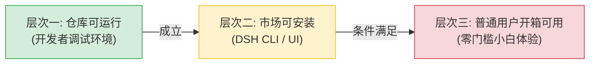

# 角色审计报告 03：DSH 官方插件市场审核者视角

> **审计视角**：DeepSeek Harness 官方插件生态与市场合规性审查委员会  
> **审查基准**：DSH 插件规范 (Manifest v0.15) 与平台准入标准  
> **核心命题**：**本插件是否符合官方市场发布标准？分别在“仓库可运行”、“市场可安装”、“普通用户可用”三个层次是否成立？**

---

## 一、官方市场准入规范逐项核验

| 审查维度 | 规范要求 | 实际代码核验结果 | 合规结论 |
|---|---|---|:---:|
| **Manifest 规范** | 符合 `manifestVersion: 0.15`，声明 ID 与 Facet | `dsh-plugin.json` 规范声明 `id: dsh-solidworks.solidworks`, `host: lib/index.js` | **✔ PASS** |
| **版本一致性** | `package.json`, `dsh-plugin.json` 与代码完全统一 | `package.json` (0.2.0), `dsh-plugin.json` (0.2.0), **但 `lib/index.js:33` 硬编码为 `0.1.0`** | **❌ FAIL (版本漂移)** |
| **npm 包纯净度** | 不包含敏感凭据、系统垃圾、临时字节码 | 部署根目录与 tests 专属 `.npmignore`，排除 `__pycache__` 与 `*.pyc`，包体积 740 kB | **✔ PASS** |
| **权限最小化声明** | 声明 `permissions` 且阐明必要理由 | 声明 `process.spawn`, `fs.read`, `fs.write`，理由阐述合理无过度越权 | **✔ PASS** |
| **开源许可证合规** | 明确开源协议，穿透第三方依赖许可证 | 声明 `AGPL-3.0-only`，携带 `LICENSE`, `NOTICE` (179 文件) 及 `PROVENANCE.md` | **✔ PASS** |
| **工具清单契约** | Manifest 声明工具与服务端暴露工具一致 | Manifest 声明 68 个工具，**遗漏 4 个 v0.2.0 新工具，且存在 1 处命名漂移** | **❌ FAIL (契约漂移)** |
| **生命周期钩子** | 支持完整优雅关闭，避免进程残留 | `lib/index.js` 正确注册 `ctx.effect` 清理 disposers 并关闭 McpClient 子进程 | **✔ PASS** |
| **多语言本地化** | 提供中英双语市场描述与图标资源 | 具备 `docs/assets/icon.png` 及 `docs/locale/en.json`, `docs/locale/zh.json` | **✔ PASS** |

---

## 二、市场三层次可用性独立评定

### 层次一：仓库本地可运行性 (Repository Runnability) —— 【✔ PASS 成立】
- **审查证据**：
  - 在配置好 Python 3.13 且依赖齐全的宿主环境中，`npm test`（59 项全绿）、`node scripts/doctor.js`（8 维全部 PASS）；
  - 核心桥接机制与 Stdio 通信链路经由 `tests/mcp.test.js` 证明高度稳固。

### 层次二：市场可安装性 (Marketplace Installability) —— 【🟡 CONDITIONAL 部分成立】
- **审查事实**：
  - 用户在 DSH 插件市场中执行 `dsh plugin add dsh-solidworks`，npm 包可以顺利解压至插件目录并被 Cordis 框架正确加载；
  - **安装后遗留问题**：DSH 插件规范无法自动为宿主机安装 Python 虚拟环境与 Windows 专有二进制包（`pywin32`）。安装后插件处于“半就绪”状态，必须依赖用户再次手动运行 `node scripts/setup.js`。

### 层次三：普通终端用户开箱可用性 (Consumer Usability) —— 【❌ FAIL 不成立】
- **审查事实**：
  - 普通用户安装后，由于缺少自动 Python 绑定，首次加载必然触发 `solidworks_status` 报告 `PYTHON_NOT_FOUND`；
  - 用户必须在外部自行安装 Python、手动编辑 YAML 配置文件并切换到 `standard` 模式才能建模；
  - **市场审核结论**：**若直接面向大众用户开放，将产生大量“无法启动”、“无法建模”的 1 星差评与负面反馈。**

---

## 三、市场审核委员会最终裁决

### 裁决状态：**REJECTED FOR GENERAL PUBLIC / APPROVED AS DEVELOPER PREVIEW (有条件准入：仅限开发者预览版)**

### 必须整改的上架阻断项 (Marketplace Release Blockers)：
1. **修复 `lib/index.js:33` 版本号**：强制与 `package.json` 保持严格一致（更新为 `0.2.0`）；
2. **对齐 Manifest 与 Policy 工具表**：将 4 个新工具补充进 `dsh-plugin.json` 与 `lib/policy.js`，修复 `solidworks_pack_and_go` 命名；
3. **前置依赖友好拦截**：当检测到缺少 Python 依赖时，提供清晰的一键修复指引卡片，而非直接抛出冰冷的报错堆栈。
