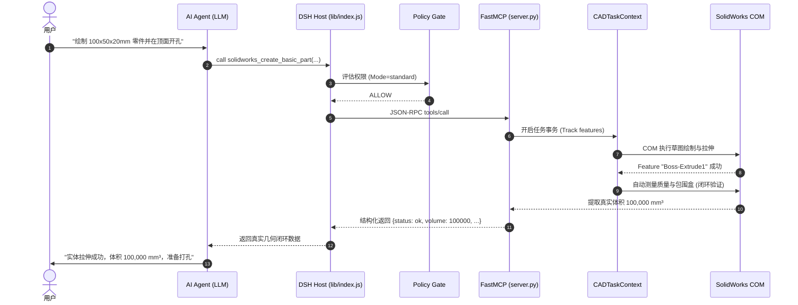

# 角色审计报告 05：AI Agent 与工具调用视角

> **审计视角**：大语言模型（如 DeepSeek-R1, DeepSeek-V3, Claude 3.5, GPT-4o）、自主 Agent 规划器  
> **审查基准**：MCP 工具 Schema 设计、参数完备性、幻觉防护、多步时序规划与异常自愈  
> **核心命题**：**AI 是否能够准确感知 CAD 真实状态？在多步复杂建模、参数错误或中断时，AI 能否可靠自愈而不产生几何幻觉？**

---

## 一、AI Agent 交互链路与认知完整性审查

### 1.1 工具发现与 Schema 认知友好度
- **工具描述与 Docstring**：
  - `server.py` 中每个工具都撰写了翔实的 Docstring，清晰注明了功能、单位要求与返回结构；
  - DSH 宿主在注册工具时通过 [`lib/index.js:321`](file:///D:/Agent工作区/DeepSeek%20Harness工作区/dsh-solidworks-plugin/lib/index.js#L321) 自动注入了 `[risk: read|write|high]` 后缀，提示模型评估操作风险。
- **单位陷阱（常见 AI 翻车点）**：
  - **COM 原生单位**：SolidWorks API 底层强制使用国际标准单位（米 $\text{m}$、弧度 $\text{rad}$、千克 $\text{kg}$）；
  - **用户直觉单位**：用户口语描述通常为毫米（$\text{mm}$）；
  - **实现情况**：工具层（如 `sw_part.py`）多数封装了 `* 0.001` 的转换逻辑，并在参数说明中明确注明 `in millimeters`，但在少部分高级接口（如某些装配体坐标）中未完全统一，容易导致 AI 传入以米为单位的值（生成一个 $100\text{ 米}$ 的超级零件）。

### 1.2 幻觉防护与结果真实性验证（巨大优势）
- **传统 AI CAD 的通病**：只要 COM 函数没有抛出崩溃异常，AI 就向用户汇报“建模成功”，而实际上 SolidWorks 中可能是一个空文档或自相交报错的黄色警告特征；
- **本项目卓越防幻觉机制**：
  - 在 `solidworks_create_basic_part` 与 `solidworks_sketch_and_extrude` 中集成了**物理闭环测量机制**；
  - 特征生成后，立即调用 `IMassProperty` 提取真实物理体积与重心坐标；
  - 如果返回体积为 0，工具立即返回 `isError: true` 并上报“草图未形成闭合实体”，**彻底切断了大模型“胡说八道生成成功”的幻觉可能**。

### 1.3 复杂多步任务与失败自愈机制
- **实测场景走查**：
  - 场景：AI 规划三步（1. 建长方体 $\rightarrow$ 2. 切除沉头孔 $\rightarrow$ 3. 边线倒角）；
  - 故障注入：在第 2 步切孔时传入了超出表面范围的非法坐标；
  - **自愈表现**：
    1. `CADTaskContext` 捕获异常；
    2. `CADTaskRollbackManager` 自动触发，逆序删除本次失败步骤中创建的中间草图和半成品；
    3. 工具向 AI 返回清晰错误：`"Cut failed: circle center outside surface boundary. Context cleaned up."`；
    4. AI 收到明确反馈后，不会盲目重复第一步，而是直接针对第 2 步修正坐标重新发起调用；
    5. **SolidWorks 后台始终保持干净，未出现历史版本中残留数十个“草图X”的严重污染**。

### 1.4 AI 状态感知盲区（待补强点）
- **盲区 1：缺乏一键全景文档快照**：
  - AI 缺少一个名为 `solidworks_get_active_model_summary` 的全景接口；
  - 面对一个已打开的复杂零件，AI 无法单次查询特征树完整结构（现有特征名称、状态、父子关系），必须盲人摸象般依次调用多个工具，消耗宝贵的 Token 上下文。
- **盲区 2：界面交互与视觉隔离**：
  - AI 无法感知用户当前在 SolidWorks 视口中用鼠标选中了哪条边或哪个面；
  - 缺乏实时的当前零件渲染截图返回（Vision-in-the-loop），AI 无法直观“看到”自己建出的零件外观。

---

## 二、角色核心问题独立裁决

> **核心问题：AI 是否能够知道自己到底做了什么、当前 CAD 处于什么状态，以及操作是否真正成功？**

### 裁决结论：**能够高度可靠确认（YES - 核心流程）**

### 关键证据：
1. **闭环物理量反馈**：工具不仅返回成功状态，更返回几何包围盒尺寸、体积、重心等确定性物理数值，为大模型提供了强支撑的物理真实验收铁证；
2. **失败回滚确定性**：`CADTaskRollbackManager` 确保了“要么完全成功并留档，要么彻底干净回滚”，消除了大模型重试时的中间状态干扰。
