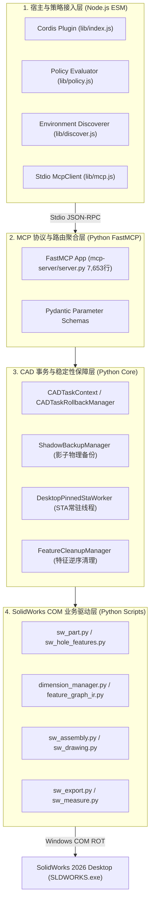

# 角色审计报告 06：架构师与代码质量审查者视角

> **审计视角**：分布式系统架构师、代码静态分析专家、高可靠性软件技术专家  
> **审查基准**：软件分层架构、单一职责、状态机完备性、防御性编程与死代码识别  
> **核心命题**：**系统分层边界是否清晰？是否存在无法到达的死路径（Unreachable Code）？资源生命周期与全局状态管理是否可控？**

---

## 一、系统全貌分层架构与边界审查

### 1.1 架构分层优秀实践
1. **策略前置隔离 (Shift-Left Security)**：
   - 将所有路径安全性检查（物理真实路径解析、Junction 祖先折叠、保留设备名阻断）与权限门禁统一定位在 Node.js 宿主层；
   - 任何非法参数或无授权调用在触碰 Python 子进程与 SolidWorks COM 之前被拦截，避免了底层 COM 资源的无效开销与竞态攻击。
2. **Windows 交互桌面 STA 单例穿透 (STA Pinning)**：
   - 创新的 [`DesktopPinnedStaWorker`](file:///D:/Agent工作区/DeepSeek%20Harness工作区/dsh-solidworks-plugin/vendor/solidworks-automation-skill/scripts/sw_connect.py) 架构，彻底解决了 Windows 交互桌面服务（ROT Session 0/1 穿透）与 STA 消息泵跨线程调度冲突，是本项目极其出彩的底层工程突破。

---

## 二、架构缺陷与死路径审查 (Dead Code / Unreachable Paths)

### 2.1 【严重架构断层】4 大高级工具形成“逻辑死路径”
- **现象**：
  在 `server.py` 中实现了 4 个先进的尺寸与图编译器工具：
  1. `solidworks_compile_feature_graph`
  2. `solidworks_identify_dimensions`
  3. `solidworks_inspect_dimension_impact`
  4. `solidworks_modify_dimension_safe`
- **断层机理**：
  - `lib/policy.js` 中的 `RISK_TABLE` 固化为 66 项，未将这 4 个工具收录；
  - Node.js 宿主在初始化时，遍历工具并调用 `policy.registerable(tool.name)`；
  - 由于未收录，`classify(name)` 降级走默认逻辑判定为 `HIGH` 风险；
  - 在默认的 `read-only` 模式或日常建模的 `standard` 模式下，`registerable()` 直接返回 `false`；
  - **结果**：**这 4 个耗费大量精力研发的先锋工具在 DSH 宿主中根本不会被发布！对用户和 AI 而言，调用路径在逻辑上被完全阻断。**

### 2.2 【命名失配导致死路径】`solidworks_pack_and_go`
- `dsh-plugin.json` 声明：`solidworks_pack_and_go`
- `lib/policy.js` 声明：`solidworks_pack_and_go`
- `server.py:6571` 注册：`@mcp.tool() def solidworks_pack_and_go_tool(...)`
- **结果**：服务端暴露的名称带有 `_tool` 后缀，而前台注册和策略表未带后缀，导致前台请求无法命中服务端映射，形成接口死链接。

### 2.3 隐藏全局状态与单任务假设
- **全局状态 1：`CADTaskContext._current_context`**
  - 当前实现假设一次只有一个 Agent 任务在运行；
  - 如果未来 DSH 引入多 Agent 协作（如一个 Agent 负责查图，一个 Agent 负责建模），静态全局上下文将被交叉污染，导致特征清理误伤另一任务的产物。
- **全局状态 2：单例常驻线程缺少看门狗**
  - `DesktopPinnedStaWorker` 内部通过队列循环调度任务；
  - 如果底层 SolidWorks 发生极其罕见的内核死锁导致 COM 函数无限阻塞，工作线程卡死后缺乏外部超时强制回收与看门狗重启机制。

---

## 三、架构师最终审计结论

### 评级：**B (良好基础设施，但存在接口集成装配失误)**

- **优点**：分层清晰、策略前置、STA 调度稳定、事务逆序清理理念极其先进；
- **核心扣分项**：存在由于前后端清单未同步而导致的**逻辑死路径**，上帝文件 `server.py` 缺乏模块化重构。
