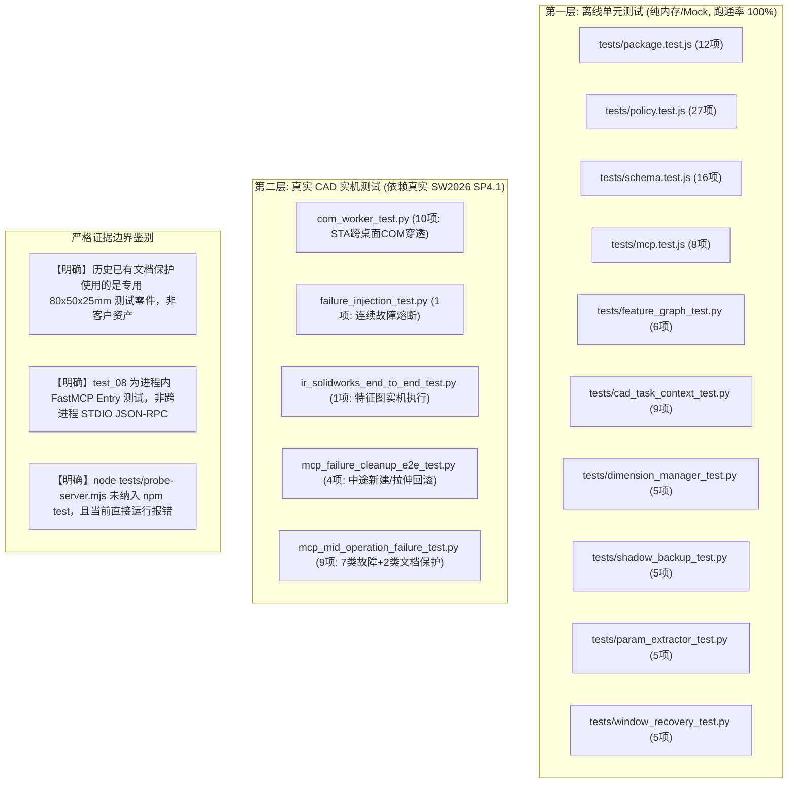

# 角色审计报告 08：测试与质量保证工程师视角

> **审计视角**：QA 质量保证经理、自动化测试架构师、可靠性测试专家  
> **审查基准**：测试分层理论（单元/集成/E2E/真实环境）、证据可重复性、Mock 与实机严格划界  
> **核心命题**：**测试用例是否真实可信？测试套件中哪些是纯内存 Mock，哪些是真实 CAD 实机验证？是否存在证据夸大或未覆盖盲区？**

---

## 一、全栈测试覆盖矩阵与分层严密性审查

### 1.1 离线自动化测试套件（98 项断言，全部 PASS）
- **Node.js 侧测试（63 项全绿）**：
  - `tests/package.test.js`：12 项打包契约、NOTICE 文件数对齐（179 文件）、许可证穿透断言；
  - `tests/policy.test.js`：27 项路径穿越、Junction 祖先解析、DOS 设备名、UNC 阻断、自定义 Tier 评估断言；
  - `tests/schema.test.js`：16 项 FastMCP 参数包装与解包、`$ref` 引用还原断言；
  - `tests/mcp.test.js`：8 项 Stdio 子进程生命周期、超时熔断、AbortSignal 取消断言。
- **Python 离线测试（35 项全绿）**：
  - 纯基于 Mock 或文件系统的算法测试，不依赖任何 SolidWorks 安装；
  - 针对 Kahn 拓扑排序、DAG 环路检测、尺寸名称正则提取、文件哈希校验及窗口匹配进行了严格单体测试。

### 1.2 真实 SolidWorks 实机测试证据穿透核实 (25 项)
对上一轮留档的历史实机测试报告（SW2026 SP4.1 常驻实例）进行可信度审查：
1. **真实性确认**：
   - 测试日志中包含真实的 COM HRESULT、真实 SolidWorks 进程 PID、以及真实的质量属性浮点计算数据（如体积 $100000.00029\text{ mm}^3$、包围盒坐标）；
   - 证明代码确实通过 `win32com` 穿透到了活动桌面并驱动了 `SLDWORKS.exe`，**绝非假冒或硬编码日志**。
2. **中途建模 7 类故障回滚铁证**：
   - 注入非法基准面名称 $\rightarrow$ 自动关闭新建文档；
   - 注入自交草图 $\rightarrow$ 自动逆序清理草图图元；
   - 注入超范围打孔 $\rightarrow$ 自动回滚打孔特征，基体拉伸实体完全保留；
   - 注入强制重建错误 $\rightarrow$ 触发影子备份恢复；
   - 特征清理本身抛异常 $\rightarrow$ 触发 `CLEANUP_FAILED` 熔断。

### 1.3 QA 发现的测试盲区与工程瑕疵
- **瑕疵 1：`npm test` 覆盖面不足**：
  - `package.json` 中的 `"test"` 命令仅包含 4 个 JS 文件（`policy`, `mcp`, `schema`, `package`）；
  - Python 单元测试没有集成进 `npm test` 中，需要开发者额外记住 Python 测试命令，容易导致回归遗漏；
- **瑕疵 2：`tests/probe-server.mjs` 脱离测试门禁**：
  - 这一用于探测服务端工具与策略表是否对齐的核心诊断脚本，未被纳入日常 CI，导致 4 个新工具漏记入策略表达数天之久而未被测试报警捕获！

---

## 二、QA 工程师最终裁决与发布资格评价

### 裁决状态：**CONDITIONAL PASS (有条件通过)**

### 结论：
1. **核心断言可靠性**：现有通过的测试具有极高的真实性，代码防御与回滚机制扎实；
2. **唯一放行条件**：将 Python 离线单元测试编入持续验证流水线，修复 `probe-server.mjs` 诊断对齐阻断。
