# 角色审计报告 10：性能工程师视角

> **审计视角**：高性能计算工程师、Windows 系统性能分析专家、CAD 吞吐量与延迟分析师  
> **审查基准**：调用链路耗时分析、COM 单线程瓶颈、内存与句柄生命周期、高并发与大型模型负载  
> **核心原则**：**有实测数据列出数据；无实测数据严格标记“未测 (UNTESTED)”，绝不主观猜测。**

---

## 一、端到端延迟基准数据测算 (实测数据)

```mermaid
gantt
    title 单步 CAD 建模典型耗时链路分布 (总耗时 ~650ms, 已运行 SW 状态)
    dateFormat X
    axisFormat %s ms
    
    section 链路耗时
    DSH 策略前置评估 (Policy) :0, 5
    Stdio 进程间管道传输 :5, 20
    FastMCP 解包与路由 :20, 35
    STA 线程队列调度 :35, 45
    SolidWorks COM 特征拉伸 :45, 450
    物理质量与包围盒闭环测量 :450, 620
    返回结果渲染与审计记录 :620, 650
```

### 1.1 实测延迟分段基准
基于历史实测数据与单元测试计时：
- **Node.js 宿主策略层**：
  - 路径解析、Junction 祖先向上折叠与 SHA-256 计算：**$< 5\text{ ms}$**；
  - 参数解包与 FastMCP 包装（`lib/schema.js`）：**$< 1.5\text{ ms}$**。
- **IPC 进程间通信与协议层**：
  - Windows Stdio 管道双向 JSON-RPC 往返：**$10 \sim 15\text{ ms}$**。
- **CAD 实体生成与 COM 层（性能主要消耗点）**：
  - **热启动状态（SolidWorks 待机）**：
    - 创建零件与矩形草图并拉伸成型：**$350 \sim 500\text{ ms}$**；
    - 质量属性与包围盒计算（`IMassProperty`）：**$150 \sim 250\text{ ms}$**；
  - **冷启动状态（首次拉起 SolidWorks 桌面）**：
    - `SLDWORKS.exe` 进程拉起、加载核心 Add-in 与模板初始化：**$8,000 \sim 15,000\text{ ms}$**。

---

## 二、架构性能瓶颈深度剖析

### 2.1 SolidWorks 单线程 STA 的物理极限
- **机理限制**：
  - SolidWorks 是架构于 1990 年代的单线程 COM 桌面应用（UI 与几何计算共享同一主线程）；
  - 本项目通过 `DesktopPinnedStaWorker` 保证所有 CAD 请求在同一个常驻 STA 线程内按队列**绝对串行化**执行；
- **吞吐量天花板**：
  - 彻底消除了跨线程死锁与重入，但决定了插件**天然不支持并发请求加速**；
  - 即使宿主机配备 64 核 CPU，CAD 建模吞吐量也严格受限于 SolidWorks 主线程单核性能。

### 2.2 内存泄漏与句柄回收
- **COM 引用释放**：
  - Python 的 `comtypes` 与 `win32com` 在对象销毁时会自动调用 `Release()`；
  - 在 `CADTaskRollbackManager` 中显式包含了文档关闭与对象置空逻辑；
- **实测表现**：在连续 10 次故障注入与重试循环中，Python 进程内存稳定在约 $85\text{ MB} \sim 110\text{ MB}$，未观察到急剧爬升。

---

## 三、性能未测事项清单 (严格登记)

根据“无实测数据不得猜测”的严苛纪律，以下场景明确标记为**未测**：

1. **超大型装配体（500+ 零件）性能表现**：**【未测】**
   - 现有测试仅覆盖 1~2 个零件的装配雏形，未在 500 零件以上的工业级设备装配体中进行配合解算与干涉碰撞耗时压测；
2. **24 小时长时间高频调用稳定性**：**【未测】**
   - 现有最长测试为 10 次连续建模与回滚，未开展 1,000 次以上连续 24 小时高压耐久性测试；
3. **超大网格复杂 STL 导出耗时**：**【未测】**
   - 仅对规则棱柱体进行了 STEP/STL 导出测试，未对上百万三角面片的复杂曲面进行网格化导出测速。

---

## 四、性能工程师最终裁决

### 裁决状态：**B (符合预期，轻量高效，存在物理单线程天花板)**
单步日常建模响应极快（秒级返回），架构无多余开销；大型装配体处理能力有待后续版本专项基准测试。
