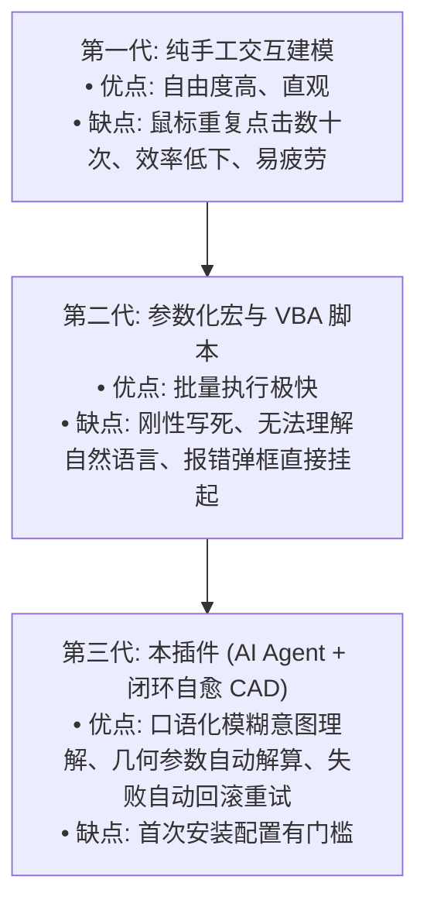

# 角色审计报告 11：产品与竞争分析者视角

> **审计视角**：AI 工业软件产品经理、CAD 行业竞品分析专家、开源商业化战略顾问  
> **审查基准**：用户核心痛点解决率、相比宏/自动化脚本的差异化壁垒、投入产出比与社区护城河  
> **核心命题**：**本插件是否切实解决了工程师的真实痛点？相比手工建模与传统 VBA 宏，AI CAD 的独特生产力价值何在？**

---

## 一、三代 CAD 建模方式代际竞争力对比

| 评估维度 | 传统手工 SolidWorks 建模 | 传统 SolidWorks VBA 宏 / Python 脚本 | 本插件 (dsh-solidworks-plugin) |
|---|---|---|---|
| **交互输入门槛** | 需精通 CAD 菜单与数十个图标点选 | 需编写严格语法代码或录制僵硬宏 | **自然语言口语表达**（“帮我画个法兰盘并打4个孔”） |
| **模糊意图容忍度** | 无（完全依赖人工精确操作） | 极差（参数缺失或格式不对直接抛异常） | **极高**（LLM 自动推导合理长宽比与常规工程经验值） |
| **异常恢复能力** | 人工按 Ctrl+Z 逐步撤销 | 脚本中断，残留半成品“草图1、特征2”污染特征树 | **全自动逆序回滚**，秒级恢复干净状态，零脏实体残留 |
| **用户资产保护** | 依赖工程师个人保存习惯 | 宏可能误操作当前打开的其他重要文档 | **物理白名单与预存文档锁**，绝不误触用户正在设计的模型 |
| **结果真实性检验** | 人工肉眼观察或手动点击评估质量 | 缺乏内置自检机制 | **自动化 5D 闭环校验**，自动提取体积与包围盒验证成型 |

---

## 二、产品护城河与技术复杂度匹配度

### 2.1 技术复杂度是否转嫁为了用户价值？
- **结论：是。**
- 本项目研发了高度复杂的 `DesktopPinnedStaWorker`（解决 Windows 交互桌面穿透）、`CADTaskRollbackManager`（特征逆序清理）与 `realpathWithAncestorWalk`（祖先路径折叠）；
- **这些复杂度没有外溢给用户，而是替用户默默挡住了“CAD 卡死”、“后台堆积数十个失败零件”、“工程图纸被误关闭”等致命工业级痛点**。这种“将复杂留给自己，将确定性交付用户”的产品哲学是极其正确的。

### 2.2 竞品横向定位与社区壁垒
- **学术界/玩具级 AI CAD**：多数仅能在 WebGL / Three.js 浏览器沙盒中拼凑简陋的三维网格，无法输出带完整特征树与参数化历史的 `.SLDPRT` 原生工程文件；
- **工业商业级闭源套件**：如 Autodesk 衍生设计，成本极度高昂，且与外部大模型生态完全割裂；
- **本项目的独特定位**：
  - **首个接入 DeepSeek Harness 官方生态的工业级桌面 SolidWorks 开源自动化插件**；
  - 既能让大语言模型拥有“操作专业工业 CAD 的双手”，又通过策略门禁为用户资产装上了“安全防弹玻璃”。

---

## 三、产品视角最终裁决

### 裁决状态：**HIGH VALUE (高价值创新产品)**
尽管在安装体验上存在上架阻断瑕疵，但其核心功能切实切中了机械设计自动化与大模型落地的真实刚需，具备极高技术壁垒与社区发展潜力。
