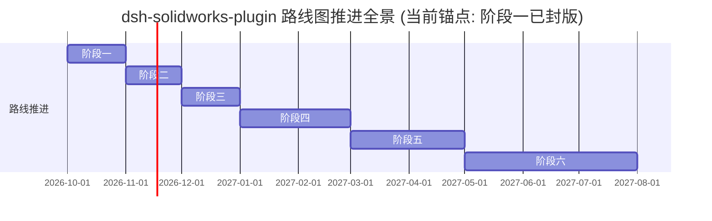

# 角色审计报告 12：未来架构与路线图审查者视角

> **审计视角**：首席技术战略官 (CTO)、系统演化架构师、工业软件路线图规划委员会  
> **审查基准**：项目六阶段路线图、技术债务递延风险、跨版本演进平滑度与技术断层识别  
> **核心命题**：**当前 v0.2.0 代码与六阶段路线图规划是否一致？是否存在超前建设、重复建设或致命架构瓶颈？**

---

## 一、六阶段路线图落地现状对照表

| 路线图阶段 | 核心目标规划 | 当前基线落地状态 | 真实度评价 | 架构诊断与发现 |
|---|---|:---:|:---:|---|
| **阶段一：独立验收与封版 (v0.2.0)** | 双层安全门禁、STA 穿透、中途建模失败回滚清理、用户文档保护、npm 纯净度、8 维 Doctor 诊断 | **100% 完成** (Commit: `7d70bc0`) | **✔ 已达成** | 阶段一本职工作极扎实，但暴露出接口表未同步新工具的轻度封版瑕疵。 |
| **阶段二：稳定性与用户体验完善 (v0.2.1+)** | 便携 Python 运行时、图形化配置切换、错误信息中文化、版本号纠偏 | **待启动** | **🟡 亟待补强** | 大众用户的核心绊脚石在此阶段，若跳过此阶段强推后续功能，将加剧产品脱节。 |
| **阶段三：AI 建模能力升级 (v0.3.0)** | Feature Graph IR 编译器、全生命周期参数尺寸联动、影子物理备份 | **部分能力超前落地** (Python 侧) | **🟢 局部超前** | `feature_graph_ir.py` 与 `dimension_manager.py` 已提前实现，但处于“孤岛”状态，需在 v0.3.0 正式打通前台。 |
| **阶段四：CAD 业务范围扩展 (v0.4.0)** | 双零件/多零件智能装配配合求解、工程图 A4 标准出图与对齐尺寸 | **仅有原型代码** (`sw_assembly.py`, `sw_drawing.py`) | **⚪ 雏形阶段** | 仅具备简单脚本与 Mock 验证，缺乏机构级约束求解引擎与图纸空间管理。 |
| **阶段五：产品化与 DSH 生态建设 (v0.5.0+)** | 官方市场深度互联、CAD 资产版本树追踪、跨文档协作工作流 | **规划中** | **⚪ 规划阶段** | 需等待 DSH 平台多 Agent 协同协议的成熟。 |
| **阶段六：高级 AI CAD 旗舰能力 (v1.0.0)** | 2D 蓝图机械图纸逆向转 3D、钣金自动展开、Toolbox 紧固件库智能匹配 | **长远愿景** | **⚪ 远期目标** | 属于前沿 AI + CAD 几何求解结合点，当前架构保持了良好解耦，未产生阻碍性坏味道。 |

---

## 二、关键技术落点深度剖析

### 2.1 Feature Graph IR 的实际落点与架构解耦
- **现状**：[`feature_graph_ir.py`](file:///D:/Agent工作区/DeepSeek%20Harness工作区/dsh-solidworks-plugin/vendor/solidworks-automation-skill/scripts/feature_graph_ir.py) 已经完成了 DAG 节点拓扑排序与环路检测；
- **架构评价**：这一模块完全不依赖 Windows COM，是纯净的内存中间表示（IR）。它代表了未来“AI 负责规划拓扑图，IR 编译器负责最优时序重排与合法性校验，后端 Driver 负责执行具体 CAD API”的现代 CAD 编译器架构，**设计极具前瞻性，没有架构瓶颈**。

### 2.2 装配体与工程图架构瓶颈识别
- **装配体瓶颈**：当前缺少“配合求解约束网络”（Mate Constraint Network）。若两个零件配合产生自由度冲突（Over-constrained），底层 COM 会直接抛出错误，系统缺乏配合回溯与自由度分析器；
- **工程图瓶颈**：工程图目前采用的是过程式直接调用投影函数，缺乏“图纸模型-图纸视图-尺寸图元-图框表格”的面向对象数据模型，难以应对国标标题栏与复杂装配体 BOM 明细表。

---

## 三、路线图审查最终建议

1. **切忌“未走先跑”**：必须在 **v0.2.1** 优先完成阶段二的体验纠偏（补齐策略表、对齐 Python 探测、纠正版本号），切勿在基础交互未稳固前强行将重心转移至装配体开发；
2. **正式将 IR 纳入版本主线**：在 **v0.3.0** 将已实现的 Feature Graph IR 与尺寸管理工具正式暴露给 DSH 前台，形成产品级核心卖点；
3. **分阶段构建装配体状态机**：在 **v0.4.0** 引入面向对象的 `AssemblyManager`，解耦单零件与装配体逻辑。
