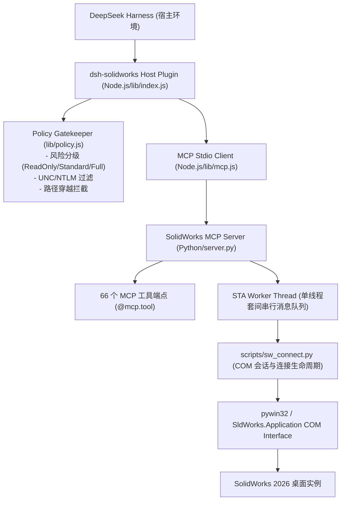

# 模块架构与生产工具审计报告 (03_ARCHITECTURE_AUDIT.md)

**执行时间**：2026-11-08 00:30 CST  
**基线 commit**：`7d70bc090d5cef146ac3946bb062667ae30a4cc9`  

---

## 一、系统整体架构层次

---

## 二、核心模块职责与权限审计

| 模块路径 | 语言 | 核心职责 | 文件写权限 | COM 调用 | 关键输入/输出 | 风险等级 |
| :--- | :---: | :--- | :---: | :---: | :--- | :---: |
| `lib/index.js` | JS | DSH 插件宿主入口，管理 MCP 子进程生命周期与工具转发 | 审计日志写入 | 无 | JSON-RPC 消息 | 低 |
| `lib/policy.js` | JS | 路径安全校验、只读模式拦截、UNC 路径防护 | 无 | 无 | 文件路径与命令 | **关键防线** |
| `lib/discover.js` | JS | 本地 Python 运行时自动探测（查找带 mcp 的解释器） | 无 | 无 | 解释器路径 | 低 |
| `mcp-server/server.py` | Py | 生产 FastMCP 接口网关，Pydantic Schema 校验与工具分派 | 有（间接） | 是 | Pydantic Input / JSON | **高危入口** |
| `scripts/sw_connect.py` | Py | SolidWorks 实例探测、连接、单文档关闭防线与进程生命周期 | 有（SaveAs）| **直接 COM** | 句柄/COM 对象 | **P0 核心** |
| `scripts/cad_task_context.py` | Py | 自动化 CAD 会话上下文、登记已创建模型、逆序安全释放 | 有（临时沙箱）| **直接 COM** | 上下文对象 | **高** |
| `scripts/dimension_manager.py` | Py | 尺寸识别、安全影响分析与参数化尺寸驱动 | 有（模型修改）| **直接 COM** | 尺寸对象与数值 | 中 |
| `stage5/.../cad_quality_inspector.py` | Py | 多维几何质量检查器、独立解析几何核算与防篡改凭据校验 | 纯计算 | 无 | 模型参数与特征数据 | **安全凭据** |

---

## 三、生产 MCP 工具全量盘点与风险分级

生产环境中在 `server.py` 中通过 `@mcp.tool` 注册了 66 个底层工具，结合 Node.js 宿主工具 `solidworks_status` 与 `solidworks_confirm`，共向 DSH 暴露 71 个工具。关键高危接口清单如下：

| 工具名称 | 写入权限 | 访问 COM | 当前缺陷 / 风险点 | 整改要求 (P0) |
| :--- | :---: | :---: | :--- | :--- |
| `solidworks_close_documents` | 是 | 是 | 1. 公开 `force_discard: bool` 参数； 2. 缺省目标时回退到 `sw.ActiveDoc` | 彻底移除 `force_discard`，禁止回退到活动文档 |
| `solidworks_save_document` | 是 | 是 | 允许另存为并改写磁盘文件 | 严格检查目标路径处于白名单沙箱内 |
| `solidworks_open_document` | 否 | 是 | 打开指定磁盘模型进入会话 | 强校验路径存在性与白名单归属 |
| `solidworks_connect` | 否 | 是 | 挂载到现有桌面实例 | 标记会话来源，严禁假借测试名义篡改已有会话 |
| `solidworks_batch_export_files` | 是 | 是 | 批量写入导出文件 | 限制在允许沙箱根目录内 |
