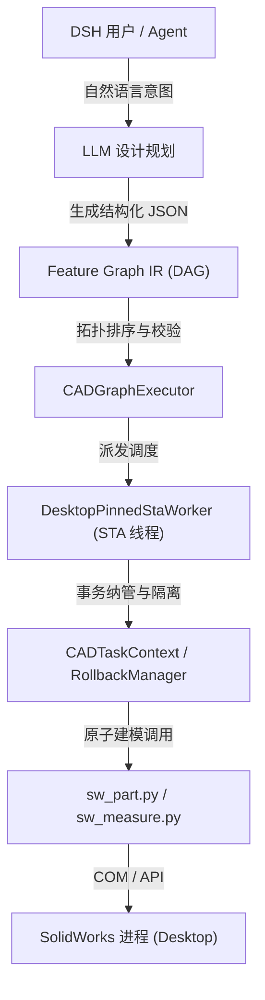

# SolidWorks CADGraphExecutor 架构与开发规范文档

> 本文档规范 SolidWorks 特征图执行引擎（`CADGraphExecutor`）与 Feature Graph IR 的核心架构、时序流转、状态转换、异常回滚及 MCP 契约，供后续阶段开发者与维护者遵循。

---

## 一、系统总体架构

`dsh-solidworks` 的 AI 建模采用分层架构，将自然语言推理与底层 COM 几何计算解耦：



### 核心模块职责
1. **FeatureGraphIR** (`feature_graph_ir.py`):
   - 提供有向无环图（DAG）数据结构表示；
   - 基于 Kahn 算法实现确定性拓扑排序；
   - 静态排查循环闭环死锁（`CyclicDependencyError`）与未定义前置依赖（`UndefinedDependencyError`）；
   - 计算失败波及子树（`get_reverse_rollback_subgraph`）。
2. **CADGraphExecutor** (`cad_graph_executor.py`):
   - 执行主引擎，管理节点生命周期状态；
   - 调度 STA 线程，避免多线程 COM 死锁；
   - 处理下游特征对上游草图名称与 CAD 实体句柄的自动继承；
   - 区分新建文档与用户已有文档生命周期；
   - 结构化返回 `ExecutionResult`。
3. **CADTaskContext & RollbackManager** (`cad_task_context.py`):
   - 任务生命周期隔离容器，记录任务创建的所有特征与文档；
   - 保护系统固有几何白名单（`PROTECTED_FEATURE_NAMES`：默认基准面、原点、材质等）；
   - 失败自动回滚：新建文档安全关闭删除；已有文档逆序清理新增特征并重构。

---

## 二、Feature Graph IR 输入格式与最小示例

### 最小可执行特征图 JSON 示例
以下展示一个基础法兰支架零件的特征图结构（包含草图与拉伸凸台）：

```json
{
  "graph_id": "bracket_demo_01",
  "target_part_name": "L_Bracket",
  "nodes": {
    "node_sketch_base": {
      "type": "sketch_2d",
      "name": "BaseSketch",
      "parameters": {
        "plane": "Front Plane",
        "shape": "rectangle",
        "width_m": 0.1,
        "height_m": 0.05,
        "cx_m": 0.0,
        "cy_m": 0.0
      },
      "depends_on": []
    },
    "node_boss_base": {
      "type": "extrude_boss",
      "name": "Boss-Extrude1",
      "parameters": {
        "depth_m": 0.02,
        "direction": true,
        "merge": true
      },
      "depends_on": ["node_sketch_base"]
    }
  },
  "metadata": {
    "author": "DeepSeek Harness",
    "version": "1.0"
  }
}
```

---

## 三、DAG 执行流程与节点状态机

### 1. 节点状态转移模型
每个特征节点在执行过程中经历以下单向受控状态流转：

```
       +------------+
       |  PENDING   | (初始待执行状态)
       +------------+
             |
             v
       +------------+
       |  RUNNING   | (正在派发至 STA 线程建模)
       +------------+
        /     |      \
       /      |       \
      v       v        v
+-----------+ +--------+ +-----------+
| SUCCEEDED | | FAILED | |  SKIPPED  | (前置依赖失败引发级联跳过)
+-----------+ +--------+ +-----------+
      |
      | (任务失败且触发回滚)
      v
+-------------+
| ROLLED_BACK |
+-------------+
```

### 2. 状态隔离保证
每次执行开始时，`CADGraphExecutor` 自动重置所有节点的 `status` 为 `PENDING` 并清空历史 CAD 句柄映射，保证同一 IR 图重入执行时不携带残留状态。

---

## 四、特征引用与草图继承机制

1. **显式优先级**：特征参数中的 `sketch_name` 优先级最高；
2. **严格草图类型匹配**：未显式指定时，执行引擎遍历 `reversed(node.depends_on)`，必须匹配节点类型为 `sketch_2d` 的上游节点；
3. **强校验拦截**：对于强依赖草图的特征（拉伸、切除、旋转），若依赖链中未解析到有效草图，执行器直接抛出明确的 `ValueError`，**绝不静默使用 SolidWorks 当前恰好选中的未知对象**。

---

## 五、失败级联处理与事务回滚策略

### 1. 故障局域隔离
当节点 $N$ 发生几何求解失败时：
- $N$ 标记为 `FAILED`；
- 调用 `ir_graph.get_reverse_rollback_subgraph(N.id)`，将所有直接或间接依赖 $N$ 的下游节点置为 `SKIPPED`；
- 与 $N$ 并行的独立健康分支不被波及。

### 2. 回滚级别定义
`CADTaskRollbackManager.rollback()` 返回结构化 `RollbackResult`，区分为：
- `SUCCESS`：任务创建的所有特征已完全逆序删除，且重构正常；或新建文档已完全安全关闭；
- `PARTIAL`：部分特征因底层几何拓扑锁定未能成功删除，标记为部分回滚并记录错误清单；
- `FAILED`：回滚过程中发生严重二次 COM 崩溃（原始异常与二次异常均被完整保留至诊断报告中）；
- `NOT_NEEDED`：未发生异常，无需回滚。

### 3. 资产保护底线
- **基准面/原点永久保护**：白名单特征绝对不被删除；
- **用户已有文档保护**：若操作外部传入的已有文档（`created_doc=False`），即使开启 `close_on_finish=True`，也**坚决禁止调用 `CloseDoc`**，仅在内存中逆序清理本次任务新建的特征。

---

## 六、MCP 契约与安全调用规范

### 工具定义
- 工具名称：`solidworks_execute_feature_graph`
- 风险评级：`HIGH`（驱动真实 CAD 产生写入和几何变动）
- 输入模型：`FeatureGraphExecuteInput`
  - `graph`: 特征图字典
  - `output_path`: 可选落盘路径（`.SLDPRT`）
  - `auto_rollback`: 失败时是否自动回滚（默认 `True`）
  - `collect_metrics`: 是否提取质量属性与包围盒（默认 `True`）
  - `close_on_finish`: 完成后是否关闭新建文档（默认 `False`）

### DSH 策略模式
- 在默认 `read-only` 和 `standard` 模式下，该工具受 Fail-Closed 机制保护自动处于 `withheld`（扣留）状态；
- 在 `full` 模式下，调用前需通过 `solidworks_confirm` 获得单次 Grant 授权，确保高风险 CAD 写入完全透明受控。

---

## 七、实机测试准入防线

在未来开展真实 SolidWorks 端到端验证时，必须遵守以下安全防线：
1. **绝不附着用户当前活动文档**，必须新建隔离零件；
2. **强制物理沙箱**：写入路径严格锁定在 `测试代码/sandbox_benchmark/`；
3. **唯一时间戳命名**：文件名带微秒级时间戳，防止同名冲突；
4. **失败现场保留**：若建模发生错误，保留沙箱文件供排查，不破坏用户本地其他 CAD 工程。
