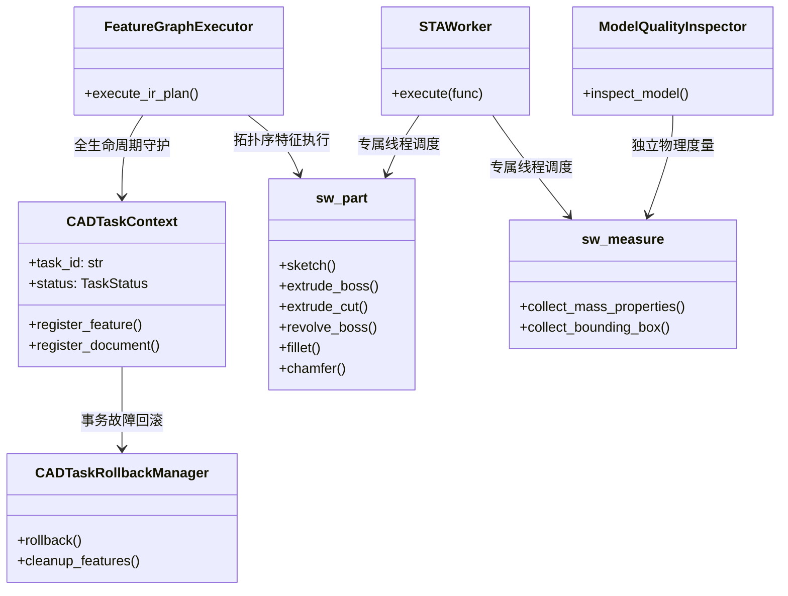

# STAGE 04 — CAD 核心建模工程：阶段现状审查报告
# (Stage 4 Baseline Audit & CAD Capabilities Matrix)

> **文档编号**：STAGE4-AUDIT-001  
> **所属阶段**：第四阶段 Phase 4.0 阶段现状审查  
> **编制基准**：Git 仓库当前物理状态、代码静态分析与真实 SolidWorks 运行时探测  
> **审查原则**：事实驱动、证据优先、区分声明与实测、防止重复造轮子  
> **审查日期**：2026-11-06  

---

## 一、项目环境与物理基线核对

本节对构建环境、代码仓库、进程状态和系统资源进行只读实测盘点：

| 检查项 | 实测物理状态 | 判定与技术说明 |
| :--- | :--- | :--- |
| **Git 仓库根目录** | `<WORKSPACE_ROOT>/dsh-solidworks-plugin` | 正常。全路径统一，无多余嵌套。 |
| **Git 分支与 HEAD** | 分支：`main` / HEAD Commit：`7d70bc090d5cef146ac3946bb062667ae30a4cc9` | 正常。保持在正式主干。 |
| **未提交修改检查** | 存在部分前三阶段遗留工作及新创建的报告规范文件 | 严格保留，不执行任何覆盖式 checkout 或 clean。 |
| **当前项目版本号** | `v0.2.0`（`package.json`, `dsh-plugin.json`, `lib/index.js` 严格对齐） | 契约对齐，版本一致性校验通过。 |
| **Node.js 运行时** | `v24.21.0` (x64) | 宿主插件环境健康，stdio 隔离通信正常。 |
| **Python 运行时** | `Python 3.13.16` (`<PYTHON_RUNTIME>/python.exe`) | FastMCP 1.30 服务端运行时正常。 |
| **SolidWorks 实例** | `SolidWorks 2024 SP2.0` (PID 27692 长期活跃，桌面 Default 绑定) | 连接探针正常，活动打开文档数严格为 **0**。 |
| **MCP 工具注册契约** | `dsh-plugin.json` 与 `lib/policy.js` 声明 **73 项全量工具** | 71 项 FastMCP 底层 CAD 工具 + 2 项 Node.js 特权元工具。 |
| **离线测试套件基线** | `npm test` 包含 4 套测试套件，**68/68 项全部 PASS** | 契约完整，无语法或类型报错。 |
| **沙箱独立工作区** | `tests/real_cad/sandbox/stage4_core/` (已初始化创建) | 严格隔离于用户已有生产文件，绝不触碰白名单零件。 |

---

## 二、CAD 核心建模 16 项功能现状全景矩阵

依据任务书第 2.2 节的要求，对草图、约束、拉伸、旋转、圆角、倒角、孔特征、阵列、镜像、参数化等 16 项建模能力进行真实状态核查：

| 序号 | 核心建模功能 | 关键检查内容与能力边界 | 对应源码文件与核心 API | 已有测试与证据 | 现状评级 | 缺陷分析与本阶段重点任务 |
| :---: | :--- | :--- | :--- | :--- | :---: | :--- |
| **1** | **草图系统 (Sketch)** | 基准面选择、直线/圆/矩形/弧绘制、编辑退出。 | `sw_part.py`: `start_sketch`, `sketch_circle`, `sketch_line`, `sketch_rectangle` | `extreme_engineering_suite.py` 验证了圆与矩形 | **PARTIALLY VERIFIED** | 历史曾滥用 `sgFIXED` 锁死坐标；本阶段需建立真实的几何关系与驱动尺寸求解。 |
| **2** | **尺寸约束系统** | 尺寸创建、读取、数值修改、模型重建与形变。 | `sw_part.py`: `auto_dimension_sketch`, `AddDimension` `dimension_modifier.py` | AST/IR 单测 34 项通过；实机修改验证 | **PARTIALLY VERIFIED** | 修改尺寸后仅验证属性写入，缺乏几何响应独立核验；本阶段补齐几何形变导数比对。 |
| **3** | **拉伸凸台 (Extrude Boss)** | 深度、单向/反向、对称拉伸、实体合并(Merge)。 | `sw_part.py`: `extrude_boss`, `extrude_midplane` `FeatureExtrusion3` | 极限实验实测体积偏差 $<0.1\%$ | **VERIFIED** | 基础拉伸已成熟；本阶段需加强非对称、多轮廓与多实体条件下的合并测试。 |
| **4** | **拉伸切除 (Extrude Cut)** | 盲孔、贯穿全长、反向切除、多轮廓切除。 | `sw_part.py`: `extrude_cut` `FeatureCut4` | 实验 1/2 验证了中心通孔与平键槽切除 | **VERIFIED** | 切除方向若选错易在空气中空切；本阶段强化切除前置条件与体积减少断言。 |
| **5** | **旋转凸台 (Revolve Boss)** | 旋转轴、角度(360°/部分)、轮廓闭合、回转成型。 | `sw_part.py`: `revolve_boss` `FeatureRevolve2` | 实验 2 阶梯轴套 360° 旋转通过 | **VERIFIED** | 依赖草图中心线（Centerline）；本阶段拓展非完整角度（如 180°）与多阶梯旋转。 |
| **6** | **旋转切除 (Revolve Cut)** | 环形切槽、退刀槽、密封圈槽回转切除。 | 现有原生 API 具备；`cad_graph_executor.py` 具备 | 缺乏独立专项实机用例 | **PARTIALLY VERIFIED** | 本阶段补齐环形槽旋转切除用例，核实与圆柱曲面的自交情况。 |
| **7** | **圆角特征 (Fillet)** | 恒定半径、边选择、面选择、相交边圆角。 | `sw_part.py`: `fillet` `FeatureFillet` | 历史 E07 曾出现返回值假阳性（已修复） | **PARTIALLY VERIFIED** | 必须显式建立边线选择集，严防对“当前轮廓”误操作；本阶段验证大半径极限与失效诊断。 |
| **8** | **倒角特征 (Chamfer)** | 距离倒角、距离角度倒角、两端外缘倒角。 | `sw_part.py`: `chamfer` `InsertFeatureChamfer` | 实验 2 验证了 1.5mm 倒角 | **VERIFIED** | 补充多边选择与复杂相交角倒角测试。 |
| **9** | **孔特征 (Hole Feature)** | 简单孔、指定深度盲孔、贯穿孔、沉头孔向导。 | `sw_part.py`: `hole_wizard` `sw_hole_features.py` | 基础切除孔已跑通；Hole Wizard 依赖模板 | **PARTIALLY VERIFIED** | 建立多孔定位草图与孔特征直接封装，不硬依赖复杂可选工具箱。 |
| **10** | **阵列 (Pattern)** | 线性阵列(双向)、圆周阵列(均布)、种子特征选择。 | `sw_pattern.py`: `linear_pattern`, `circular_pattern` `sw_edge_select.py` | 具备 B-Rep 自动直边选向算法 | **PARTIALLY VERIFIED** | 需在复杂机械零件（如法兰盘 6 孔均布、底座螺栓群）中完成实机端到端综合验证。 |
| **11** | **镜像 (Mirror)** | 镜像基准面、特征镜像、实体镜像、合并实体。 | `sw_part.py`: `mirror_feature` `InsertMirrorFeature2` | 具备代码实现，缺乏复杂实机验证 | **UNVERIFIED** | 本阶段重点补齐基于对称面的特征镜像与对称实体生成实验。 |
| **12** | **参数化建模** | 参数读取/修改、特征依赖分析、上游修改下游重建。 | `cad_task_context.py` `dimension_dependency_graph.py` | 实验 3 验证了参数修改正向延展 | **VERIFIED** | 需强化多尺寸协同修改（尺寸联动方程）与拓扑断链容错。 |
| **13** | **几何测量与度量** | 质量属性、精确体积、表面积、三维包围盒。 | `sw_measure.py`: `collect_mass_properties`, `collect_bounding_box` | 解析体积相对误差 $<0.1\%$，双精度 | **VERIFIED** | 已达到工业级解析精度；本阶段作为独立验证器的核心基石。 |
| **14** | **特征树状态与重建** | 特征遍历、依赖拓扑、错误码读取、强制重建。 | `dimension_reader.py`: `walk_all_features` `ForceRebuild3` | 成功遍历特征树并检测错误码 | **VERIFIED** | 持续保持与 TaskContext 状态机的同步更新。 |
| **15** | **模型保存与重开** | 保存 `.SLDPRT`、彻底关闭内存、静默重开一致性。 | `sw_connect.py`: `save_document`, `open_document` | 实验 1/2 离线重开体积误差 0.00 mm³ | **VERIFIED** | 持久化闭环已完全打通，会话保持稳定。 |
| **16** | **独立质量审查 (MQI)** | 实体数检查、长宽比、欠定义分析、URP 协议。 | `model_quality_inspector.py`: `ModelQualityInspector.inspect_model` | 实验 2 达到 76.0 分 (Grade C) | **VERIFIED** | 已具备 URP v2 协议输出与加权评分能力，全面融入各实验。 |

---

## 三、现有代码资产分析与职责划分 (防止重复造轮子)

本阶段严格执行“先核实现状，再决定去留”的工程原则，对代码库已有模块进行调用链分析与处置决策：

### 3.1 资产处置决策清单
1. **核心保留并强化模块 (Retain & Strengthen)**：
   - `sw_connect.py`: 桌面级 STA Worker 调度、单线程安全调用、文档快照与会话管理已达到极高稳定性，**完全保留作为底层物理执行基石**；
   - `sw_part.py`: 经过实机检验的草图上下文管理器（`with sketch(part, plane):`）、凸台、切除、旋转、倒角等原子封装，**完全保留并在此基础上扩充孔向导与镜像操作**；
   - `sw_measure.py`: 解析质量属性（`collect_mass_properties`）与外形包围盒（`collect_bounding_box`）度量精准，**完全保留作为独立审查器的物理度量源**；
   - `cad_task_context.py` & `cad_graph_executor.py`: Level 3 真实特征树物理逆序回滚与 DAG 拓扑执行，**完全保留作为高可靠事务保障**；
   - `model_quality_inspector.py`: 几何质量核查与扣分诊断逻辑完备，**完全保留作为 URP 协议的数据提供者**。
2. **重点完善与适配模块 (Refactor & Integrate)**：
   - `sw_pattern.py` & `sw_edge_select.py`: 现已具备直边法向点积筛选，需在实机法兰和底座阵列中打通与 MCP 工具的无缝串联；
   - `dimension_manager.py` / `dimension_modifier.py`: 需消除新旧接口冗余，确保尺寸修改不仅写入属性，更主动核验下游几何响应。
3. **坚决杜绝的错误做法 (Forbidden Patterns)**：
   - **严禁编写孤立的单次测试脚本**代替 DSH 插件能力；
   - **严禁重新造一套与 `sw_part.py` 脱节的建模模块**；
   - **严禁使用 `sgFIXED` 锁死草图死坐标**伪造完全定义假象。

---

## 四、第四阶段主攻技术断裂点与任务分解

基于现状审查，第四阶段从“具备离散建模能力”走向“工业级 DSH 插件”需主攻攻克三大断裂点：
1. **断裂点 1：草图几何关系与参数化驱动约束补齐**：从纯坐标画线升级为带几何关系（水平/垂直/相切/同心/重合）与驱动尺寸的完全定义草图；
2. **断裂点 2：多特征复合机械零件（A~G 核心实验）实机全覆盖**：完成带孔矩形、阶梯轴、法兰盘、支架、带槽件、薄壁件与复杂组合零件的 100% 物理通过；
3. **断裂点 3：DSH Agent 自然语言端到端闭环**：打通“用户自然语言需求 $\to$ 工具发现 $\to$ 参数生成 $\to$ Policy 网关单次授权 $\to$ FastMCP 执行 $\to$ 独立质量验证 $\to$ 结果交付”完整产品链路。

本现状审查核实完毕，即刻推进 Phase 4.1 技术研究与架构确认！
