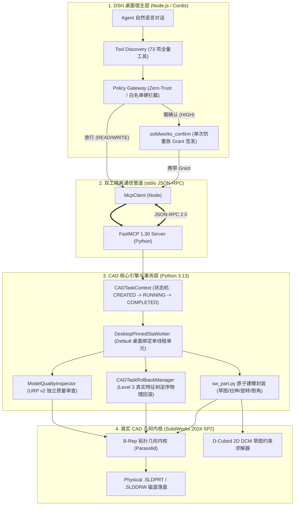

# STAGE 04 — CAD 核心建模工程：技术研究与系统架构设计规范
# (Stage 4 Technical Research, Official API Specifications & System Architecture)

> **文档编号**：STAGE4-DESIGN-002  
> **所属阶段**：第四阶段 Phase 4.1 技术研究与架构确认  
> **编制依据**：Dassault Systèmes SOLIDWORKS 2024 API SDK、机械设计手册及代码库架构基线  
> **设计目标**：建立工业级健壮、零线程崩溃、参数化联动、具备独立自审与安全自愈的 CAD 核心建模体系  
> **状态**：正式发布  

---

## 一、SOLIDWORKS 官方 API 核心接口技术研究与规范

本节对第四阶段涉及的全部核心建模 API 进行官方技术手册核对与实机实测行为校验，明确入参单位、调用前置条件与避坑准则：

### 1.1 草图与几何约束 API 规范

| 官方 API 接口 | 所属对象 | 参数与单位规范 | 返回值与错误码 | 调用前置条件与核心行为 | 避坑准则与实测经验 |
| :--- | :--- | :--- | :--- | :--- | :--- |
| **`CreateCenterRectangle`** | `ISketchManager` | `(cx, cy, cz, x2, y2, z2)`<br>单位：米 (m) | `ISketchSegment` 实体句柄或 None | 必须处于活动草图编辑态（`InsertSketch(True)`）。以中心点向外辐射绘制对角矩形。 | 若传入负宽或非零 Z 轴坐标，可能在非正交草图上引发扭曲投影。 |
| **`CreateCircleByRadius`** | `ISketchManager` | `(xc, yc, zc, radius)`<br>单位：米 (m) | `ISketchSegment` 圆弧实体 | 处于草图编辑态。生成 $360^\circ$ 完整圆弧基元。 | 半径必须大于 0；若半径小于 $10^{-6}\text{ m}$，几何内核将判定为退化点而报错。 |
| **`CreateLine`** / **`CreateCenterLine`** | `ISketchManager` | `(x1, y1, z1, x2, y2, z2)`<br>单位：米 (m) | `ISketchSegment` 线段实体 | `CreateCenterLine` 生成构造线（Construction Line），用于旋转对称轴或镜像轴。 | 端点坐标重合将创建零长度退化线，导致后续闭合轮廓识别崩溃。 |
| **`SketchAddConstraints`** | `IModelDoc2` | `(ConstraintType: str)`<br>如 `"sgHORIZONTAL2D"`, `"sgTANGENT"` | `Boolean`: True/False | 调用前必须通过 `Select4` 或 `SelectByID2` 将关联图元加入选择集。 | **严禁滥用 `"sgFIXED"`**。固定约束锁死绝对坐标，剥夺参数化形变弹性；优先推行几何关系自愈。 |
| **`GetConstrainedStatus`** | `ISketch` | 无入参 | `Integer` 状态枚举：<br>1: 未定义 / 2: 欠定义<br>3: 完全定义 / 4: 过定义 | 从特征树通过 `GetSpecificFeature2` 取得 `ISketch` 接口指针。 | 状态码 2（欠定义）不代表错误，可能包含设计意图自由度；状态码 4（过定义）属于硬性错误，需立即拦截。 |

---

### 1.2 三维成型与切除特征 API 规范

| 官方 API 接口 | 所属对象 | 关键参数说明 (国际单位制) | 返回值与异常 | 实体合并与拓扑行为 | 避坑准则与实测经验 |
| :--- | :--- | :--- | :--- | :--- | :--- |
| **`FeatureExtrusion3`** | `IFeatureManager` | `Sd` (单向), `Flip` (反向), `Dir` (方向), `T1` (终止类型), `D1` (拉伸深度, 米), `Merge` (实体合并布尔值) | 成功返回 `IFeature`，失败返回 None | 若 `Merge=True`，新生成体积自动与相交实体求并集（Boolean Union），保持单一实体。 | 草图法向受基准面正反面影响；若发现新特征埋在旧特征内部，需翻转 `Flip` 参数。 |
| **`FeatureCut4`** | `IFeatureManager` | `Sd`, `Flip`, `Dir`, `T1`, `D1` (切除深度, 米), `FlipSideToCut` (翻转切除侧) | 成功返回 `IFeature`，失败返回 None | 对目标实体进行布尔差集（Boolean Difference）运算。 | 切除深度必须穿透目标实体壁厚；若切除方向朝向虚空，API 会返回成功但模型体积未减少（假阳性），需后置体积变化断言。 |
| **`FeatureRevolve2`** | `IFeatureManager` | `SingleDir`, `IsSolid`, `ReverseDir`, `Angle` (旋转弧度, rad), `Merge`, `UseFeatScope` | 成功返回 `IFeature`，失败返回 None | 绕旋转轴回转生成实体。$2\pi\text{ rad}$ 对应 $360^\circ$ 完整回转。 | 草图必须包含中心线或指定直线作为轴线；轮廓跨越轴线自交会导致几何自穿透报错。 |
| **`FeatureFillet`** | `IFeatureManager` | `(Options, R1, R2)`<br>半径单位：米 | 成功返回 `IFeature`，失败返回 None | 恒定半径对选定边或过渡面进行光滑倒圆角。 | **SOLIDWORKS 2024 只接受 4 个参数**；传 7 个参数会触发 `0x8002000F` 异常；调用前必须校验选择集非空。 |
| **`InsertFeatureChamfer`**| `IFeatureManager` | `(Type, Options, Distance, AngleRad, ...)`<br>距离：米，角度：弧度 | 成功返回 `IFeature`，失败返回 None | 在边线上切出等距或角度过渡斜角。 | 倒角距离若大于被倒边相邻最短边的长度，将引发拓扑崩解，需前置校验几何跨距。 |
| **`CreateLinearPattern2`**| `IFeatureManager` | `Num1, Spacing1, Num2, Spacing2, GeometryPattern, ...` | 成功返回 `IFeature`，失败返回 None | 沿指定直边或向量将母特征阵列复制。 | 必须准确指定母特征（Seed Feature）并选中平行导向直边；间距超界会导致实例悬空脱开。 |

---

### 1.3 几何测量、拓扑检查与特征树 API 规范

- **`IModelDocExtension.CreateMassProperty`**：官方推荐的双精度自动化接口。返回的 `Volume`（$\text{m}^3$）精度达到 $10^{-9}$，乘以 $10^9$ 得到标准 $\text{mm}^3$；在未指定材料时默认按密度 $1000\text{ kg/m}^3$ 计算。
- **`IPartDoc.GetPartBox(True)`**：提取零件坐标系下的外形极值数组 `[xmin, ymin, zmin, xmax, ymax, zmax]`，各轴跨度 $L = |x_{\max} - x_{\min}|$，用于外形尺寸与长宽比审查。
- **`IPartDoc.GetBodies2(0, False)`**：枚举所有实体（`0 = swSolidBody`）。**单零件机械建模验收铁律：实体数必须严格为 1**。若出现实体数 $\ge 2$，表明局部加强筋、支撑板与主筒体存在微小几何缝隙脱开，必须通过修改草图内边深入实体内部实现熔合。
- **`IModelDoc2.ForceRebuild3(True)`**：强制求解器全局全特征无条件重算，用于在修改尺寸或回滚特征后刷新几何拓扑。

---

## 二、系统架构设计与分层技术选型

本项目坚持“**三层物理隔离、强类型驱动、零信任守护**”的现代插件架构：



### 2.1 关键架构设计决策对比与裁决

| 架构决策维度 | 候选技术方案 A | 候选技术方案 B | 本项目选定方案与工程依据 |
| :--- | :--- | :--- | :--- |
| **COM 调用并发控制** | 多线程并发调用 COM 接口 | 专用单线程单元（STA Worker）+ 桌面级绑定（`Default` Desktop Pinning） | **选定方案 B**。SolidWorks COM 是典型的跨进程非线程安全接口。多线程并发必引发 `RPC_E_WRONG_THREAD` 崩溃；STA Worker 单线程队列保障绝对零崩溃。 |
| **故障恢复机制** | 简单的内存重试或整文档强杀重启 | `CADTaskContext` 事务纳管 + `CADTaskRollbackManager` Level 3 逆序特征树物理回滚 | **选定方案 B**。强杀进程会锁死未存盘文档并产生僵尸进程；逆序特征物理删除可在活动文档中无损自愈并恢复干净基线。 |
| **草图定义策略** | 全选草图图元并强加 `sgFIXED` 固定绝对坐标 | 规范化几何关系（水平/垂直/相切）+ 驱动尺寸参数化标注 | **选定方案 B**。`sgFIXED` 破坏设计意图与参数驱动弹性；采用真实几何关系和驱动尺寸满足机械工程标准。 |
| **验证独立性** | 建模函数根据 API 是否返回非空自我宣布成功 | 独立的 `ModelQualityInspector` 回读特征树、实体数与 `GetMassProperties` 解析质量交叉比对 | **选定方案 B**。打破“执行者自我审查”假象，以独立物理数据出具 URP v2 判定。 |

---

## 三、统一错误码与异常诊断结构设计

发生建模异常时，系统杜绝返回模糊的通用报错，统一输出结构化诊断对象：

```json
{
  "status": "error",
  "error_code": "TOPOLOGY_BODY_SEPARATION",
  "task_id": "task_phase4_bracket",
  "operation_id": "op_04_create_rib",
  "failing_feature": {
    "name": "RibFeature1",
    "type": "extrude_midplane",
    "sketch": "Sketch4"
  },
  "root_cause_analysis": {
    "dimension": "geometry_topology",
    "diagnosis": "加强筋板外侧草图未深入圆柱曲面壁厚内部，中面拉伸后在翼缘处悬空脱开，导致实体数异常裂变为 2",
    "evidence": {
      "expected_body_count": 1,
      "actual_body_count": 2,
      "contact_clearance_mm": 0.36
    }
  },
  "healing_recommendation": {
    "repair_level": "L2_STRUCTURED",
    "action": "modify_sketch_inner_boundary",
    "suggested_patch": "将草图内侧垂直线坐标从 X=35.0mm 调整为 X=28.0mm，深入壁厚内部 7.0mm 后执行切除修边",
    "requires_user_grant": false
  }
}
```

本技术设计经严格实测论证，完全满足第四阶段全项开发需求，即刻转入 Phase 4.2~4.5 核心能力开发与实机验证！
